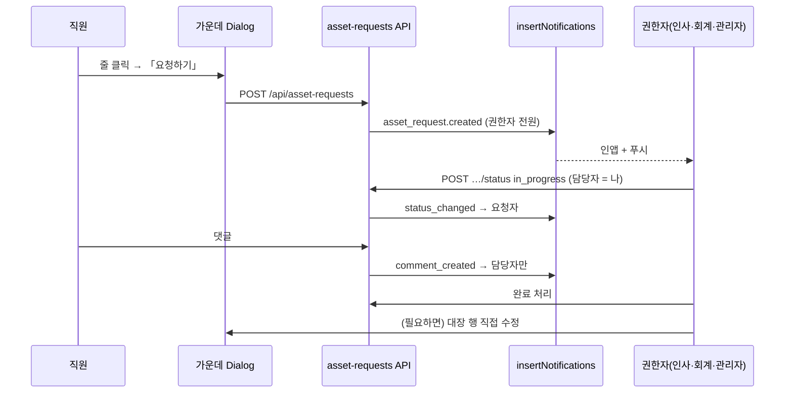

# 구독 관리 · 비품 관리 (요청·댓글·알림 포함) 기획서

> Date: 2026-10-29
> Status: ~~Approved~~ **Completed** (r2 · 2026-10-29 · verifier 57/57 green 2회 · AC 54/54 — AC-51은 대체 증거 통과 · §검증 결과)
> Author: planner
> **SQL:** ~~`99` 예정~~ **[r2]** `99` 확정 · `supabase/sql/99_subscription_equipment_ledger.sql` — 적용 직전 최대 98 → 99 재확인 · **Dev 적용 완료** · **Main(운영) 미적용**(SQL 99·엑셀 이관 모두 · 사용자 별도 지시 필요)
> **UI 시안:** **A안 채택**(표 + 가운데 Dialog · CS 문의 상세형) — 시안 원본은 저장소 밖 `/private/tmp/claude-501/-Users-hoon-Desktop-Wake-Auto/9dd323e6-e2bc-4784-84f2-eeeb10869e76/scratchpad/ledger-mockups/a.html` · 캡처 `…/ledger-mockups/png/a1.png`(구독 목록) · `a2.png`(비품 상세 Dialog) · `a3.png`(요청 1건) · `a4.png`(휴대폰). 3안 비교 `…/ledger-mockups/index.html`. **세션 임시 폴더라 사라질 수 있음** — designer는 착수 시 필요하면 `.claude/handoff/103-mockups/`로 복사(저장소 커밋 금지 · 더미 데이터만)
> **선행:** [08](./08_activity-audit-log-plan.md), [14](./14_delete-confirm-dialog-plan.md), [15](./15_asset-ledger-plan.md)(Cancelled), [23](./23_asset-ledger-removal-plan.md), [40](./40_filter-shell-loading-ux-plan.md), [42](./42_cs-support-plan.md), [43](./43_cs-support-comments-notifications-plan.md), [63](./63_org-chart-admin-profile-plan.md), [73](./73_benefits-url-filters-plan.md), [76](./76_hr-benefits-manager-access-plan.md), [89](./89_quick-workflow-dongbang-openchat-plan.md), [91](./91_pwa-web-push-notifications-plan.md), [95](./95_dongbang-visibility-audit-plan.md)

## 선행 plan 참조 (Phase 0)

| Plan | Status | 관계 · 가져온 제약 |
|------|--------|-------------------|
| **15** | Cancelled | 옛 비품 대장(`/dashboard/product` · `asset_items` · 자산번호 자동 추천). wake 전원 편집 · 빈 장부 시작 · 엑셀 이관 Out이었다. **이번엔 반대로**: 편집은 권한자만, 직원은 요청으로 참여, 엑셀 1회 이관 |
| **23** | Completed | 비품 대장 완전 제거(SQL 30). **제거 이유는 문서·커밋 어디에도 없음 → 「미상」**(사용자에게 물었으나 답 없음). `e2e/asset-ledger-removal.spec.ts`가 `/dashboard/product`·`/api/asset-items` **404**와 활동 로그 `asset.*` 옵션 **없음**을 검사한다 → 이번 기능은 **다른 경로**(`/dashboard/subscriptions`·`/dashboard/equipment`)와 **다른 action 이름**(`subscription.*`·`equipment.*`·`asset_request.*`)을 쓴다. 테이블 이름도 `asset_items` 재사용 금지 |
| **42 · 43** | Approved | **UI·동작 1차 참조.** CS 문의 = 목록 + **상세 Dialog**(가운데 창) + 등록 **Sheet** · 상태 단방향 전이 · 사용자 수정은 첫 상태에서만 · 댓글(임의 깊이 · `path`/`depth` · Realtime INSERT/UPDATE · soft delete · 본인만 수정 · 권한자 삭제 가능) · 알림 본인 제외 · metadata 본문 금지. `support-comment-*` 컴포넌트는 support 전용 → **패턴 복제**(새 feature) — support 코드는 건드리지 않는다 |
| **76** | Completed | `affiliation=wake` + `rank=인사팀` 판정 선례(`isWakeHrBenefitsManager`). **회계팀 헬퍼는 없음** → 신규 `isAssetManager`(admin · wake 인사팀 · wake 회계팀). 복지비 헬퍼는 변경 없음 |
| **63 · 89** | Approved · In Progress | 「팀」 = 소속(`affiliation`) + 부서(`profiles.rank`). 소속별 부서 목록 = `RANK_BY_AFFILIATION`(산스는 매장 「익선」「신세계강남」). 동방 allowlist(`src/config/dongbang-routes.ts`)는 **기본 거부** → 새 페이지·API는 **추가 작업 없이** 동방에게 막힌다 |
| **95** | Completed | 사람 목록 서버 쿼리는 `applyDongbangScope`(기본 제외). 새 `from('profiles')` 호출은 **95 §감사표에 등재**(AC-01 grep 규칙). `insertNotifications` 동방 가드 → 새 푸시 그룹은 `dongbang_visible: false` |
| **91** | Completed | 알림 type 추가 시 **4곳**: `NotificationType` 유니언 · DB `notifications_type_check` · `PUSH_NOTIFICATION_GROUPS`(exhaustive · 누락 시 tsc 실패) · `notification-helpers`/`notification-route.ts`. 새 그룹이면 SQL 90 `push_notification_preferences_groups_check`도 변경. `insertNotifications()`만 거치면 인앱 + 푸시 자동 |
| **08 · 14** | Approved · Completed | 모든 CUD Route 전 분기 `recordActivityLog`(`jsonWithActivityLog`) · 삭제 확인 `AlertModal`(`window.confirm` 금지) · 시각은 절대 시각 |
| **40 · 73** | Approved | filter shell은 Suspense **밖**, 데이터 본문만 Spinner · 필터는 nuqs URL · 검색 500ms debounce |
| **88** | Approved | 지출결의서(전자결재). 엑셀 비고에 결의서 번호가 있으나 **연결은 Out** |

**이번 plan과의 관계:** 신규(독립 feature). 15/23과 같은 도메인이지만 코드·DB·경로를 **새로** 만든다.

---

## 한 줄 요약

WakeOne에 **「구독 관리」**(`/dashboard/subscriptions`)와 **「비품 관리」**(`/dashboard/equipment`)를 만든다. **동방특송을 뺀 전 직원**이 표로 보고(휴대폰은 카드), **관리자·웨이크 인사팀·웨이크 회계팀**만 추가·수정·삭제하며, 민감한 칸(결제·카드·구입 정보 등)은 권한자에게만 보인다. 직원은 줄을 눌러 가운데 창(CS 문의 상세와 같은 모양)에서 **고장·교체·해지 같은 요청**을 남기고, 요청마다 **상태(접수대기→처리중→완료/반려, 요청자 취소)·담당자·댓글**로 대화하며, **앱 안 알림 + 휴대폰 푸시**(이메일 없음)를 받는다. 엑셀 원본 2개는 **Dev DB에 1회 이관**(비밀번호·로그인 정보는 옮기지 않음)한다.

---

## 정책 확정안 (deep-interview 2026-10-29 · UI 시안 A안)

| # | 항목 | 확정 |
|---|------|------|
| D-1 | 권한자 | **관리자(`system_role=admin`) + 웨이크 인사팀 + 웨이크 회계팀** — 세 쪽 모두 **두 페이지에서 권한 동일**. 판정 = `status=active` AND (`system_role=admin` OR (`system_role=user` AND `affiliation=wake` AND `rank ∈ {인사팀, 회계팀}`)). 부서가 바뀌면 **다음 요청부터** 반영(plan 76 방식) |
| D-2 | 보는 사람 | 동방특송(`affiliation=dongbang`)을 뺀 **로그인한 전 직원**. 동방은 페이지 redirect · API 403(89 allowlist 그대로) · 사이드바 「자산」 그룹 없음 |
| D-3 | 페이지·위치 | 사이드바 새 묶음 **「자산」**(「워크플로우」 다음 · 「HR (인사)」 앞) → **「구독 관리」**·**「비품 관리」** |
| D-4 | 탭 | **구독** = 툴 종류: 전체 · 크리에이티브 툴 · 소프트웨어 · 협업툴 · 기타. **비품** = 전체 · 노트북·컴퓨터 · 모니터 · 본체 · 마우스 · 키보드 · 태블릿 · 매장 기기(라우터·프론트·터미널) · 기타 장비. 결제 카드별 보기는 **권한자 전용 「결제 카드」 필터** |
| D-5 | 대상자(구독) | 한 구독에 여러 개. 종류 3가지: ① **사람**(WakeOne active 계정 · 동방 제외) ② **팀** = 소속 + 부서(예: 「웨이크 마케팅팀」「산스 신세계강남」) ③ **소속 전체**(예: 「웨이크 전 직원」). WakeOne 계정이 없는 사람(퇴사자·외부 법인 임원 등)은 대상자로 못 고르고 관리 메모에 적는다 |
| D-6 | 사용자(비품) | 한 대에 **하나**: 사람 또는 팀, 또는 비어 있음(보관) |
| D-7 | 보기 범위 필터 | **구독**: 전체 / **내 구독**(나 · 내 팀 · 내 소속 전체에 걸린 것) / **내 팀 구독**(우리 팀에 걸린 것 + 우리 팀원 개인에게 걸린 것). **비품**: 전체 / **내 장비**(나에게 배정) / **내 팀 장비**(우리 팀 배정 + 팀원 장비). 기본 「전체」. 부서(rank)가 없는 사람(관리자 등)은 「내 팀」이 빈 목록 + 안내 문구 |
| D-8 | 구독 칸 | §데이터 모델 표의 「누가 보나」 그대로. 결제 카드는 **끝 4자리만**. **비밀번호·로그인 정보 칸은 만들지 않는다.** 줄 단위 = **한 번에 결제되는 묶음 1줄**(예: M365 Family 1줄 + 대상자 여러 명, 사람마다 따로 결제되는 Adobe는 사람 수만큼 줄) |
| D-9 | 비품 칸 | 엑셀 「자산명」은 품목으로 합침 · 「사용처」 칸 삭제(매장 기기는 매장 팀에 배정, 특별 용도는 메모) · 짝 정보·고장일·퇴사자 메모는 관리 메모 · **자산번호 자동 제안**(품목·접두사 고르면 다음 번호 · 수정 가능 · 중복 금지) |
| D-10 | 상태 값 | **구독**: 사용중 · 해지 예정 · 해지됨. **비품**: 사용중 · 보관 · 수리중 · 분실 · 폐기. 기본 목록에서 **해지됨·폐기는 숨김**(상태 필터로 보기) |
| D-11 | 삭제 | 기본은 상태 변경(해지됨·폐기). 실제 삭제는 **요청이 하나도 없는 줄만** · `AlertModal` 확인. 요청이 있으면 버튼 비활성 + 안내, API **409** |
| D-12 | 요청 종류 | **비품**: 고장·수리 / 교체 / 반납 / 분실 신고 / 기타. **구독**: 해지 / 변경(플랜·이용자) / 기타 |
| D-13 | 요청 가능자·열람 | **누구나 아무 줄에나** 요청 가능(동방 제외). 요청 내용은 **요청자 본인 + 권한자만** 본다(다른 직원에게는 안 보임 · API 404). 같은 사람이 같은 줄에 **진행 중(접수대기·처리중) 요청을 2개** 만들 수 없음(409 · 중복 클릭 방지) |
| D-14 | 처리 흐름 | 접수대기 → (권한자 「처리 시작」) 처리중 → 완료. 접수대기·처리중에서 **반려**(사유 필수). 요청자는 **접수대기일 때만 수정·취소**. 완료·반려·취소는 되돌릴 수 없음. 접수대기 → 완료 바로 가기 금지(처리 시작 필수) |
| D-15 | 담당자 | 「처리 시작」을 누른 권한자가 담당자. 처리중일 때 다른 권한자로 **변경 가능**(후보 = active 권한자만) |
| D-16 | 대장 자동 변경 없음 | 요청이 완료돼도 대장 행(상태·사용자 등)은 **자동으로 바뀌지 않는다** — 권한자가 같은 Dialog에서 직접 수정 |
| D-17 | 화면(UI A안) | 목록 = **표**(데스크톱) · `md`(768px) 미만은 **카드 목록**. 줄 클릭 → **가운데 Dialog**: 줄 정보 + 권한자 「관리 정보」 영역(수정·삭제) + 「이 구독/장비의 요청」 목록 + 하단 「요청하기」. 요청 1건은 **같은 Dialog 안에서** 상태·담당자·요청 내용·댓글 스레드로 전환(「← 장비로」 뒤로가기). 대장 추가·수정 폼은 **Sheet**(CS 「문의하기」와 같음) |
| D-18 | 목록 / 요청 전환 | 각 페이지 상단 **「목록 \| 요청」** 전환(`?view=requests`). 요청 화면도 **표 + 같은 Dialog**. 권한자: 그 페이지 종류의 전체 요청 + 「처리 대기 N」. 직원: 내 요청만 + 「내 요청 N」 |
| D-19 | 댓글 | CS 문의와 같은 방식: 답글 가능(임의 깊이 · 화면 들여쓰기 제한) · Realtime · 본인 글 수정 · 본인 삭제(권한자는 남의 댓글도 삭제) · soft delete. **모든 상태**(완료·반려·취소 포함)에서 작성 가능. 작성 가능자 = 요청자 + 권한자 |
| D-20 | 알림 | **앱 안 알림 + 휴대폰 푸시만**(이메일 없음). 수신자는 §알림 매트릭스. 새 푸시 그룹 **「구독·비품 요청」**(`asset_request` · 기본 켜짐 · 동방에게 안 보임) |
| D-21 | 엑셀 이관 | **Dev DB 1회 이관 스크립트.** 이름은 WakeOne 계정과 맞추고, 못 맞춘 이름은 관리 메모로. 사본 시트 제외. **비밀번호·로그인 정보가 든 칸은 통째로 버림.** 운영 DB 반영은 Out(사용자 별도 확인) |
| D-22 | 이번에 빼는 것 | 라벨 인쇄 · 결제일/만료일 자동 알림 · 엑셀 내보내기/업로드 · 요청 첨부 · 새 장비/새 구독 신청 · 지출결의서 연결 · 이메일 |

---

## 용어

| 쉬운 말 | 코드·DB |
|---------|---------|
| 권한자 | `isAssetManager(profile)` / SQL `private.is_asset_manager(uid)` |
| 대장 행 | `subscriptions` 1행 · `equipment_items` 1행 |
| 대상자 / 사용자 | `subscription_assignees` / `equipment_items.assignee_*` |
| 요청 | `asset_requests` (`target_type` = `subscription` \| `equipment`) |
| 내 팀 | 로그인한 사람의 (`affiliation`, `rank`)와 같은 팀. rank가 null이면 팀 없음 |

---

## 목표 & 완료 기준 (AC)

### 목표
- 엑셀 2개로 흩어진 구독·비품 정보를 WakeOne 두 페이지로 옮겨, 직원은 「내 것」을 바로 찾고 권한자는 한곳에서 관리한다.
- 고장·교체·해지 같은 요청을 메신저·구두가 아닌 **기록이 남는 요청 + 댓글**로 처리하고, 놓치지 않게 알림을 보낸다.
- 비용·카드·계정 같은 민감 정보는 권한자에게만, 비밀번호는 어디에도 저장하지 않는다.

### 테스트 계정·데이터 (verifier)
- 기존 storageState: `admin.json`(관리자) · `hr-benefits.json`(웨이크 인사팀 · plan 76) · `dongbang.json`(89).
- **신규 setup `e2e/auth.asset-ledger.setup.ts`** — `createOrgChartTestUser`로 4명 만들고 storageState 저장: `asset-accounting.json`(wake · 회계팀) · `asset-staff.json`(wake · 디자인팀 · 「직원 A」) · `asset-teammate.json`(wake · 디자인팀 · 「직원 B」) · `asset-other.json`(wake · 마케팅팀 · 「직원 C」). 이름은 `E2E Asset …` 접두.
- **대장 fixture**는 service-role 헬퍼 `e2e/helpers/asset-ledger.ts`로 만들고 **`source='e2e'` + 이름(구독명/모델·시리얼) `E2E` 접두**를 붙인다. 이관 데이터(`source='excel_import'`)에는 **요청·수정·삭제를 하지 않는다.**
- 메일 Route(`POST /api/contracts/reminders` 등)는 **호출하지 않는다**(이 기능은 메일 없음).

### AC

| AC | 유형 | Given | When | Then |
|----|------|-------|------|------|
| AC-01 | Playwright | `asset-staff.json` | `/dashboard/overview` 사이드바 확인 후 「구독 관리」·「비품 관리」 클릭 | 그룹 라벨 **「자산」** 아래 `role=link` **「구독 관리」**·**「비품 관리」** · 각각 `/dashboard/subscriptions` · `/dashboard/equipment` 이동 · ~~`h1` 「구독 관리」/「비품 관리」~~ **[r1]** `getByRole('heading', { name: '구독 관리' })` / `getByRole('heading', { name: '비품 관리' })` 보임(**레벨 지정 없음** — `PageContainer` 제목은 `h2`로 그려짐 · handoff C-1) · `data-testid=subscriptions-page`/`equipment-page` |
| AC-02 | Playwright | `asset-staff.json` · E2E 구독 1·비품 1 | 두 페이지 진입 · 행 클릭으로 Dialog 열기 | `subscription-create-button`·`equipment-create-button` **없음** · Dialog 안 `asset-manager-section`(관리 정보) · `asset-edit-button` · `asset-delete-button` **없음** · 표 헤더에 「결제」「회계장부」「구입일」 칸 **없음** |
| AC-03 | Playwright | `admin.json` · `hr-benefits.json` · `asset-accounting.json` (3계정 반복) | 두 페이지 진입 · 행 Dialog 열기 | 추가 버튼 **보임** · `asset-manager-section` **보임**(라벨 「관리 정보」 + 「권한자만 보여요」) · 수정·삭제 버튼 보임 · 표 헤더에 「결제」(구독)/「회계장부」·「구입일」(비품) 칸 보임 |
| AC-04 | Playwright·API | `dongbang.json` | `/dashboard/subscriptions`·`/dashboard/equipment` 이동 · `GET /api/subscriptions` · `GET /api/equipment` · `GET /api/asset-requests` · `GET /api/asset-ledger/assignee-options` | 페이지는 `/dashboard/quick`로 redirect(+ access-denied flash) · API 4개 모두 **403** `{"success":false,"message":"접근 권한이 없습니다."}` · 사이드바 「자산」 그룹 **없음** |
| AC-05 | API | `asset-staff.json` | `POST /api/subscriptions` · `PATCH /api/equipment/{id}` · `DELETE /api/equipment/{id}` · `GET /api/asset-ledger/assignee-options` · `GET /api/equipment/next-number?prefix=N` | 전부 **403** 「권한이 없습니다.」 · CUD 3건은 `GET /api/activity-logs`에 각 action(`subscription.create`·`equipment.update`·`equipment.delete`) **403 행** 존재 |
| AC-06 | API | E2E 구독 1건(결제 정보·관리 메모 채움) | `asset-staff.json`과 `hr-benefits.json`으로 각각 `GET /api/subscriptions?limit=50` · `GET /api/subscriptions/{id}` | staff 응답 항목에 키 `amount`·`currency`·`amount_varies`·`payer_entity`·`card_last4`·`billing_cycle`·`billing_day`·`billing_date`·`started_on`·`owner_account`·`manager_memo` **하나도 없음**(값 null도 아님 — 키 자체 없음) · hr 응답에는 **모두 있음** |
| AC-07 | API | E2E 비품 1건(구입 정보·관리 메모 채움) | `asset-staff.json`·`asset-accounting.json`으로 `GET /api/equipment?limit=50` · `GET /api/equipment/{id}` | staff 응답에 `ledger_entity`·`ledger_code`·`purchase_amount`·`purchased_on`·`vendor`·`manager_memo` 키 **없음** · accounting 응답에는 **있음** |
| AC-08 | Playwright | `asset-staff.json` · 구분별 E2E 구독 4건 | `/dashboard/subscriptions`의 탭 ~~`role=tab`~~ **[r1]** `subscription-category-tabs` 안의 `role=tab` 확인 → 「협업툴」(`subscription-category-tab-collaboration`) 클릭 | 탭 5개 순서 **「전체」「크리에이티브 툴」「소프트웨어」「협업툴」「기타」**(각 탭 옆 건수 · **[r1]** 탭 이름 뒤에 건수가 붙으므로 이름은 앞부분 일치로 판정 · 「목록 \| 요청」의 `role=tab`은 세지 않음 · handoff C-22) · 클릭 후 URL `category=collaboration` · 표에는 협업툴 행만 |
| AC-09 | Playwright | `asset-staff.json` | `/dashboard/equipment` 탭(**[r1]** `equipment-kind-tabs` 안의 `role=tab`) 확인 → 「모니터」(`equipment-kind-tab-monitor`) 클릭 | 탭 9개 순서 **「전체」「노트북·컴퓨터」「모니터」「본체」「마우스」「키보드」「태블릿」「매장 기기」「기타 장비」**(**[r1]** 각 탭 옆 건수 · 판정 방식은 AC-08과 같음) · URL `kind=monitor` · 모니터 행만 |
| AC-10 | Playwright | `asset-staff.json`(디자인팀 A) · E2E 구독 S1(A 개인) · S2(팀 웨이크 디자인팀) · S3(소속 웨이크 전체) · S4(B 개인 · B는 디자인팀) · S5(팀 웨이크 마케팅팀) | `asset-scope-filter`에서 「내 구독」 → 「내 팀 구독」 → 「전체」 | 「내 구독」 = **S1·S2·S3**만(URL `scope=mine`) · 「내 팀 구독」 = **S2·S4**만(`scope=team`) · 「전체」 = S1~S5 모두 보임 |
| AC-11 | Playwright | `asset-staff.json` · E2E 비품 E1(A 개인) · E2(팀 디자인팀) · E3(B 개인) · E4(팀 마케팅팀) | 「내 장비」 → 「내 팀 장비」 | 「내 장비」 = **E1**만 · 「내 팀 장비」 = **E2·E3**만 |
| AC-12 | Playwright | E2E 구독 「해지됨」 1건 · E2E 비품 「폐기」 1건 | 기본 진입 → `asset-status-filter`에서 「해지됨」(구독)/「폐기」(비품) 선택 | 기본 목록에 **안 보임** · 표 아래 「해지됨 N개 숨김」/「폐기 N대 숨김」 문구 · 필터 선택 후 **보임** |
| AC-13 | Playwright | E2E 구독 카드 끝 `1234` 1건 · `5678` 1건 | `hr-benefits.json`이 `subscription-card-filter`에서 「끝 1234」 선택 · `asset-staff.json` 같은 화면 | hr: 1234 행만(URL `card=1234`) · staff: `subscription-card-filter` **없음** |
| AC-14 | Playwright | E2E 구독 「E2E Figma」·비품 「E2E-SN-7788」 | `asset-search-input`에 「figma」 / 「7788」 입력 | 500ms 뒤 해당 행만 · URL `q=` 반영 · 비품 검색 대상 = 자산번호 · 모델·시리얼 |
| AC-15 | Playwright (390×844) | `asset-staff.json` · E2E 비품 E1 | `/dashboard/equipment` → `equipment-card-{E1}` 탭 → Dialog | `equipment-table` **안 보임**(**[r1]** CSS로 숨겨 DOM에는 남아 있음 → `toBeHidden()`으로 판정 · `toHaveCount(0)` 아님 · handoff C-21) · 카드 보임(자산번호·모델·사용자·상태) · Dialog가 화면 높이 가득 · `asset-request-open-form`(「요청하기」)이 스크롤 없이 화면 안에 보임 · 가로 스크롤 없음 |
| AC-16 | Playwright | `hr-benefits.json` | `subscription-create-button` → `subscription-form-sheet`에서 구분·구독명·플랜·상태 입력 + 대상자 3종(사람 A · 팀 「웨이크 디자인팀」 · 소속 「웨이크 전 직원」) 추가 → `asset-form-submit` | 토스트 **「구독을 추가했어요.」** · Sheet 닫힘 · 표에 행 + 대상자 칩 3개 · `subscription.create` 로그 **201** 1건 |
| AC-17 | Playwright·API | `asset-accounting.json` · E2E 비품 최대 번호가 `N-0xx` | `equipment-create-button` → 품목 「노트북·컴퓨터」 선택 | 자산번호 칸 자동으로 **`N-{최대+1, 3자리}`** · 저장 성공 토스트 **「비품을 추가했어요.」** · 같은 번호로 한 번 더 `POST` → **409** 「이미 있는 자산번호예요.」(폼에서는 자산번호 칸 아래 같은 문구) · 접두사가 품목과 안 맞으면(예: 모니터 + `N-`) **400** |
| AC-18 | Playwright | `hr-benefits.json` · E2E 비품 E1 | Dialog `asset-edit-button` → `equipment-form-sheet` 값이 채워진 채 열림 → 상태 「수리중」 저장 | Dialog·표의 상태 배지 「수리중」 · `equipment.update` 로그 200 · metadata `changed_fields`에 `status` |
| AC-19 | Playwright | `hr-benefits.json` · 요청 없는 E2E 비품 | `asset-delete-button` → `AlertModal` 「취소」 → 다시 → 「삭제」 | 제목 **「이 비품을 삭제할까요?」**(구독은 「이 구독을 삭제할까요?」) · 취소 시 행 유지 · 확인 후 행 사라짐 · `equipment.delete` 로그 200 · 전 과정 `page.on('dialog')` **0회**(`window.confirm` 미사용) |
| AC-20 | Playwright·API | 요청 1건 있는 E2E 비품 | Dialog 확인 · `DELETE /api/equipment/{id}` | `asset-delete-button` **비활성** + 안내 **「요청 기록이 있는 장비는 지울 수 없어요. 더 안 쓰면 상태를 「폐기」로 바꿔 주세요.」** · API **409** 「요청 기록이 있어 삭제할 수 없어요.」 · 409 로그 행 |
| AC-21 | API | `hr-benefits.json` | 구독·비품 `POST`/`PATCH`에 `manager_memo: "PW: abc"` · `"비밀번호 1234"` · `"ID: x@y"` | 모두 **400** 「비밀번호·로그인 정보는 저장할 수 없어요.」 · DB 변경 없음 · 400 로그 행(metadata에 메모 값 **없음**) |
| AC-22 | API | `hr-benefits.json` · 동방 사용자 D | 대상자에 D(사람) · 팀 `{affiliation:'dongbang'}` · 같은 대상자 2번 · 비품 사용자에 D | 모두 **400**(「선택할 수 없는 대상자예요.」/「같은 대상자가 두 번 들어 있어요.」) · `GET /api/asset-ledger/assignee-options` 응답 사람 목록에 D **없음**, 소속 목록에 동방 **없음** |
| AC-23 | Playwright | `asset-staff.json` · E2E 비품 E1 · E2E 구독 S1 | E1 Dialog `asset-request-open-form` → `asset-request-form`에서 종류 선택 + `asset-request-body` 입력 → `asset-request-submit` | 비품 종류 `role=radio` **5개**(고장·수리 · 교체 · 반납 · 분실 신고 · 기타) · 구독은 **3개**(해지 · 변경(플랜·이용자) · 기타) · 토스트 **「요청을 보냈어요.」** · 「이 장비의 요청」 목록(`asset-row-requests`)에 새 항목 **접수대기** · `asset_request.create` 로그 201 · 내용 5자 미만이면 「내용을 5자 이상 적어 주세요.」로 막힘 |
| AC-24 | API | AC-23 직후(같은 사람·같은 줄 · 접수대기) | 같은 줄에 `POST /api/asset-requests` 한 번 더 | **409** 「이미 진행 중인 요청이 있어요.」 · 409 로그 |
| AC-25 | Playwright·API | AC-23의 요청 R1 | `asset-other.json`으로 E1 Dialog 열기 · `GET /api/asset-requests/{R1}` · `GET /api/asset-requests?target_type=equipment` | Dialog 「이 장비의 요청」에 R1 **없음** · 단건 **404** · 목록에 R1 없음 · 권한자 계정은 R1 보임 |
| AC-26 | Playwright | `asset-staff.json` · 접수대기 R1 | 요청 화면 `asset-request-edit` → 내용 수정 저장 → `asset-request-cancel` → `AlertModal` 확인(**[r1]** 확인 버튼 **「요청 취소」** · 닫기 버튼 「닫기」 — `asset-request-cancel`과 이름이 같으므로 확인창 안으로 범위를 좁혀 클릭 · handoff C-16) | 내용 갱신 + **「수정됨 yyyy-MM-dd (EEE) HH:mm:ss」**(`formatAbsoluteDateTimeKo`) · 취소 확인창 제목 **「요청을 취소할까요?」** · 상태 배지 **취소** · 로그 `asset_request.update` 200 · `asset_request.cancel` 200 |
| AC-27 | Playwright·API | 처리중 요청 R2(요청자 staff) | staff가 R2 화면 확인 · `PATCH /api/asset-requests/{R2}` · `POST …/{R2}/cancel` | 수정·취소 버튼 **없음** · 두 API 모두 **403** 「접수대기일 때만 수정·취소할 수 있어요.」 + 로그 |
| AC-28 | Playwright | `hr-benefits.json` · 접수대기 R2 | 요청 표(`?view=requests`)에서 `asset-request-row-{R2}` 클릭 → `asset-request-start` | Dialog 안 상태 **처리중** · `asset-request-assignee`에 hr 이름 · `asset-request-stepper` 현재 단계 「처리중」 · 로그 `asset_request.status_update` metadata `previous_status=pending`·`new_status=in_progress` |
| AC-29 | Playwright | `asset-accounting.json` · 처리중 R2(담당 hr) | `asset-request-assignee-change` → 후보 목록(**[r1]** 항목 `asset-request-assignee-option-{userId}`) 확인 → 자신 선택 | 후보 = active 권한자만(admin·인사팀·회계팀 · 일반 직원·동방 **없음**) · **[r1]** 후보 출처 = `GET /api/asset-ledger/assignee-options` 응답의 **`managers`** 배열(`isAssetManager` 대상 active 사용자 · 동방 제외) — 화면 후보 userId 집합 = `managers[].user_id` 집합 · `asset-staff.json`·`dongbang.json` 계정 user_id는 둘 다에 없음(handoff C-15) · 담당자 회계팀 계정으로 바뀜 · 로그 `asset_request.assignee_update` |
| AC-30 | Playwright | `hr-benefits.json` · 접수대기 R3 | `asset-request-reject` → 사유 비운 채 저장 → 사유 입력 후 저장 | 빈 사유 **「반려 사유를 입력해 주세요.」** · 저장 후 배지 **반려** · 화면에 「반려 사유: …」 · 이후 버튼(처리 시작·완료·반려) **없음** |
| AC-31 | API | 접수대기 R4 · 완료 R5 | 권한자 `POST …/{R4}/status {status:'completed'}` · `…/{R5}/status {status:'in_progress'}` · staff `…/{R4}/status {status:'in_progress'}` | R4 **400** 「먼저 처리를 시작해 주세요.」 · R5 **400** 「이미 끝난 요청이에요.」 · staff **403** · 모두 로그 |
| AC-32 | Playwright·API | 처리중 고장·수리 요청(E2E 비품 E1, 상태 사용중 · 사용자 A) | hr가 `asset-request-complete` | 요청 **완료** · `GET /api/equipment/{E1}`의 `status`·`assignee`는 **그대로**(사용중 · A) · 권한자 화면에 「완료해도 장비 정보는 자동으로 바뀌지 않아요.」 문구 |
| AC-33 | Playwright | 비품 요청: 접수대기 2(staff 1 · other 1) · 처리중 1 · 완료 1 | `hr-benefits.json`·`asset-staff.json`이 `asset-view-switch`의 「요청」 클릭 | URL `view=requests` · `asset-requests-table` 보임 · **hr**: 4건 모두 · 「요청」 탭 배지 `asset-pending-badge` = **「처리 대기 2」** · `asset-requests-mine-only`(「내 담당만」) 켜면 hr 담당 건만 · 상태 필터 기본 「진행 중」(접수대기·처리중) · **staff**: 본인 건만 · 배지 `asset-my-open-badge` = **「내 요청 1」** · 「내 담당만」 없음 |
| AC-34 | Playwright | AC-33 상태 | 사이드바 확인(hr · staff) | hr: 「비품 관리」 옆 `nav-badge-equipment` = **2**(구독도 같은 규칙 `nav-badge-subscriptions`) · staff: 배지 **없음** · hr가 1건 처리 시작 후 새로고침 없이 또는 페이지 이동 시 **1**로 줄어듦 |
| AC-35 | Playwright (2 컨텍스트) | staff·hr가 같은 요청 Dialog를 연 상태 | staff가 `asset-comment-input`에 입력 → `asset-comment-submit` · hr가 답글 | hr 화면에 새로고침 없이 **5초 안** 댓글 표시(Realtime) · 답글은 원댓글 아래 들여쓰기 · 각 댓글에 이름 · 역할 배지(「요청자」/「담당자」/「권한자」) · 절대 시각 `yyyy-MM-dd (EEE) HH:mm:ss` |
| AC-36 | Playwright·API | staff 댓글 C1 · hr 댓글 C2 | staff가 C1 수정 · C2에 수정 버튼 확인 · `PATCH …/comments/{C2}`(staff) | C1 **「수정됨 …」** · C2 수정 버튼 **없음** · PATCH **403** + 로그 |
| AC-37 | Playwright | 답글 달린 staff 댓글 C1 · staff 댓글 C3 | staff가 C1 삭제(`AlertModal` 「댓글을 삭제할까요?」 확인) · hr가 C3 삭제 | C1 자리에 **「삭제된 댓글입니다.」** · 답글 유지 · hr는 남의 댓글(C3)도 삭제 가능 · 로그 `asset_request.comment_delete` · `window.confirm` 0회 |
| AC-38 | API | staff의 요청 R1 | `asset-other.json`으로 `GET/POST /api/asset-requests/{R1}/comments` | **404** · POST 로그 404 행 |
| AC-39 | API·DB | 권한자 = admin 1 · hr · accounting(+ Dev의 기존 인사·회계팀 active) | staff가 요청 생성 | `notifications`에 type **`asset_request.created`** 행 = **active 권한자 전원**(동방·일반 직원·요청자 본인 제외) · staff 본인 0 · 각 행 metadata 키 ⊆ {`kind`,`asset_request_id`,`asset_target_type`,`request_type`} (본문·금액 **없음**) |
| AC-40 | API·DB | AC-39 요청 R | ① 처리 시작 전 staff 댓글 → ② hr 처리 시작 → ③ staff 댓글 → ④ hr 댓글 | ① 권한자 전원에게 `asset_request.comment_created` ② staff에게 `asset_request.status_changed`(new_status=in_progress) ③ **hr(담당자)에게만**(admin·accounting 0) ④ staff에게만 · 글쓴이 본인 0 |
| AC-41 | API·DB | 처리중 R(담당 hr) | accounting이 담당자를 자신 → 다시 hr로 변경 | 새 담당자(hr)에게 `asset_request.assigned` 1건 · 자기 자신을 고른 변경(accounting)은 알림 0 · staff는 0 |
| AC-42 | Playwright | staff에게 `asset_request.status_changed` 알림 1건 | `/dashboard/notifications`에서 그 카드 클릭 | URL **`/dashboard/equipment?view=requests&request={id}`**(구독이면 `/dashboard/subscriptions?…`) · 요청 Dialog 자동 열림 · `resolveNotificationRoute` 단위 테스트 6 type 통과(푸시 payload url 동일) |
| AC-43 | API | `asset-staff.json` · `dongbang.json` | `GET /api/notifications/push/preferences` · staff `PUT {disabled_groups:['asset_request']}` · 동방 같은 PUT | staff `groups`에 **`asset_request`(「구독·비품 요청」)** 포함 · PUT 200 · 동방 `groups`에 **없음** · 동방 PUT **400** 「알림 종류가 올바르지 않습니다.」 |
| AC-44 | grep·CLI | 구현 완료 | `grep -rniE "nodemailer\|sendMail\|resend\|smtp" src/features/{subscriptions,equipment,asset-requests} src/app/api/{subscriptions,equipment,asset-requests,asset-ledger}` · 새 spec 파일 grep `contracts/reminders\|balance-email` | 둘 다 **0건**(메일 발송·메일 Route 호출 없음) |
| AC-45 | API | 각 Route 1회씩 2xx + 403/400 1회 | 응답 헤더 `x-request-id`로 `GET /api/activity-logs` 조회 | §기록 연동 **14 action** 모두 2xx 행 존재 · 403/400 행 존재 · `target_type` 일치 · metadata에 금액·카드·메모·요청 본문·댓글 본문 **없음** |
| AC-46 | Playwright | `admin.json` | `/dashboard/logs` action 필터 열기 | 새 action 한국어 라벨(예: 「구독 추가」「비품 삭제」「자산 요청 상태 변경」「자산 요청 댓글 등록」) 보임 · `asset.create`/`asset.update`/`asset.delete` **없음**(plan 23 AC 유지) |
| AC-47 | CLI | 엑셀 2개(저장소 밖 `/Users/hoon/Desktop/Wake_Auto/Excel/`) | `node scripts/asset-ledger-import/run.mjs --subscriptions <구독 xlsx> --equipment <비품 xlsx> --dry-run` | DB 변경 **0** · 리포트(콘솔)에 구독 **70건**(시트별 건수 · **「9937 (킨키)의 사본」 시트 제외** 표시) · 대상자 매칭/미매칭 건수 · 비품 **159대**(N 29 · M 47 · T 1 · R 1 · F/TER 4 · S 23 · K 15 · A 36 · W 3) · 「비밀번호·로그인 의심 칸 제외 N개」는 **시트명·행 번호만**(값 출력 0) |
| AC-48 | CLI | `.env`를 바꿔 실행(① URL이 Dev 프로젝트 ref `dgjtcx…`가 아님 ② `WAKEONE_ENV`≠`development`) | `run.mjs`(dry-run 아님) | **쓰기 전에** exit 1 · 「Dev DB에서만 실행할 수 있어요.」 · DB 변경 0 |
| AC-49 | SQL(Dev MCP 읽기) | 실제 이관 1회 후 | `select count(*) from subscriptions where source='excel_import' and manager_memo ~* '(pw\|password\|passwd\|비밀번호\|비번\|아이디\|login\|\bid\b)\s*[:=]'` (비품 동일) · 원본 비밀번호 의심 칸이 있던 행의 `manager_memo` 확인 | **0건** · 해당 칸 값은 통째로 없음(부분 마스킹 아님) · `owner_account`에는 이메일만(공백·「각자 계정」 같은 문구 없음) |
| AC-50 | SQL | 실제 이관 후 | `select payer_entity, card_last4, count(*) … where source='excel_import' group by 1,2` | 카드 `9937` 행 = **8**(사본 시트 8건 중복 없음) · 전체 **70** · 비품 `source='excel_import'` **159** |
| AC-51 | CLI·SQL | 이관 1회 완료 · 그중 1행을 앱에서 수정 | `run.mjs` 한 번 더 실행 | 리포트 「새로 추가 0 · 이미 있음 N」 · 건수 그대로 · 앱에서 고친 값 **덮어쓰지 않음** · **[r2] 판정: 대체 증거로 통과**(사용자 결정 2026-10-29 「그냥 통과해」 · 「앱에서 고친 뒤 재실행」은 **직접 시험 안 함** · §검증 결과 AC-51 · 후속 [TBD] F-1) |
| AC-52 | CLI | 이관 완료 | `git -C WakeOne-web ls-files \| grep -E '\.(xlsx\|xls\|csv)$'` · `git status --porcelain` · 스크립트 임시 파일 위치 확인 | xlsx·csv·추출 JSON **0건** · 중간 산출물은 `os.tmpdir()` 아래에만 쓰고 끝나면 삭제 · `.gitignore`에 `*.xlsx` 추가 |
| AC-53 | CLI·SQL | 이관 데이터 + E2E 실행 후 | `npm run e2e:cleanup` 전후 `source='excel_import'` 건수 | **변화 없음** · `source='e2e'` 및 `source='manual' AND (이름 ILIKE 'E2E%')` 행·그 요청·댓글·알림만 삭제 · remaining 0 |
| AC-54 | CLI | 구현 완료 | `npx tsc --noEmit` · `npm run lint:strict` · `npm run build` · `npx playwright test e2e/subscription-equipment` · 회귀 `e2e/asset-ledger-removal.spec.ts e2e/notifications e2e/push-notifications e2e/quick-round2/95-dongbang-visibility.spec.ts e2e/support` · `node --test`(수신자·라우트 순수 함수) | 모두 통과 · 새 spec green 2회 연속 |

**AC 총 54개.** **[r2]** 결과: 54/54 통과(53 직접 판정 + AC-51 대체 증거) — 아래 §검증 결과.

---

## 검증 결과 (verifier · 2026-10-29 · r2)

> 근거: `.claude/handoff/103-verifier.md`(저장소 밖 · 실데이터 값 없이 건수만). DB는 Dev만 · 운영 MCP 사용 0 · 메일 Route 호출 0(`.env` DRY_RUN 플래그 유지).

| 항목 | 결과 |
|------|------|
| spec | `e2e/subscription-equipment/` **10개 파일**(01-access ~ 10-import-cli) + `e2e/auth.asset-ledger.setup.ts` · 헬퍼 `e2e/helpers/asset-ledger.ts` · `playwright.config.ts` project `setup-asset-ledger`·`chromium-asset-ledger` |
| Playwright CLI | **57/57 green × 2회 연속**(셋업 4 + AC 테스트 53 · AC-03은 계정 3개로 3건) |
| `node --test` | **313/313**(테스트 파일 24개 명시) · plan 103 관련 **59/59** |
| `npx tsc --noEmit` | **0 errors** |
| `npm run lint:strict` | **0 warnings · 0 errors** |
| react-doctor | plan 103 파일 **error 0**(warning 31 — 비차단) |
| `npm run build` | **exit 0** |
| `npm run e2e:cleanup` | **exit 0** · remaining 전부 **0** |
| 이관 데이터 보존 | `source='excel_import'` 구독 **70** · 비품 **159** · 이관 대상자 행 **54** 유지 · 검증 전후 내용 **md5 동일** |
| 기획 실패 · 구현 실패 | 없음 |

### AC-51 (재실행 안전) — 대체 증거 통과
- 실제 재실행 검증(이관 행 1개를 앱에서 고친 뒤 `run.mjs` 재실행)은 **자동 권한 검사가 두 번 거부**(이관 비품 1행을 고치는 단계)해 수행하지 못했다. DB 변경 0(복구할 것 없음).
- **사용자 결정(2026-10-29 「그냥 통과해」)으로 대체 증거 통과:** ① BE 재실행 기록 「새로 추가 0 · 이미 있음 70/159」 ② 코드 `upsert(..., { ignoreDuplicates: true })`(`import_key`·`asset_no` 충돌 시 건너뜀 · 대상자 INSERT는 새 구독 id만) ③ verifier 전후 이관 행 내용 md5 동일.
- **직접 시험하지 않은 것:** 「앱에서 고친 값이 재실행 때 덮어써지지 않음」 → 후속 **[TBD] F-1**.

### 구현 결정 기록 (이관 · 데이터)
| # | 결정 |
|---|------|
| I-1 | 엑셀 「구분」이 탭 4개(크리에이티브 툴·소프트웨어·협업툴·기타) 라벨 밖인 구독 **23건 → 「기타」(`etc`)**, 원래 분류는 관리 메모 「구분(원문): …」 — 권한자가 화면에서 재분류 가능 |
| I-2 | 대상자 칸의 **부서명**(예: 「마케팅팀」「산스 익선 매장」)은 **팀 대상자**로 매칭(12건) · 「웨이크 임직원」은 소속 전체 |
| I-3 | 이름 미매칭 **구독 13 · 비품 11**은 관리 메모(「대상자(원문)」/「실사용자(원문)」) |
| I-4 | 비밀번호·로그인 의심 칸 **12칸**(비고 11 · 주계정 1) **미이관**(통째 제외 · 리포트엔 위치만) — OQ-2: 해당 계정 비밀번호 변경 권고, **사용자에게 전달됨** |
| I-5 | **운영(Main) DB**: SQL 99·엑셀 이관 **미적용** — 사용자 별도 지시 필요(OQ-3) |

### 후속 / 참고
| # | 항목 | 상태 |
|---|------|------|
| F-1 | AC-51 직접 확인: 이관 행 1개를 앱에서 고친 뒤 `run.mjs` 재실행 → 고친 값 유지 확인. **운영 이관 전에 한 번 직접 수행** | [TBD] |
| F-2 | **(103 무관 · 기존 회귀 실패)** `e2e/asset-ledger-removal.spec.ts` AC-removal-08 — 활동 로그 필터 버튼의 옛 이름 'Action'(커밋 `b76202b`에서 「활동 유형」으로 바뀜) · 같은 검사(asset.* 옵션 없음)는 103 AC-46이 새 이름으로 통과 | [TBD] |
| F-3 | **(103 무관)** `e2e/push-notifications` 03 AC-05/06 — 비로그인 `POST /api/notifications/push/subscriptions` 응답에 `x-request-id` 없음 · plan 105가 해당 Route·middleware 수정 중 | [TBD] |
| F-4 | **(103 무관)** `e2e/notifications` AC-07 무한 스크롤(10건 이상 안 늘어남) | [TBD] |
| F-5 | **(103 무관)** user-update AC-03 — admin 본인 `PUT /api/users` 400 | [TBD] |
| F-6 | **(103 무관)** `e2e/quick-workflow/access.spec.ts` AC-02 — 사용자 수정 Sheet 시간 초과 | [TBD] |
| F-7 | **(103 무관)** `node --test`를 인자 없이 전체 실행하면 `src/app/api/notifications/push/test/route.ts`(경로 이름 `test/`)가 테스트로 잡혀 1건 실패 — 파일을 명시하면 전부 통과 | [TBD] |

---

## 범위 (In / Out)

### In
1. SQL 99: 테이블 5개 · `private.is_asset_manager` · RLS · Realtime(댓글) · 알림 type CHECK · 푸시 그룹 CHECK
2. 권한 헬퍼 · NavAccess 플래그 · 사이드바 「자산」 그룹 · 처리 대기 배지
3. 구독·비품 CRUD API(역할별 칸 투영) · 자산번호 제안 · 대상자 후보 API · 요청 API(생성·수정·취소·상태·담당자) · 댓글 API · 요약(배지) API
4. 두 페이지 UI(A안): 표/카드 · 탭 · 범위·상태·카드·검색 필터 · 「목록 | 요청」 · 가운데 Dialog(행 화면 · 요청 폼 화면 · 요청 화면) · 추가/수정 Sheet · 삭제 AlertModal
5. 알림 6 type · 푸시 그룹 1 · 수신자 순수 함수 · 클릭 이동
6. activity log 14 action
7. 엑셀 이관 스크립트(Dev 1회) · `.gitignore` `*.xlsx`
8. E2E(신규 setup·헬퍼·spec) · cleanup 확장 · 95 감사표 등재 · README 103

### Out
| 항목 | 이유 |
|------|------|
| 라벨 인쇄 · 자산 QR | 사용자 결정(D-22) |
| 결제일·만료일 자동 알림(Cron) | 다음 단계 1순위 후보 |
| 엑셀 내보내기·업로드 기능 | 1회 이관 스크립트로 대체 |
| 요청·댓글 첨부(사진) | 후속 |
| 새 장비·새 구독 **신청**(대장에 없는 것) | 전자결재로 처리(D-22) |
| 지출결의서(88) 연결 | 후속 |
| 이메일 발송 | 전역 이메일 정책(독촉·잔액만) |
| 요청 상태 변경의 Realtime | CS와 같이 mutation 후 갱신 + 알림. 댓글만 Realtime |
| 대장 행 변경 이력 화면 | activity log로 추적 |
| 운영(Main) DB 적용·이관 | 사용자 별도 확인 |
| 옛 plan 15/23 코드 복구 | 새로 만든다 |

---

## 권한 / RBAC

| 동작 | 일반 직원 | 권한자(admin · wake 인사팀 · wake 회계팀) | 동방특송 |
|------|-----------|------------------------------------------|----------|
| 두 페이지·목록·상세 보기 | ✅(민감 칸 제외) | ✅(전체 칸) | ❌ redirect / 403 |
| 대장 추가·수정·삭제 | ❌ 403 | ✅(삭제는 요청 0건일 때만) | ❌ |
| 자산번호 제안 · 대상자 후보 API | ❌ 403 | ✅ | ❌ |
| 요청 만들기 | ✅ 아무 줄 | ✅ | ❌ |
| 요청 보기 | 본인 요청만 | 전부 | ❌ |
| 요청 수정·취소 | 본인 + 접수대기 | 본인 요청 + 접수대기(요청자로서) | ❌ |
| 처리 시작 · 완료 · 반려 · 담당자 변경 | ❌ 403 | ✅ | ❌ |
| 댓글 쓰기 | 본인 요청 | 전부 | ❌ |
| 댓글 수정 | 본인 글 | 본인 글 | ❌ |
| 댓글 삭제 | 본인 글 | 모든 글 | ❌ |

- 판정 함수는 **하나**: `src/features/auth/api/asset-access.server.ts` `isAssetManager(profile)`(순수 함수 · `server-only` 붙이지 않음 — `quick-access.server.ts` 선례). SQL `private.is_asset_manager(uid)`는 같은 규칙.
- nav·UI 숨김은 UX일 뿐, **Route Handler가 매번 재검증**한다(plan 07). 상세·PATCH는 목록과 별도로 소유자/권한 재확인(IDOR 방지).
- 페이지 가드: 두 페이지는 일반 직원도 열 수 있으므로 proxy에 새 규칙 **없음**(동방 allowlist가 이미 거부).

---

## 데이터 모델 (SQL 99 · `supabase/sql/99_subscription_equipment_ledger.sql`)

> 파일 상단 메타: `Plan: 103_subscription-equipment-ledger-plan.md` · Date · Status · Remote migration(dev) · Summary · 롤백(drop 순서). 기존 SQL 98 헤더 형식을 따른다.

### 공통
- 모든 테이블: `id bigint generated always as identity primary key` · `created_at`/`updated_at timestamptz default now()` + `updated_at` 트리거 · `created_by`/`updated_by uuid references auth.users(id)`.
- **`source text not null default 'manual' check (source in ('excel_import','manual','e2e'))`** — 대장 2테이블에만. API는 항상 `manual`, 이관 스크립트는 `excel_import`, E2E 헬퍼(service role)는 `e2e`.
- `authenticated`의 INSERT/UPDATE/DELETE **revoke** — 쓰기는 Route Handler(service role)만.

### `subscriptions`

| 칸(화면) | 컬럼 | 타입·제약 | 누가 보나 |
|----------|------|-----------|-----------|
| 구분(탭) | `category` | `text not null check in ('creative','software','collaboration','etc')` | 전 직원 |
| 구독명 | `name` | `text not null` 1~80자 | 전 직원 |
| 플랜 | `plan_name` | `text` ≤ 80 | 전 직원 |
| 사용 목적 | `purpose` | `text` ≤ 200 | 전 직원 |
| 상태 | `status` | `text not null default 'active' check in ('active','cancel_scheduled','canceled')` | 전 직원 |
| 만료·갱신일 | `expires_on` | `date` | 전 직원 |
| 대상자 | (`subscription_assignees`) | | 전 직원 |
| 결제 법인 | `payer_entity` | `text check in ('wake','sans','sans_foundry','kinky','beyond_food','personal_card','unknown')` | **권한자** |
| 결제 카드 끝 4자리 | `card_last4` | `text check (card_last4 ~ '^[0-9]{4}$')` | **권한자** |
| 결제 주기 | `billing_cycle` | `text check in ('monthly','yearly')` | **권한자** |
| 결제일(월) | `billing_day` | `smallint check between 1 and 31` | **권한자** |
| 결제일(연) | `billing_date` | `date` | **권한자** |
| 결제 금액 | `amount` | `numeric(14,2) check (amount >= 0)` | **권한자** |
| 통화 | `currency` | `text check in ('KRW','USD')` | **권한자** |
| 매월 다름 | `amount_varies` | `boolean not null default false` | **권한자** |
| 시작일 | `started_on` | `date` | **권한자** |
| 주계정 | `owner_account` | `text` ≤ 120 · 이메일 형식 | **권한자** |
| 관리 메모 | `manager_memo` | `text` ≤ 1000 · **비밀번호·로그인 패턴 금지**(Route 검증 · AC-21) | **권한자** |
| — | `import_key` | `text unique` (이관 행만 · 재실행 중복 방지) | 비공개 |

### `subscription_assignees`

| 컬럼 | 타입·제약 |
|------|-----------|
| `subscription_id` | `bigint not null references subscriptions(id) on delete cascade` |
| `assignee_type` | `text not null check in ('user','team','affiliation')` |
| `user_id` | `uuid references auth.users(id)` — type=user일 때만 not null |
| `affiliation` | `text check in ('wake','sans','sans_foundry')` — team·affiliation일 때 not null (**동방 불가**) |
| `rank` | `text` — type=team일 때만 not null (`RANK_BY_AFFILIATION` 값 · Route 검증) |
| 제약 | 타입별 null 조합 CHECK · 중복 방지 unique index `(subscription_id, assignee_type, coalesce(user_id::text,''), coalesce(affiliation,''), coalesce(rank,''))` |

### `equipment_items`

| 칸(화면) | 컬럼 | 타입·제약 | 누가 보나 |
|----------|------|-----------|-----------|
| 자산번호 | `asset_no` | `text not null unique` · `check (asset_no ~ '^(N\|M\|W\|S\|K\|T\|R\|F\|TER\|A\|P)-[0-9]{3,4}$')` | 전 직원 |
| 품목(탭) | `kind` | `text not null check in ('notebook','monitor','desktop','mouse','keyboard','tablet','store_device','etc')` · 접두사-품목 일치 CHECK(아래 표) | 전 직원 |
| 모델·시리얼 | `model_serial` | `text` ≤ 120 | 전 직원 |
| 상태 | `status` | `text not null default 'in_use' check in ('in_use','stored','repair','lost','disposed')` | 전 직원 |
| 사용자 | `assignee_type` (`'user'\|'team'\|null`) · `assignee_user_id` · `assignee_affiliation` · `assignee_rank` | 조합 CHECK · 동방 불가 | 전 직원 |
| 회계장부 | `ledger_entity` | `text check in ('wake','sans','sans_foundry','kinky','beyond_food')` | **권한자** |
| 장부코드 | `ledger_code` | `text` ≤ 40 | **권한자** |
| 구입 금액(VAT 포함) | `purchase_amount` | `numeric(14,0) check (>= 0)` | **권한자** |
| 구입일 | `purchased_on` | `date` | **권한자** |
| 구입처 | `vendor` | `text` ≤ 80 | **권한자** |
| 관리 메모 | `manager_memo` | `text` ≤ 1000 · 비밀번호·로그인 패턴 금지 | **권한자** |

**품목 ↔ 자산번호 접두사**

| `kind` | 탭 라벨 | 허용 접두사 | 아이콘(designer 확정) |
|--------|---------|-------------|----------------------|
| `notebook` | 노트북·컴퓨터 | `N` | laptop |
| `monitor` | 모니터 | `M` | — |
| `desktop` | 본체 | `W` | — |
| `mouse` | 마우스 | `S` | — |
| `keyboard` | 키보드 | `K` | — |
| `tablet` | 태블릿 | `T` | smartphone |
| `store_device` | 매장 기기 | `R`(라우터) · `F`(프론트) · `TER`(터미널) | creditCard |
| `etc` | 기타 장비 | `A`(외장하드 등) · `P`(패파카드) | product |

### `asset_requests`

| 컬럼 | 타입·제약 |
|------|-----------|
| `target_type` | `text not null check in ('subscription','equipment')` |
| `subscription_id` / `equipment_id` | FK **`on delete restrict`**(요청 있으면 대장 삭제 불가 · D-11) · target_type과 정확히 하나 not null CHECK |
| `target_label` | `text not null` — 생성 시 스냅샷(예: 「N-012 · MacBook Air 13」, 「Adobe Creative Cloud · 모든 앱」) |
| `request_type` | `text not null` · CHECK: equipment → `repair`·`replace`·`return`·`lost`·`other` / subscription → `cancel`·`change`·`other` |
| `body` | `text not null check (char_length(trim(body)) between 5 and 2000)` |
| `status` | `text not null default 'pending' check in ('pending','in_progress','completed','rejected','canceled')` |
| `requester_user_id` · `requester_name` | 요청자 · 이름 스냅샷 |
| `assignee_user_id` | 담당자(처리 시작 시 설정) |
| `reject_reason` | `text` — status=rejected면 not null CHECK(1~500자) |
| `status_updated_at` · `status_updated_by` · `edited_at` | 상태 변경 · 요청자 수정 시각(「수정됨」 표시) |
| 인덱스 | `(target_type, status, created_at desc)` · `(requester_user_id, created_at desc)` · `(assignee_user_id)` · **부분 unique** `(requester_user_id, coalesce(subscription_id,0), coalesce(equipment_id,0)) where status in ('pending','in_progress')`(D-13 · 409) |

### `asset_request_comments`
- plan 43 `support_comments`와 같은 구조: `request_id`(FK cascade) · `author_user_id` · `parent_id` · `root_comment_id` · `path` · `depth` · `body`(1~2000) · `is_deleted`/`deleted_at`/`deleted_by` · `edited_at`.
- `replica identity full` + `supabase_realtime` publication 추가.

### 함수 · RLS
- `private.is_asset_manager(p_uid uuid) returns boolean` — security definer · `search_path=''` · active AND (admin OR (user AND wake AND rank in ('인사팀','회계팀'))). EXECUTE는 authenticated·service_role.
- 대장 3테이블(`subscriptions`·`subscription_assignees`·`equipment_items`): SELECT 정책 = `private.is_asset_manager((select auth.uid()))`만. **일반 직원은 클라이언트로 직접 못 읽는다**(민감 칸 보호) — 화면 데이터는 Route가 service role로 읽고 역할별로 칸을 골라 준다.
- `asset_requests`: SELECT = `not private.is_dongbang_user(uid) and (requester_user_id = uid or private.is_asset_manager(uid))`.
- `asset_request_comments`: SELECT = 부모 요청에 대해 위와 같음(Realtime 수신 범위).

### 알림·푸시 CHECK
- `notifications_type_check`: **적용 시점 Dev 목록(31종)을 SELECT로 확인해 전부 보존** + 6종 추가 → **37종**.
- `push_notification_preferences_groups_check`: 기존 9그룹 + `asset_request` → **10그룹**.

---

## API / Service Layer

### Routes

| Route | Method | 권한 | 동작 |
|-------|--------|------|------|
| `/api/subscriptions` | GET | 로그인(비동방) | 목록 · 필터 `category`·`scope`(all\|mine\|team)·`status`(복수)·`card`(권한자만 · 그 외 403)·`q`·`page`·`perPage`(10/20/50 · 기본 20)·`sort` · 응답 `{items, total, counts:{all,creative,…}, hidden_count}` · **역할별 칸 투영** |
| `/api/subscriptions` | POST | 권한자 | 생성 + 대상자 배열 |
| `/api/subscriptions/[id]` | GET | 로그인 | 단건 + 대상자 + **보는 사람 기준 요청 목록**(직원: 본인 요청 · 권한자: 전부) |
| `/api/subscriptions/[id]` | PATCH | 권한자 | 수정(대상자 배열은 통째로 교체) |
| `/api/subscriptions/[id]` | DELETE | 권한자 | 요청 0건이면 삭제 · 아니면 409 |
| `/api/equipment` · `/[id]` | GET/POST/PATCH/DELETE | 위와 같음 | 필터 `kind`·`scope`·`status`·`q`(자산번호·모델·시리얼) |
| `/api/equipment/next-number` | GET | 권한자 | `?prefix=N` → `{suggested:'N-030'}`(같은 접두사 최대 번호 +1 · 3자리 zero-pad · 4자리 넘으면 그대로) |
| `/api/asset-ledger/assignee-options` | GET | 권한자 | `{people:[{user_id, full_name, affiliation_label, rank}], teams:[{affiliation, rank, label}], affiliations:[{affiliation,label}], managers:[{user_id, full_name, team_label}]}` · 사람 = active · **`applyDongbangScope`** · 팀 = `RANK_BY_AFFILIATION`(ORG 소속) · **[r1]** `managers` = 담당자 변경 후보(AC-29) — active 사용자 중 `isAssetManager` 대상(admin · wake 인사팀 · wake 회계팀) · 동방 제외(`applyDongbangScope`) |
| `/api/asset-requests` | GET | 로그인 | `target_type` 필수 · `status`(open\|done\|all · 기본 open) · `mine_assigned=1`(권한자만) · 페이지네이션 · 직원은 본인 것만 |
| `/api/asset-requests` | POST | 로그인 | `{target_type, target_id, request_type, body}` · 대상 존재 확인 · 중복 진행 중 409 |
| `/api/asset-requests/[id]` | GET | 요청자·권한자 | 단건(그 외 404) |
| `/api/asset-requests/[id]` | PATCH | 요청자 | `{request_type?, body?}` · pending만 |
| `/api/asset-requests/[id]/cancel` | POST | 요청자 | pending만 → canceled |
| `/api/asset-requests/[id]/status` | POST | 권한자 | `{status:'in_progress'\|'completed'\|'rejected', reject_reason?}` · 전이 규칙 서버 강제 · in_progress 시 담당자 = 행위자(비어 있으면) |
| `/api/asset-requests/[id]/assignee` | PATCH | 권한자 | `{assignee_user_id}` · in_progress만 · 후보 = active 권한자(**[r1]** assignee-options `managers`와 같은 규칙) |
| `/api/asset-requests/summary` | GET | 로그인 | `{subscription_pending, equipment_pending}`(권한자) · `{subscription_my_open, equipment_my_open}`(직원) — 사이드바·전환 배지 |
| `/api/asset-requests/[id]/comments` | GET · POST | 요청자·권한자 | 댓글 flat tree(`path` 정렬) · 원댓글 |
| `/api/asset-requests/[id]/comments/[commentId]/replies` | POST | 요청자·권한자 | 답글 |
| `/api/asset-requests/[id]/comments/[commentId]` | PATCH · DELETE | 작성자 / 작성자·권한자 | 수정 · soft delete |

### 요청 상태 전이 (서버 강제)

| from | to | 누가 | 실패 응답 |
|------|----|------|-----------|
| pending | in_progress | 권한자 | — |
| pending | rejected | 권한자(사유 필수) | 사유 없음 400 「반려 사유를 입력해 주세요.」 |
| pending | canceled | 요청자 | 다른 사람 403 |
| pending | completed | — | 400 「먼저 처리를 시작해 주세요.」 |
| in_progress | completed · rejected | 권한자 | — |
| in_progress | canceled · 수정 | — | 403 「접수대기일 때만 수정·취소할 수 있어요.」 |
| completed · rejected · canceled | 무엇이든 | — | 400 「이미 끝난 요청이에요.」 |

### 검증 문구 (Zod · 서버 공용 스키마 `src/features/asset-requests/schemas/*`, `…/subscriptions/schemas/*`, `…/equipment/schemas/*`)
- 필수 누락: 「{칸 이름}을(를) 입력해 주세요.」 · 비밀번호 패턴: 「비밀번호·로그인 정보는 저장할 수 없어요.」 · 자산번호 형식: 「자산번호는 N-001처럼 적어 주세요.」 · 접두사 불일치: 「품목과 자산번호 앞글자가 맞지 않아요.」 · 중복: 「이미 있는 자산번호예요.」 · 대상자 불가: 「선택할 수 없는 대상자예요.」
- 비밀번호·로그인 패턴(서버·이관 공용 상수 `SECRET_LIKE_PATTERN`): `/(pw|password|passwd|비밀번호|비번|아이디|login|\bid\b)\s*[:=]|비밀번호|비번/i` — 오탐 시 사용자가 표현을 바꾸면 된다(보안 우선).

### 역할별 칸 투영
- `src/features/{subscriptions,equipment}/api/projection.ts`: `toPublicSubscription(row)` / `toManagerSubscription(row)` — **허용 목록 방식**(public은 키를 명시적으로 고름). 목록·단건·POST/PATCH 응답 전부 같은 함수 사용.

### 「내 것」 판정 (서버)
- 내 구독: `assignee user_id = me` OR (`team` AND (affiliation, rank) = 나) OR (`affiliation` AND affiliation = 나의 소속).
- 내 팀 구독: (`team` AND (affiliation, rank) = 나) OR (`user` AND user_id ∈ 같은 소속·같은 rank의 active 동료). 나의 rank가 null이면 빈 결과 + 응답 `team_unavailable: true` → 화면 「부서가 정해지지 않아 팀 목록을 볼 수 없어요.」
- 비품 내 장비 / 내 팀 장비: 같은 규칙(사람 1명 또는 팀).
- 동료 목록 조회는 `from('profiles')` → **95 감사표 등재**(아래).

### Feature 구조

```
src/features/auth/api/asset-access.server.ts          — isAssetManager (순수 함수)
src/features/subscriptions/api/{types,keys,service,service.server,queries,mutations,projection,filter-utils}.ts
src/features/subscriptions/components/*                — 페이지·표·카드·필터·Dialog(행 화면)·Sheet 폼
src/features/equipment/api/…  · components/…          — 동일 구조 + next-number
src/features/asset-requests/api/{types,keys,service,service.server,queries,mutations,recipients}.ts
src/features/asset-requests/components/*               — 요청 표 · 요청 폼 화면 · 요청 화면 · 상태 배지 · 단계 표시 · 담당자 변경 · 댓글(section/thread/item/form/realtime) · 대상자 피커(공용)
src/features/asset-requests/lib/recipients.ts          — 알림 수신자 순수 함수 (node --test)
src/app/dashboard/subscriptions/{page,loading}.tsx · src/app/dashboard/equipment/{page,loading}.tsx
src/app/api/{subscriptions,equipment,asset-requests,asset-ledger}/**
```
- Read: `useSuspenseQuery`(목록 · 페이지네이션) · CUD: `mutations.ts` → `service.ts` → `/api/*` · `onSettled` invalidate(목록·단건·요약 키).
- URL 상태(nuqs, `src/lib/searchparams.ts`에 추가): `category`·`kind`·`scope`·`status`·`card`·`q`·`page`·`perPage`·`view`(list\|requests)·`subscription`/`equipment`(행 Dialog id)·`request`(요청 id)·`rstatus`(open\|done\|all)·`mine_assigned`.

---

## 알림

### 새 type 6종 (31 → 37종)

| type | 언제 | 받는 사람(글쓴이·행위자 본인 제외) | 제목 / 본문 예 |
|------|------|-----------------------------------|----------------|
| `asset_request.created` | 요청 생성 | **active 권한자 전원** | 「새 비품 요청」 / 「{요청자} · {target_label} · 고장·수리」 |
| `asset_request.updated` | 요청자 수정(접수대기) | 권한자 전원 | 「비품 요청이 수정됐어요」 |
| `asset_request.canceled` | 요청자 취소 | 권한자 전원 | 「비품 요청이 취소됐어요」 |
| `asset_request.status_changed` | 처리 시작 · 완료 · 반려 | **요청자** | 「요청이 처리중으로 바뀌었어요」 / 반려면 「반려됐어요 · 사유를 확인해 주세요」 |
| `asset_request.assigned` | 담당자 변경 | **새 담당자** | 「요청 담당자로 지정됐어요」 |
| `asset_request.comment_created` | 댓글·답글 | 요청자 + (담당자 있으면 **담당자만**, 없으면 **권한자 전원**) | 「새 댓글 · {target_label}」 / 댓글 앞부분 한 줄(UI `line-clamp-1`) |

(구독 요청이면 「비품」 → 「구독」.)

- 수신자 계산은 `src/features/asset-requests/lib/recipients.ts` **순수 함수**(입력: 이벤트·요청자·담당자·권한자 id 목록·행위자) → `node --test`.
- 권한자 id 목록: `listActiveAssetManagerUserIds()`(신규 · `fan-out.server.ts` 또는 `asset-requests/api/notifications.server.ts`) — `from('profiles')` + `applyDongbangScope` → **95 감사표 등재**.
- INSERT는 **`insertNotifications()`만** 사용(91 AC-17) → 푸시 자동 · 동방 가드 자동.
- metadata allowlist: `kind` · `asset_request_id` · `asset_target_type` · `request_type` · `previous_status` · `new_status` · `comment_id` · `is_reply`. **요청 본문·댓글 전문·금액·카드·메모 저장 금지.** 알림 `body` 문자열에 댓글 앞부분 미리보기(최대 80자 자름)만 허용(43과 같음).
- 클릭 이동: action `view-asset-request` → `/dashboard/{subscriptions|equipment}?view=requests&request={id}` — `notification-helpers.ts`(`NOTIFICATION_ACTION_ROUTES`·`getNotificationActions`) + `notification-route.ts` `resolveNotificationRoute` + `notification-infinite-list.tsx` 분기. CTA 라벨 「요청 보기」.

### 푸시 그룹
- `PUSH_GROUP_KEYS`에 `asset_request` · 카탈로그 `{label:'구독·비품 요청', description:'요청 접수·처리·댓글', admin_only:false, dongbang_visible:false}` · `PUSH_NOTIFICATION_GROUPS.asset_request` = 위 6 type · SQL 99에서 그룹 CHECK 갱신.
- 기본 켜짐(행 없음 = 전부 ON · 91 규칙).

### 이메일
- **없음.** 새 코드에 메일 라이브러리·메일 Route 호출 금지(AC-44). 전역 정책: 이메일은 계약서 독촉·식대 잔액 안내만.

---

## 활동 감사 로그

> `core-conventions.mdc` §활동 감사 로그 · [plan 08](./08_activity-audit-log-plan.md). READ(목록·단건·요약·후보·next-number) 로그 **Out**. 이관 스크립트는 Route가 아니라 activity log 대상 아님 — 대신 실행 리포트(건수)와 `source='excel_import'`로 추적.

### action 14개 · 라벨(`ACTION_LABELS`)

| action | 라벨 | target_type |
|--------|------|-------------|
| `subscription.create` · `.update` · `.delete` | 구독 추가 · 구독 수정 · 구독 삭제 | `subscription` |
| `equipment.create` · `.update` · `.delete` | 비품 추가 · 비품 수정 · 비품 삭제 | `equipment_item` |
| `asset_request.create` · `.update` · `.cancel` | 자산 요청 등록 · 자산 요청 수정 · 자산 요청 취소 | `asset_request` |
| `asset_request.status_update` · `.assignee_update` | 자산 요청 상태 변경 · 자산 요청 담당자 변경 | `asset_request` |
| `asset_request.comment_create` · `.comment_update` · `.comment_delete` | 자산 요청 댓글 등록 · 수정 · 삭제 | `asset_request_comment` |

`ActivityAction` · `ActivityTargetType`(4개 추가) · `labels.ts` · `activity-logs-table/options.tsx` 필터 옵션에 추가.

### 기록 연동 (Route × action × return 분기)

| Route | action | return 분기 |
|-------|--------|-------------|
| `POST /api/subscriptions` | `subscription.create` | 401 · 403 · 400 · 500 · 201 |
| `PATCH /api/subscriptions/[id]` | `subscription.update` | 401 · 403 · 400 · 404 · 500 · 200 |
| `DELETE /api/subscriptions/[id]` | `subscription.delete` | 401 · 403 · 404 · 409 · 500 · 200 |
| `POST /api/equipment` | `equipment.create` | 401 · 403 · 400 · 409(자산번호 중복) · 500 · 201 |
| `PATCH /api/equipment/[id]` | `equipment.update` | 401 · 403 · 400 · 404 · 409 · 500 · 200 |
| `DELETE /api/equipment/[id]` | `equipment.delete` | 401 · 403 · 404 · 409 · 500 · 200 |
| `POST /api/asset-requests` | `asset_request.create` | 401 · 400 · 404(대상 없음) · 409(진행 중 중복) · 500 · 201 |
| `PATCH /api/asset-requests/[id]` | `asset_request.update` | 401 · 403 · 400 · 404 · 500 · 200 |
| `POST /api/asset-requests/[id]/cancel` | `asset_request.cancel` | 401 · 403 · 400 · 404 · 500 · 200 |
| `POST /api/asset-requests/[id]/status` | `asset_request.status_update` | 401 · 403 · 400 · 404 · 500 · 200 |
| `PATCH /api/asset-requests/[id]/assignee` | `asset_request.assignee_update` | 401 · 403 · 400 · 404 · 500 · 200 |
| `POST …/comments` · `…/replies` | `asset_request.comment_create` | 401 · 403 · 400 · 404 · 500 · 201 |
| `PATCH …/comments/[commentId]` | `asset_request.comment_update` | 401 · 403 · 400 · 404 · 500 · 200 |
| `DELETE …/comments/[commentId]` | `asset_request.comment_delete` | 401 · 403 · 404 · 500 · 200 |

- Route 진입 시 `requestId` · 모든 return이 `jsonWithActivityLog` · 응답 헤더 `x-request-id`.
- dongbang 403은 proxy에서 끝나므로 Route 로그 없음(89 규칙과 같음).

### metadata allowlist
| 대상 | 키 |
|------|----|
| subscription | `subscription_id` · `name`(80자 자름) · `category` · `status` · `changed_fields`(칸 **이름**만) · `assignee_count` |
| equipment | `equipment_id` · `asset_no` · `kind` · `status` · `changed_fields` |
| asset_request | `asset_request_id` · `target_type` · `target_id` · `request_type` · `previous_status` · `new_status` · `assignee_user_id` · `body_length` |
| comment | `asset_request_id` · `comment_id` · `parent_id` · `depth` · `deleted_by_manager` |
| 4xx/5xx | `error_code` · `message` |

**금지:** 금액·카드·주계정·관리 메모·요청 본문·댓글 본문·반려 사유 원문.

### 삭제 확인
- 대장 삭제·요청 취소·댓글 삭제는 모두 `@/components/modal/alert-modal` `AlertModal` · `loading={isPending}` · `window.confirm` 금지(AC-19·26·37).

---

## UI 요구사항 (A안 · designer / frontend-dev)

> 시안: `ledger-mockups/png/a1.png`(구독 목록) · `a2.png`(비품 Dialog) · `a3.png`(요청 1건) · `a4.png`(휴대폰). 시안은 **배치·위계 참고용**이며, 실제 구현은 shadcn(New York) + 기존 컴포넌트(`PageContainer`·`DataTable`·`Dialog`·`Sheet`·`Tabs`·`Badge`·`AlertModal`·`PageLoadingSpinner`)로 한다. 시안의 사이드바 숫자·더미 이름은 예시다.

### 공통 페이지 골격
- `PageContainer` `pageTitle`(「구독 관리」/「비품 관리」) · `pageDescription`(「회사가 돈을 내는 툴·서비스와, 누가 쓰는지를 한곳에서 봅니다. 줄을 누르면 자세히 보고 요청할 수 있어요.」 / 「회사 전산장비와 쓰는 사람을 봅니다. 고장·교체·반납은 줄을 눌러 요청하세요.」) · `pageHeaderAction` = 권한자에게만 「구독 추가」/「비품 추가」(`subscription-create-button`/`equipment-create-button`).
- 그 아래 **「목록 \| 요청」 전환**(`asset-view-switch` · `role=tablist` · 항목 `asset-view-list`/`asset-view-requests`). 「요청」 옆 배지: 권한자 `asset-pending-badge` 「처리 대기 N」(N=0이면 숨김) · 직원 `asset-my-open-badge` 「내 요청 N」.
- filter shell(탭·필터 줄)은 Suspense **밖**, 표/카드 본문만 `PageLoadingSpinner variant="fill"`(plan 40).
- 날짜만: `formatAbsoluteDateKo`(`yyyy-MM-dd`) · 시각: `formatAbsoluteDateTimeKo`(`yyyy-MM-dd (EEE) HH:mm:ss`) · 숫자 칸 `font-mono`. 만료·갱신일이 30일 이내면 날짜 옆에 보조 표시 「D-N」(주황) — 판정 기준은 날짜 텍스트.

### 목록 화면 (`view=list`)
- **탭**(`subscription-category-tabs`/`equipment-kind-tabs` · `role=tab` · 밑줄형): D-4 순서 · 각 탭 옆 건수(현재 범위·상태·검색 필터 기준).
- **필터 줄**: 검색(`asset-search-input` · 「구독명 검색」/「자산번호·모델·시리얼 검색」 · 500ms) · 범위 칩 `asset-scope-filter`(「전체」「내 구독」「내 팀 구독」 / 「전체」「내 장비」「내 팀 장비」 · 버튼 `asset-scope-all|mine|team`) · 상태 다중 선택 `asset-status-filter`(기본: 구독 사용중·해지 예정 / 비품 사용중·보관·수리중·분실) · 권한자만 `subscription-card-filter`(「결제 카드」 · 「끝 1234」 형식 · 🔒「권한자만」 표시) · 「초기화」.
- **표**(`subscription-table`/`equipment-table` · 행 `subscription-row-{id}`/`equipment-row-{id}` · 행 전체 클릭 · 키보드 Enter):
  - 구독 칸: 구독(이름 굵게 + 플랜 작게) · 구분 · 사용 목적 · 대상자(칩 최대 2개 + 「외 N」 · 사람=아바타 · 팀=사람들 아이콘 · 소속 전체=건물 아이콘) · 상태 배지 · 만료·갱신일 · **권한자만** 「결제」(금액/주기 + 「카드 끝 1234」 · 헤더에 🔒) · 진행 중 요청(보는 사람 기준 · 「{상태} {종류}」 · 없으면 「—」).
  - 비품 칸: 자산번호(mono 굵게) · 품목 · 모델·시리얼 · 사용자(칩 · 비어 있으면 점선 「비어 있음」) · 상태 배지 · 진행 중 요청 · **권한자만** 회계장부 · 구입일.
  - 표 아래: 「24개 중 1–20 · 해지됨 3개 숨김」 + 페이지 이동(10/20/50).
  - 정렬 기본: 구독 = 구분 → 이름 / 비품 = 자산번호(접두사 → 번호).
- **상태 배지 색**(CS 배지와 같은 연한 배경 둥근 배지): 사용중·완료=초록 · 해지 예정·접수대기=주황 · 수리중·처리중=파랑 · 분실·반려=빨강 · 해지됨·보관·폐기·취소=회색.
- **휴대폰(`<md`)**: 표 대신 카드 목록(`subscription-card-{id}`/`equipment-card-{id}`): 아이콘 · 이름/자산번호 · 모델 · 사용자 칩 · 상태 · 진행 중 요청. 탭은 가로 스크롤, 「목록 \| 요청」은 꽉 찬 2칸, 필터는 범위 칩 + 「필터」 버튼(Sheet). 가로 스크롤 없음.
- 빈 상태: 「조건에 맞는 구독이 없어요.」/「조건에 맞는 비품이 없어요.」 · 내 팀 불가: 「부서가 정해지지 않아 팀 목록을 볼 수 없어요.」

### 가운데 Dialog (`subscription-detail-dialog` / `equipment-detail-dialog`) — 3개 화면
URL: `?equipment={id}`(행 화면) · `?equipment={id}&request={rid}`(요청 화면) · `?equipment={id}&compose=1`(요청 폼). 새로고침·알림 클릭으로 바로 열린다. 너비 데스크톱 ~720px · 휴대폰은 화면 전체 높이(본문 스크롤 · 하단 버튼 고정).

1. **행 화면**
   - 머리: 아이콘 · 「N-012 · MacBook Air 13」/「Adobe Creative Cloud」 + 상태 배지 · 보조 줄(품목 · 시리얼 / 플랜 · 구분 · 사용 목적) · 닫기 X.
   - 「장비 정보」/「구독 정보」: 사용자(또는 대상자 전체 칩 · 팀명 보조) · 상태 · 품목 · 모델·시리얼 / 만료·갱신일.
   - **「관리 정보」 영역**(`asset-manager-section` · 권한자만 · 연보라 테두리 · 🔒「권한자만 보여요」): 비품 = 회계장부 · 장부코드 · 구입 금액(VAT 포함) · 구입일 · 구입처 · 관리 메모 / 구독 = 결제 법인 · 카드 끝 4자리 · 결제 주기 · 결제일 · 금액(「매월 다름」) · 시작일 · 주계정 · 관리 메모. 오른쪽 위 `asset-edit-button`(「수정」 → Sheet) · `asset-delete-button`(「삭제」 → AlertModal · 요청 있으면 비활성 + D-11 안내 문구).
   - **「이 장비의 요청」/「이 구독의 요청」**(`asset-row-requests` · 건수): 항목 `asset-request-item-{id}` = 종류 + 상태 배지 · 「{요청자} · {절대 시각} · 담당 {이름}」 · 댓글 수 · 「›」. 직원은 본인 요청만, 권한자는 전부. 없으면 「아직 요청이 없어요.」
   - 하단 고정: 왼쪽 안내 「고장·교체·반납·분실은 여기서 요청해요」(구독: 「해지·변경은 여기서 요청해요」) · 오른쪽 `asset-request-open-form` **「요청하기」**(전송 아이콘 + 텍스트).
2. **요청 폼 화면**(`asset-request-form`): 「← 돌아가기」 · 대상 이름 · 종류 `RadioGroup`(`asset-request-type-{code}` · D-12) · 내용 `Textarea`(`asset-request-body` · placeholder 「무슨 일이 있는지 적어 주세요. 예) 화면에 줄이 생겨요.」 · 5~2000자) · 하단 「취소」 · `asset-request-submit` 「등록」. 실패 시 입력 유지.
3. **요청 화면**(`asset-request-detail`):
   - 「← N-012 장비로」(`asset-request-back` · 행 화면으로) — 요청 표에서 열었으면 대신 「장비 정보 보기」.
   - 제목 「고장·수리 요청」 + `asset-request-status-badge` · 대상 줄.
   - 단계 표시 `asset-request-stepper`: 접수대기 → 처리중 → 완료 (+ 「반려」 「취소」는 끝 상태로 따로 표시).
   - 정보: 요청자(이름 · 소속 팀) · 요청 시각 · 담당자 `asset-request-assignee`(+ 권한자 처리중일 때 `asset-request-assignee-change` 「담당자 변경」 → 권한자 후보 Combobox).
   - 요청 내용 카드(+ 「수정됨 …」) · 반려면 「반려 사유: …」.
   - 버튼 줄: **요청자 + 접수대기** → `asset-request-edit`「수정」 · `asset-request-cancel`「요청 취소」 / **권한자** → 접수대기: `asset-request-start`「처리 시작」 · `asset-request-reject`「반려」 / 처리중: `asset-request-complete`「완료 처리」 · 「반려」 / 끝 상태: 없음. 권한자에게 보조 문구 「완료해도 장비(구독) 정보는 자동으로 바뀌지 않아요.」 · 반려는 작은 Dialog(사유 `asset-request-reject-reason` 필수).
   - 댓글 `asset-comments-section`: plan 43 모양(이름 · 역할 배지 「요청자」/「담당자」/「권한자」 · 절대 시각 · 답글/수정/삭제 · 들여쓰기 제한 · 삭제 placeholder 「삭제된 댓글입니다.」 · 빈 상태 「아직 댓글이 없어요.」) · 아래 고정 입력 `asset-comment-input` + `asset-comment-submit`「등록」 · 항목 `asset-comment-{id}`.

### 요청 화면 (`view=requests`)
- 상태 칩 `asset-request-status-filter`: 「진행 중」(기본 · 접수대기+처리중) · 「끝난 요청」(완료·반려·취소) · 「전체」 · 권한자만 `asset-requests-mine-only` 「내 담당만」.
- 표 `asset-requests-table` · 행 `asset-request-row-{id}`: 요청 종류 · 대상(`target_label`) · 상태 · 요청자 · 담당자(없으면 「담당자 없음」 주황) · 요청 시각 · 댓글 수. 정렬 = 최신 순. 행 클릭 → 같은 Dialog의 **요청 화면**. 휴대폰은 카드.
- 직원은 본인 요청만(제목 위 안내 「내가 보낸 요청만 보여요.」).

### 추가·수정 Sheet (`subscription-form-sheet` / `equipment-form-sheet`)
- `useAppForm` + Zod(서버와 같은 스키마) · `SheetContent className="flex min-h-0 flex-col"` · 본문 스크롤 · **`SheetFooter`는 form 밖 고정**(모바일 CTA) · 제출 `asset-form-submit`(「저장」 + 아이콘).
- 구독 폼: 구분 Select · 구독명 · 플랜 · 사용 목적 · 상태 · 만료·갱신일(Calendar) · **대상자 피커**(`assignee-picker` · 탭 「사람」「팀」「소속 전체」 · 사람은 이름 검색 Combobox(소속·부서 보조 표시 · 동명이인 구분) · 고른 것은 칩으로 쌓이고 X로 뺌) · 「결제 정보」 묶음(법인 · 카드 끝 4자리 · 주기 · 결제일(월이면 1~31 숫자, 연이면 날짜) · 금액 + 통화(원/달러) · 「매월 다름」 체크 · 시작일 · 주계정) · 관리 메모(아래 회색 안내 「비밀번호·로그인 정보는 적지 마세요.」).
- 비품 폼: 품목 Select → 접두사 Select(매장 기기 R/F/TER · 기타 A/P · 나머지는 자동) → 자산번호 칸 자동 제안(수정 가능) · 모델·시리얼 · 상태 · 사용자(「사람」「팀」「비워 두기」) · 회계장부 · 장부코드 · 구입 금액 · 구입일 · 구입처 · 관리 메모.
- 성공 토스트: 「구독을 추가했어요.」/「구독을 저장했어요.」/「비품을 추가했어요.」/「비품을 저장했어요.」/「삭제했어요.」/「요청을 보냈어요.」/「요청을 수정했어요.」/「요청을 취소했어요.」/「처리를 시작했어요.」/「완료 처리했어요.」/「반려했어요.」/「담당자를 바꿨어요.」 · 실패는 `notifyError`(서버 문구).

### 사이드바 · kbar
- `nav-config.ts`: 그룹 `label: '자산'`(워크플로우 다음 · HR 앞) · 항목 「구독 관리」(`/dashboard/subscriptions` · icon `creditCard`) · 「비품 관리」(`/dashboard/equipment` · icon `laptop`) · `access` 없음(동방은 기존 allowlist 필터가 숨김) · shortcut은 기존과 겹치지 않게 designer가 정하거나 생략.
- 권한자 배지: 항목 오른쪽 `nav-badge-subscriptions`/`nav-badge-equipment` = 처리 대기 수(0이면 숨김) · `GET /api/asset-requests/summary`(React Query · 창 포커스·알림 Realtime 수신 시 invalidate).
- `NavAccessProvider`에 `isAssetManager` 추가(`dashboard/layout.tsx`에서 계산 · `types` `PermissionCheck` 확장). kbar는 nav-config를 따르므로 자동(plan 31).
- 두 페이지는 `src/app/dashboard/` 아래라 `dashboard/layout.tsx`의 **`DashboardPresenceTrack`을 그대로 상속**한다(별도 presence 코드 없음 · plan 49).

### 접근성
- Dialog `aria-labelledby`=제목 · 표 행은 `role=row` + 클릭/Enter · 탭·전환은 `role=tab` · 상태 배지는 텍스트 포함(색만으로 구분 금지) · 터치 타깃 ≥ 40px(휴대폰).

---

## 엑셀 이관 스크립트 (D-21 · AC-47~53)

### 위치·실행
- `scripts/asset-ledger-import/parse_xlsx.py`(Python **stdlib**만 · `zipfile`+`xml` · `python3 -I`로 실행) → 결과 JSON을 **`os.tmpdir()`** 아래 임시 파일로 저장.
- `scripts/asset-ledger-import/run.mjs`(Node · `@supabase/supabase-js` service role · `.env` 로드는 `scripts/import-flex-users.mjs` 패턴) → 파이썬 실행 → JSON 읽기 → 매칭·변환 → 리포트 → (dry-run 아니면) INSERT → **임시 파일 삭제**.
- 실행 예: `node scripts/asset-ledger-import/run.mjs --subscriptions "/Users/hoon/Desktop/Wake_Auto/Excel/구독관리대장_원본.xlsx" --equipment "/Users/hoon/Desktop/Wake_Auto/Excel/비품대장_원본.xlsx" [--dry-run]`.
- package.json 스크립트 추가는 선택(`"asset-ledger:import": "node scripts/asset-ledger-import/run.mjs"`).

### 규칙 ①~⑤ (AC로 고정)
| # | 규칙 | AC |
|---|------|----|
| ① | 엑셀 원본은 **저장소 밖 경로를 인자로** 받는다. 저장소에 xlsx·csv·추출 JSON을 **만들지도 커밋하지도 않는다**(중간 산출물은 `os.tmpdir()` · 끝나면 삭제 · `.gitignore`에 `*.xlsx` 추가) | AC-52 |
| ② | **비밀번호·로그인 정보가 든 칸은 통째로 버린다**(`SECRET_LIKE_PATTERN` 서버와 공용 · 부분 마스킹 금지). 리포트에는 **시트명·행 번호만** 쓰고 값은 출력하지 않는다. 정찰 시 구독 엑셀 비고 칸에서 이 패턴이 **약 11칸** 발견됨(값 미확인 · 계정 비밀번호 변경 권장은 사용자에게 별도 안내) | AC-47 · AC-49 |
| ③ | 시트 이름에 「사본」이 들어간 시트는 건너뛴다(현재 「9937 (킨키)의 사본」 1개 · 리포트에 표시) | AC-47 · AC-50 |
| ④ | **Dev DB만**: `NEXT_PUBLIC_SUPABASE_URL`의 프로젝트 ref가 Dev(`dgjtcx…`)가 아니거나 `WAKEONE_ENV`≠`development`면 **쓰기 전에** 종료(「Dev DB에서만 실행할 수 있어요.」). 운영 이관은 이 plan 범위 밖 | AC-48 |
| ⑤ | **재실행 안전**: 구독은 `import_key`(`{시트명}:{행번호}`) unique · 비품은 `asset_no` unique → `on conflict do nothing`(이미 있으면 건너뜀 · 앱에서 고친 값 덮어쓰지 않음) · 리포트 「새로 추가 N · 이미 있음 M」. e2e와 충돌하지 않도록 이관 행은 `source='excel_import'`, cleanup은 이 행을 건드리지 않는다 | AC-51 · AC-53 |

### 변환 규칙
**구독** (시트 = 결제 카드)
| 엑셀 | → | 규칙 |
|------|---|------|
| 시트명 숫자 4자리 | `card_last4` | 「기타 _ 미확인」은 null |
| 시트명 괄호 | `payer_entity` | 웨이크→wake · 산스→sans · 킨키*→kinky · 비욘드푸드*→beyond_food · 미확인→unknown · 비고에 「개인카드」면 personal_card |
| 구분 | `category` | 크리에이티브 툴→creative · 소프트웨어→software · 협업툴→collaboration · 기타→etc |
| 구독명·플랜명·사용목적 | `name`·`plan_name`·`purpose` | `-`는 null |
| 주계정 | `owner_account` | **헤드 행**의 이메일만(멤버 행 이메일은 버림 — 대상자 계정에 이미 있음) · 「각자 계정」 등 문구는 관리 메모 |
| 결제유형 | `billing_cycle` | 「월 결제/월 구독」→monthly · 「연 결제/연 구독」→yearly |
| 결제금액 | `amount`·`currency`·`amount_varies` | `₩86,000`→86000 KRW · `$7.00`→7.00 USD · 「매월 상이」→`amount_varies=true` · `-`→null |
| 결제일 | `billing_day`/`billing_date` | 「매월 N일」→day · 날짜→date |
| 구독시작일·만료일 | `started_on`·`expires_on` | 날짜만 · 해석 불가는 관리 메모 |
| 구독대상자 | `subscription_assignees` | 사람 이름 → active·비동방 `full_name` **정확히 1명** 일치 시 user · 「주계정 : 이름」은 이름만 뽑아 같은 규칙 · 「웨이크 임직원」→ affiliation `wake` · 그 밖(「대표님」「이사님」「(퇴사자)」, 동명이인·불일치)은 관리 메모 「대상자(원문): …」 |
| 멤버 행(구독명 빈 행) | 바로 위 헤드 구독의 대상자 추가 | |
| 「구독 취소」 문구 | `status='canceled'` | 그 밖은 active |
| 비고 | `manager_memo` | 규칙 ② 적용 후 이어 붙임 |

**비품** (시트 = 품목 · 「라벨」「목록값」 시트 제외)
| 엑셀 | → | 규칙 |
|------|---|------|
| 자산번호 | `asset_no` | `^[A-Z]{1,3}-\d+$`인 행만 · 접두사로 `kind` 결정(표 참고) |
| 자산명 | (버림) | 품목으로 합침 |
| 상태 | `status` | 사용중→in_use · 미사용→stored · 분실→lost · 그 밖→stored + 메모 |
| 품명(모델번호) | `model_serial` | `-`·빈칸→null |
| 실사용자 | `assignee_*` | 이름 정확히 1명 일치 → user · 그 밖(「팝업」, 퇴사자 등)은 관리 메모 「실사용자(원문): …」 |
| 사용처 | (칸 삭제) | 「매장」이면 관리 메모 「사용처: 매장」 |
| 회계장부·장부코드·구입금액·구입날짜·구입처 | 권한자 칸 | 빈칸→null |
| 비고 | `manager_memo` | 규칙 ② 적용 |

### 정찰 기준 숫자 (2026-10-29 원본)
- 구독: 헤드 행 **70**(사본 시트 8 제외) · 멤버 행 25. 비품: **159**(N 29 · M 47 · T 1 · R 1 · F/TER 4 · S 23 · K 15 · A 36 · W 3) · 상태 사용중 93 · 미사용 62 · 분실 4.
- 원본이 바뀌면 리포트 숫자가 기준이다(AC-47은 리포트 숫자 = DB 건수로 판정, 위 숫자는 현재 원본 기준값).

---

## 동방 · 95 감사표 · nav-rbac

- 동방 차단: `dongbang-routes.ts` allowlist **변경 없음**(새 페이지·API는 자동 거부) · 사이드바 필터도 같은 함수 → 「자산」 그룹 숨김(AC-04).
- **95 감사표 등재(backend-dev 필수):** 새 `from('profiles')` 호출 전부를 [95 §감사표](./95_dongbang-visibility-audit-plan.md)에 행 추가(예정 S-18: 대상자 후보 사람 목록 · S-19: 「내 팀」 동료 id 조회 · S-20: `listActiveAssetManagerUserIds` · S-21: 요청자·담당자·대상자 이름 표시 조인). 목록형은 `applyDongbangScope` 적용(A), id 단건 조인은 K. 95 수정 이력 1행.
- 91 수정 이력 1행(그룹 10개 · type 37종) · README 103 행.
- `docs/nav-rbac.md`는 템플릿 일반 문서라 수정 없음 — 이 plan §권한/RBAC가 기준.

---

## E2E · cleanup · 메일 금지

- 신규: `e2e/auth.asset-ledger.setup.ts`(계정 4개) · `e2e/helpers/asset-ledger.ts`(service role로 E2E 구독·비품·요청 fixture 생성 · `source='e2e'` · 이름 `E2E` 접두) · `e2e/subscription-equipment/*.spec.ts`.
- `playwright.config.ts`: project `setup-asset-ledger` + `chromium-asset-ledger`(deps: `setup`, `setup-hr-benefits`, `setup-dongbang`, `setup-asset-ledger` · testMatch `/subscription-equipment[\\/].*\.spec\.ts$/`). 옛 `e2e/asset-ledger/` 이름은 쓰지 않는다(plan 23과 혼동 방지).
- `scripts/cleanup-e2e-mock-data.mjs`: 삭제 대상 = `source='e2e'` OR (`source='manual'` AND 이름 `ILIKE 'E2E%'`)인 대장 행 + 그 행의 요청(먼저) · 댓글(cascade) · 관련 알림(`metadata->>'asset_request_id'`) + E2E 계정이 만든 요청. **`source='excel_import'` 행과 거기 달린 요청은 절대 삭제하지 않는다**(AC-53). 테스트도 이관 행에 요청·수정·삭제를 하지 않는다.
- 푸시 테스트는 기존 mock 전송기(`E2E_WEB_PUSH_MOCK`) 사용.
- **메일 Route 호출 금지** · `.env`의 `E2E_REMINDER_DRY_RUN=1`·`E2E_WALLET_BALANCE_EMAIL_DRY_RUN=1` 유지(지우지 않음).

---

## 영향 파일 & 패턴

| 팀 | 파일 |
|----|------|
| BE · SQL | `supabase/sql/99_subscription_equipment_ledger.sql`(신규) |
| BE · 공용 | `src/features/auth/api/asset-access.server.ts`(신규) · `src/lib/secret-like-pattern.ts`(신규 · 서버·이관 공용) |
| BE · API | `src/app/api/subscriptions/**` · `src/app/api/equipment/**` · `src/app/api/asset-requests/**` · `src/app/api/asset-ledger/assignee-options/route.ts`(신규) |
| BE · feature | `src/features/{subscriptions,equipment,asset-requests}/api/*.server.ts` · `projection.ts` · `recipients.ts` |
| BE · 알림 | `src/features/notifications/api/types.ts` · `src/features/notifications/lib/push-groups.ts` · `src/features/notifications/components/notification-helpers.ts` · `src/features/notifications/lib/notification-route.ts` · `src/features/notifications/components/notification-infinite-list.tsx` · (수신자 조회) `fan-out.server.ts` 또는 `src/features/asset-requests/api/notifications.server.ts` |
| BE · 로그 | `src/features/activity-logs/api/types.ts` · `labels.ts` · `components/activity-logs-table/options.tsx` |
| BE · 스크립트 | `scripts/asset-ledger-import/{parse_xlsx.py,run.mjs}`(신규) · `scripts/cleanup-e2e-mock-data.mjs` · `.gitignore`(`*.xlsx`) |
| FE | `src/app/dashboard/{subscriptions,equipment}/{page,loading}.tsx` · `src/features/{subscriptions,equipment,asset-requests}/components/**` · `src/config/nav-config.ts` · `src/contexts/nav-access.tsx` · `src/types/index.ts` · `src/app/dashboard/layout.tsx`(`isAssetManager`) · `src/lib/searchparams.ts` · `src/hooks/use-breadcrumbs.tsx`(「자산 › 구독 관리」) · 사이드바 배지 렌더(`app-sidebar` 계열) |
| verifier | `e2e/auth.asset-ledger.setup.ts` · `e2e/helpers/asset-ledger.ts` · `e2e/subscription-equipment/*.spec.ts` · `playwright.config.ts` · `node --test` 대상(recipients · projection · notification-route) |
| docs | README 103 · 95 감사표·수정 이력 · 91 수정 이력 |

**따를 패턴:** CS 문의(42·43) Dialog·댓글·Realtime·soft delete · `isWakeHrBenefitsManager`(76) · `applyDongbangScope`(95) · `insertNotifications`(91) · `jsonWithActivityLog`(08) · nuqs URL 필터(73) · filter shell(40) · `AlertModal`(14) · `useAppForm` + Sheet footer 밖 고정(42).

---

## 리스크 & 완화

| 등급 | 리스크 | 완화 |
|------|--------|------|
| HIGH | 일반 직원 응답에 결제·카드·구입 정보가 섞여 나감 | 대장 테이블 SELECT는 권한자만(RLS) · Route **허용 목록 투영** 함수 하나 · AC-06·07(키 자체 없음) |
| HIGH | 이관 중 비밀번호·로그인 정보가 DB·저장소·콘솔에 남음 | 공용 패턴으로 칸 통째 제외 · 리포트는 위치만 · 원본 경로 인자 · 임시 파일 삭제 · `.gitignore` · AC-47·49·52 · 서버도 같은 패턴으로 400(AC-21) |
| HIGH | e2e cleanup이 이관 실데이터를 지움 | `source` 표식 · cleanup 조건 고정 · 테스트는 E2E fixture에만 작업 · AC-53 |
| MED | 권한 판정이 nav·Route·RLS·알림마다 어긋남 | TS 헬퍼 1개 + 같은 규칙 SQL 함수 · AC-03·05·29·39 |
| MED | 알림 수신자 규칙(담당자 전/후) 오류·과다 | 순수 함수 + `node --test` · AC-39~41 |
| MED | 동방 노출(사람 후보·알림) | allowlist 기본 거부 유지 · `applyDongbangScope` · `insertNotifications` 가드 · 95 감사표 · AC-04·22·43 |
| MED | 이름 매칭 오류(동명이인·퇴사자) | 「정확히 1명」일 때만 매칭 · 나머지는 메모 + 리포트 건수 · 권한자가 화면에서 보정 |
| MED | 범위가 큼(약 50파일) — 한 번에 깨짐 | 체크포인트 3개(아래) · BE API AC 먼저 |
| LOW | plan 23 제거 spec과 충돌 | 새 경로·새 action · AC-46·54에서 23 spec 회귀 |
| LOW | SQL 번호 밀림 | 적용 직전 최대+1 재확인 · 파일명·plan 메타 함께 갱신 |

**롤백:** 코드 revert · SQL 99 롤백 블록(drop 순서: comments → requests → assignees → equipment → subscriptions → 함수 · CHECK 원복) · Dev만.

---

## Battle Plan (단계)

| # | 단계 | 산출물 | 확신도 | 의존 |
|---|------|--------|--------|------|
| 0 | root Step 0 백업 | — | HIGH | — |
| 1 | designer: A안 → 컴포넌트 매핑·문구·testid 확정(이 plan 표 기준) · 시안 복사(필요 시) | `.claude/handoff/103-design.md` | HIGH | 0 |
| 2 | BE: SQL 99 작성·Dev 적용 · `isAssetManager` · 투영 함수 · 구독/비품 CRUD + next-number + 후보 API · activity log 6 action · `tsc` | **체크포인트 A**(AC-04~07·16~22 API) | HIGH | 1 |
| 3 | BE: 요청·댓글 API · 상태 전이 · 요약 API · 알림 6 type + 그룹 + 수신자 함수(`node --test`) · 로그 8 action · 95 감사표 | **체크포인트 B**(AC-23~31·38~45 API) | MED | 2 |
| 4 | BE: 이관 스크립트(dry-run → 실제 1회 · Dev) · cleanup 확장 · `.gitignore` | AC-47~53 | MED | 2 |
| 5 | FE: 사이드바·배지 · 두 페이지 표/카드·탭·필터 · Dialog 3화면 · Sheet 폼 · 요청 화면 · 댓글 Realtime · 알림 클릭 이동 | **체크포인트 C**(Playwright 화면 AC) | MED | 3 |
| 6 | verifier: setup·헬퍼·spec → AC 54 → 회귀 → tsc·lint·build → cleanup | green 2회 | MED | 4·5 |

**추정:** 약 50파일 · +5,000줄 안팎 · **Complex** · 약 14~20시간(BE 6~8 · FE 5~7 · verifier 3~5). 체크포인트 A 이후 중간 보고.

---

## requirements-pipeline Express (Phase 3)

### 가정
| ID | 가정 | 출처 |
|----|------|------|
| A1 | 인사팀·회계팀은 웨이크 소속에만 있다(산스·산스파운드리에는 해당 부서 없음) | `RANK_BY_AFFILIATION` |
| A2 | 권한자 수는 한 자릿수(Dev: admin 1 · 인사팀 3 · 회계팀 2)라 「권한자 전원」 알림이 과하지 않다 | Dev DB 2026-10-29 |
| A3 | 카드 끝 4자리는 민감도가 낮아 권한자에게 표시해도 된다(전체 번호는 저장 안 함) | 사용자 답변 Q4 |
| A4 | 주계정 이메일은 로그인 「정보」가 아니라 계정 식별자다(비밀번호·ID 문구는 저장 안 함) | 사용자 답변 Q4 |
| A5 | 엑셀의 「매장」 사용처는 어느 매장인지 확실치 않아 자동 팀 배정하지 않는다 | 원본 정찰 |
| A6 | 요청 상태 변경은 알림으로 충분하고 Realtime이 필요 없다 | plan 43 선례 |

### 핵심 흐름


### 검증 시나리오
| 시나리오 | 기대 |
|----------|------|
| 직원이 고장 신고 | 권한자 전원 알림 → 한 명이 처리 시작 → 이후 대화는 요청자↔담당자 |
| 직원이 남의 장비 Dialog 열기 | 장비 정보는 보이지만 남의 요청·관리 정보는 안 보임 |
| 회계팀이 카드별로 결제 확인 | 「결제 카드」 필터 · 금액 칸 |
| 이관 재실행 | 중복 0 · 수정값 유지 |
| 동방 계정 | 메뉴·API 모두 막힘 · 알림·푸시 그룹 없음 |

---

## 구현 팀 전달 메모

### designer
- **A안 확정.** 시안 `…/ledger-mockups/png/a1~a4.png`를 기준으로 기존 shadcn 컴포넌트 매핑표를 만든다: 표 = `DataTable` 계열(행 클릭 · 페이지네이션) · 탭 = `Tabs`(밑줄형 variant 여부 결정) · 범위 칩 = `ToggleGroup` 또는 Button 그룹 · Dialog 3화면 전환 방식(같은 `DialogContent` 안 상태 전환) · Sheet 폼 · 대상자 피커(Command + Tabs) · 상태 배지 색(§UI) · 「관리 정보」 영역 스타일(🔒 배지) · 휴대폰 카드·전체 높이 Dialog.
- 이 plan의 **문구·testid를 그대로** 쓰고, 바꿔야 하면 handoff에 표로 남긴다. 아이콘은 `@/components/icons`에 있는 것 우선(`creditCard`·`laptop`·`product`·`smartphone`·`teams`·`user`·`send`·`chat`).
- 산출물: `.claude/handoff/103-design.md`(컴포넌트 트리 · 화면별 상태 · 반응형 기준).

### backend-dev
- SQL 99(번호 재확인) → Dev `apply_migration` · `notifications_type_check`는 **적용 직전 Dev 목록 SELECT로 31종 보존** 후 6종 추가 · 푸시 그룹 CHECK 10개.
- `isAssetManager` + `private.is_asset_manager` 같은 규칙 · 대장 RLS는 권한자 SELECT만 · Route는 service role + **허용 목록 투영**.
- API 표·상태 전이·검증 문구·`SECRET_LIKE_PATTERN` 공용 상수 · 중복 진행 중 요청 409(부분 unique index).
- 활동 로그: **14 action · 전 분기** `jsonWithActivityLog` · metadata allowlist(본문·금액·메모 금지).
- 알림: 6 type 4곳 등록 · `recipients.ts` 순수 함수 + `node --test` · `insertNotifications`만 사용 · 메일 코드 금지.
- 95 감사표 S-18~ 등재 · 91·95 수정 이력 · 이관 스크립트(규칙 ①~⑤ · dry-run 리포트 먼저 · Dev 1회 실행 · 리포트 숫자를 handoff에 기록 · **값은 기록하지 않음**) · cleanup 확장 · `.gitignore`.
- 산출물: `.claude/handoff/103-backend.md`.

### frontend-dev
- 두 페이지(A안) · `PageContainer` · filter shell 밖 / 본문 Spinner · nuqs 키(§Feature 구조) · 표 ↔ 카드(`md`) · Dialog 3화면 + deep-link(`?equipment=`·`?subscription=`·`&request=`·`&compose=1`) · Sheet 폼(footer 밖 고정) · 대상자 피커 · 요청 화면 버튼 노출 규칙(§UI) · 댓글 Realtime(INSERT/UPDATE · id dedupe · unmount 시 unsubscribe) · 삭제·취소 `AlertModal`.
- 사이드바 「자산」 그룹 + 배지(summary API) · `NavAccess.isAssetManager` · breadcrumb · 알림 카드 「요청 보기」 클릭 이동.
- 시각은 `formatAbsoluteDateTimeKo` · 날짜는 `formatAbsoluteDateKo` · `toLocaleDateString` 금지.
- 산출물: `.claude/handoff/103-frontend.md`.

### verifier
- 신규 setup 4계정 · fixture는 `source='e2e'` + `E2E` 접두 · **이관 행에는 쓰기 금지** · 메일 Route 호출 금지.
- AC 54개(API AC는 request context · 화면 AC는 testid/role) · 2컨텍스트 Realtime(AC-35) · 390px(AC-15) · `node --test` · 회귀(plan 23 removal · notifications · push · 95 · support) · tsc·lint:strict·build · `npm run e2e:cleanup` remaining 0 + `source='excel_import'` 건수 불변(AC-53).
- 이관 AC-47~53은 CLI·Dev MCP **읽기**로 판정(AC-48은 `.env` 복사본으로 env만 바꿔 실행 · 원본 `.env` 수정 금지).
- 산출물: `.claude/handoff/103-verifier.md`.

---

## 열린 질문

| # | 질문 | 기본값(진행) |
|---|------|--------------|
| OQ-1 | 옛 비품 대장(plan 15/23)을 지운 이유 | **미상** — 같은 실패를 피하려고 이번엔 초기 이관·권한자 편집·요청 참여로 설계 |
| OQ-2 | 엑셀 비고의 비밀번호 의심 칸(약 11칸) 계정들 | 시스템엔 안 옮김 · **해당 계정 비밀번호 변경을 사용자에게 권장**(root가 최종 보고에 1줄) · **[r2]** 실제 **12칸**(비고 11 · 주계정 1) 미이관 · 권고 **사용자에게 전달됨** |
| OQ-3 | 운영(Main) DB 반영·이관 시점 | 사용자 별도 지시 때 · 같은 스크립트에 Main 허용 옵션을 **추가하지 않는다**(그때 새 plan/수정 이력) · **[r2]** 현재 Main에 SQL 99·이관 **미적용** · 이관 전 F-1(AC-51 직접 확인) 선행 |
| OQ-4 | 결제일·만료일 자동 알림 | 다음 단계 1순위 후보(Cron · 인앱+푸시) |

---

## 수정 이력

| 날짜 | 변경 내용 | 작성자 |
|------|----------|--------|
| 2026-10-29 | 최초 작성 · Approved(/root 단일 게이트). deep-interview 10문항(Q1 a · Q2 구독 툴 종류별/비품 목록 · Q3~Q10 추천안) + UI 시안 3안 중 **A안(표 + 가운데 Dialog)** 채택 반영. 권한자 = admin·웨이크 인사팀·웨이크 회계팀 · 역할별 칸 투영 · 대상자 3종 · 요청(접수대기→처리중→완료/반려 · 요청자 취소 · 담당자) · 댓글 Realtime · 알림 6 type + 푸시 그룹 「구독·비품 요청」 · 이메일 없음 · activity log 14 action · 엑셀 Dev 1회 이관(규칙 ①~⑤ · 비밀번호 미이관) · `source` 표식 cleanup · SQL 99 예정 · AC 54 | planner |
| 2026-10-29 | **r1** · designer handoff(`.claude/handoff/103-design.md` §8) 반영 — **AC 판정 문구만 정정**(범위·정책·AC 수 54 변경 없음 · Status Approved 유지): AC-01 `h1` → `getByRole('heading', { name })` 레벨 없음(C-1) · AC-29 후보 출처 = `GET /api/asset-ledger/assignee-options` `managers` 배열 + §API 표에 `managers` 필드·PATCH assignee 후보 규칙 주석(C-15) · AC-08·09 탭 묶음 testid 안 `role=tab` + 탭별 testid · 이름 앞부분 일치(C-22) · AC-15 표 `toBeHidden()` 판정(C-21) · AC-26 확인 버튼 「요청 취소」/「닫기」(C-16). §8 나머지(C-2~14·17~20)는 AC 판정 영향 없어 미반영 — 구현 기준은 handoff 그대로 | planner |
| 2026-10-29 | **r2** · **Status Completed** — verifier(`.claude/handoff/103-verifier.md`) 결과 반영: spec 10파일 + setup · Playwright 57/57 green 2회 · `node --test` 313/313(103 59/59) · tsc·lint:strict 0 · react-doctor 103 error 0 · build exit 0 · e2e:cleanup remaining 0 · 이관 70/159/대상자 54 md5 동일. **AC-51은 자동 권한 검사 거부(2회)로 실제 재실행 못 함 → 사용자 결정(「그냥 통과해」)으로 대체 증거 통과**(「앱 수정 후 재실행 덮어쓰기 없음」 직접 시험 안 함 → F-1 [TBD]). 신규 §검증 결과(구현 결정 I-1~5 · 후속 F-1~7 — F-2~7은 103 무관 기존 회귀) · 헤더 Status·SQL 줄 · AC-51 행 · AC 총계 줄 · OQ-2(12칸 · 전달됨)·OQ-3(Main 미적용) 갱신 | planner |
