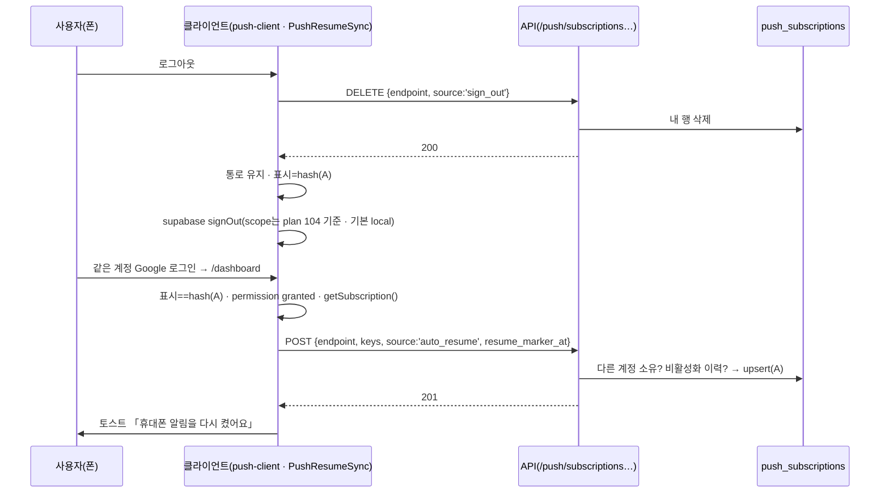

# 로그아웃 후 같은 계정 재로그인 시 휴대폰 알림 자동 복구 기획서

> Date: 2026-10-29
> Status: Completed
> Author: planner
> **SQL:** 없음 (테이블·컬럼·RLS 변경 없음)
> **번호 메모:** 메인 세션은 103을 예정했다. 그런데 같은 날 다른 세션이 [103](./103_subscription-equipment-ledger-plan.md)(구독·비품 관리 · 16:29)과 [104](./104_logout-this-device-only-plan.md)(로그아웃 「이 기기만」 · 16:43)를 먼저 등록했다. README 규칙(최대+1 · 재사용 금지)에 따라 **105**로 정했다.
> **선행:** [08](./08_activity-audit-log-plan.md), [14](./14_delete-confirm-dialog-plan.md), [45](./45_auth-session-audit-log-plan.md), [57](./57_google-auth-approval-migration-plan.md), [91](./91_pwa-web-push-notifications-plan.md), [92](./92_quick-web-only-notifications-plan.md), [94](./94_quick-realtime-and-small-fixes-plan.md), [95](./95_dongbang-visibility-audit-plan.md), [104](./104_logout-this-device-only-plan.md)
> **Supersedes:**
> - [91](./91_pwa-web-push-notifications-plan.md)의 다음 항목:
>   - D-6 「로그아웃 → 그 기기 구독만 삭제」 중 **브라우저 구독 해제 부분**
>   - In 10 「`signOut()`에 `unsubscribePushOnThisDevice()` 선행」
>   - AC-17의 「`signOut()`이 `unsubscribePushOnThisDevice`를 **먼저** 호출」 문장
>   - 리스크 MED 「로그아웃 순서」
>   - 유지: 「로그아웃한 기기에는 알림이 가지 않는다」(목표 · M-6), AC-15(비활성화 → 전 기기 삭제 · 재활성화 후 복구 없음).
> - [104](./104_logout-this-device-only-plan.md) AC-09의 판정 문장 「`signOut` 안에서 `await unsubscribePushOnThisDevice()`가 `supabase.auth.signOut(`보다 먼저」 → 105에서 「푸시 처리 호출(일반 로그아웃 `signOutPushOnThisDevice()` · 강제 로그아웃 `unsubscribePushOnThisDevice()`)이 `supabase.auth.signOut(`보다 먼저」로 읽는다.
> - 104의 scope 결정(기본 `local` · 비활성 감지 `global`)은 **그대로 따른다.**

---

## 선행 plan 참조 (Phase 0)

| Plan | Status | 관계 · 가져온 제약 |
|------|--------|--------------------|
| **91** | Completed | **수정 대상.** `push_subscriptions`(endpoint unique · upsert로 user_id 이전) · Route 4종 · `usePushDeviceStatus`(브라우저 구독 hash가 **서버 기기 목록**에 있어야 `on`) · `subscribeThisDevice()`/`disablePushOnThisDevice()` · 활동 로그 4 action을 그대로 쓴다. 로그아웃 때 서버 행은 계속 지우되 **브라우저 구독은 남긴다**. 비활성화 purge(`DELETE /api/users/[id]`)는 바꾸지 않는다 |
| **57** | Approved | 로그인은 Google OAuth만 쓴다. `GET /api/auth/google/callback`가 302로 `/dashboard/overview`(또는 redirectTo)에 보낸다. 서버 callback은 기기(브라우저 구독)를 모르므로 자동 복구는 **dashboard layout의 클라이언트 컴포넌트**에서 한다 |
| **45 · 08** | Approved | 로그아웃 자체는 activity log **Out**이다. 하지만 로그아웃 중 호출하는 `DELETE …/subscriptions`는 91과 같이 `push_subscription.delete`로 **기록**한다. 자동 복구는 `push_subscription.create`로 기록한다. 신규 Route는 전 분기를 기록한다 |
| **14** | Completed | 이번 plan에 영구 삭제 UI는 없다(안내 줄 「닫기」·자동 연결 해제는 되돌릴 수 있음). 그래서 `AlertModal` 대상이 아니다. `window.confirm`은 0건을 유지한다 |
| **92** | Completed | 가드(`src/proxy.ts`)의 비로그인 401은 Route 밖에서 나므로 `x-request-id`·활동 로그가 없다(OQ-4 · 기존 실패). 이번 AC는 401에서 **상태 코드만** 본다 |
| **94** | Completed | `public/sw.js` 클릭 이동(`postMessage`)은 변경하지 않는다 |
| **95** | Completed | 동방특송도 같은 규칙을 적용받는다. 신규 Route는 `/api/notifications/` 아래라 allowlist를 고치지 않아도 된다 |
| **103** | Approved (다른 세션 · 구현 전) | 같은 파일을 **append로만** 함께 수정한다: `src/features/activity-logs/api/types.ts` · `src/features/activity-logs/labels.ts` · `src/app/dashboard/layout.tsx` · `push-groups.ts`(103만 수정 · 105는 수정하지 않음). 논리 충돌은 없다. 늦게 구현하는 쪽이 병합한다 |
| **104** | Approved (다른 세션 · 같은 날) | **같은 함수 `signOut()`을 고친다.** 104: `signOut(options?: { scope?: 'local' \| 'global' })` 기본 `local` · `profile-status-realtime`만 `{ scope: 'global' }` · Google callback 실패 4곳 `local` · middleware `global` 명시. 105는 이 시그니처에 `reason?: 'user' \| 'forced'`를 **더한다**(합친 형태는 §범위 In 1). 104의 「이 기기만」 덕분에 PC 로그아웃이 더 이상 폰을 끊지 않아 Q3 상황(버튼 없이 로그아웃된 폰)은 드물어지지만, 쿠키 삭제·세션 만료 등으로 여전히 생길 수 있어 detach는 유지한다. **구현 순서: 104 → 105 권장**(105 FE가 104 결과 위에 얹는다). 104가 아직이면 105 FE가 104 In 1·4를 함께 반영하지 않고, 104 구현 후 병합한다 |

**관계:** 91의 **수정**이다. 알림 생성·발송 파이프라인·그룹 설정은 바꾸지 않는다. 바뀌는 것은 로그아웃·로그인 시점의 「이 기기 구독」 처리뿐이다.

---

## 원인 (코드 확인 · 2026-10-29)

| 사실 | 근거 |
|------|------|
| 로그아웃 버튼은 `signOut()`을 부르고, 이 함수가 `unsubscribePushOnThisDevice()`를 먼저 호출한다 | `src/features/auth/api/service.ts:106-111` |
| `unsubscribePushOnThisDevice()`는 서버 `DELETE {endpoint}`를 보낸 뒤 **브라우저 `subscription.unsubscribe()`까지** 한다(2초 timeout · 실패 무시) | `src/features/notifications/lib/push-client.ts:228-250` |
| 다시 구독하는 코드는 프로필 스위치 ON(`enablePushOnThisDeviceMutation` → `subscribeThisDevice()`) 하나뿐이다. 로그인 후 자동 재구독은 없다 | `src/features/notifications/api/push-mutations.ts:18-19` |
| 그룹 설정(`push_notification_preferences`)은 계정 단위라 남아 있고, 브라우저 알림 권한(granted)도 남아 있다 | `supabase/sql/90_push_subscriptions.sql` |
| 스위치 `on` 판정 = 브라우저 구독 hash ∈ **본인** 서버 기기 목록이다. 다른 계정에게는 `off`로 보인다 | `src/features/notifications/hooks/use-push-device-status.ts:84-91` · `src/app/api/notifications/push/preferences/route.ts:48` |
| supabase-js `signOut()` 기본 scope는 **global**이다(현재 코드). PC에서 로그아웃하면 같은 계정 휴대폰 세션도 잠시 뒤 끊기고, 이때 폰에서는 클라이언트 로그아웃 코드가 돌지 않으므로 **서버 행이 남는다**. → plan 104가 기본 `local`로 바꾼다. 그 뒤에는 쿠키 삭제·세션 만료처럼 「버튼 없이 로그아웃된」 경우에만 남는다 | `node_modules/@supabase/auth-js/dist/module/GoTrueClient.js:3173` · plan 104 |
| `signOut()` 호출처: `nav-user.tsx:61`(로그아웃 버튼) · `profile-security-section.tsx:9`(plan 104 확인: 어디서도 import 안 됨) · `profile-status-realtime.tsx:72`(비활성화 감지 강제 로그아웃) · `force-password-change-form.tsx:41` · `profile-password-sheet.tsx:66`(plan 57 이후 비밀번호 기능 410 · 도달 불가) | grep · plan 104 |

## 기술 사실 확인 — iOS 사용자 제스처 (추측 없이 출처 확인)

| 항목 | 결론 | 출처 |
|------|------|------|
| 홈 화면 웹앱 푸시 권한 요청 | 「direct user interaction」에 대한 응답일 때만 가능 | WebKit 블로그 https://webkit.org/blog/13878/web-push-for-web-apps-on-ios-and-ipados/ |
| 구독 요청 | 「requesting a push subscription requires an explicit user gesture」 | https://webkit.org/blog/12945/meet-web-push/ · MDN `PushManager.subscribe` |
| `PushManager.subscribe()` (WebKit main 소스) | 권한이 **Granted면 제스처 검사 없이** 구독한다. 제스처 검사(`consumeTransientActivation` · 「Push notification prompting can only be done from a user gesture.」)는 **Default(아직 안 물음)** 분기에만 있다 | `Source/WebCore/Modules/push-api/PushManager.cpp` |
| `PushManager.getSubscription()` | 제스처·권한 검사가 **없다** | 같은 파일 |
| `Notification.requestPermission()` (WebKit) | 현재 권한을 보지 않고 **먼저** `consumeTransientActivation()`을 검사한다. 실패하면 **이미 granted여도 `Denied`로 resolve**한다(「Notification prompting can only be done from a user gesture.」) | `Source/WebCore/Modules/notifications/Notification.cpp` |

**설계 결론:** 지금 `subscribeThisDevice()`는 항상 `requestPermission()`부터 부르므로, 로그인 직후 자동 호출하면 Safari/iOS에서 실패한다. 그래서 이렇게 한다.
- 로그아웃 때는 **브라우저 구독을 남기고** 서버 행만 지운다.
- 같은 계정으로 재로그인하면 **`getSubscription()`(제스처 불필요)**으로 다시 등록한다.
- 브라우저 구독이 사라진 예외 상황에서는 권한이 granted일 때 `requestPermission()`을 **건너뛰고** `subscribe()`를 직접 호출한다(소스상 Granted 경로).
- 그것도 실패하면 안내 줄의 「다시 켜기」 버튼으로 해결한다. 버튼을 누르는 것이 제스처다.
- WebKit 동작의 근거는 소스 코드이고 공식 문서에 명시돼 있지 않다. 실기기 확인은 수동 QA(M-2·M-3)로 한다.

---

## deep-interview 확정 (2026-10-29 · 사용자 「전부 추천으로」)

| # | 항목 | 확정 |
|---|------|------|
| D-1 | 기본 동작 | 로그아웃 버튼을 누르면 서버의 「이 폰으로 알림 보내기」 등록만 지우고, 폰 안의 알림 통로(브라우저 구독)는 남긴다. 폰에 「이 계정이 알림을 켜 두었음」 **표시**를 남긴다(계정 id 원문 대신 hash). **같은 계정으로 다시 로그인하면 자동으로 다시 켠다.** 다른 계정이면 켜지 않는다 |
| D-2 (Q1=가) | 다른 계정이 중간에 쓴 경우 | 폰마다 「**마지막으로 알림을 켜 둔 사람 한 명**」만 기억한다. 중간 계정이 알림을 켜지 않았으면 원래 계정은 자동 복구된다. 중간 계정이 이 폰에서 알림을 **켰으면** 원래 계정은 자동 복구하지 않는다 |
| D-3 (Q2=가) | 화면 안내 | 자동 복구에 실패하면 대시보드 상단에 **닫을 수 있는 안내 줄** 「로그아웃 전에 켜 두었던 휴대폰 알림이 꺼졌어요」 + 버튼 **「다시 켜기」**를 띄운다(누름 = 사용자 제스처). 자동 복구 성공(또는 「다시 켜기」 성공) 시 토스트 **「휴대폰 알림을 다시 켰어요」**를 1회 띄운다 |
| D-4 (Q3=가) | 버튼 없이 로그아웃된 폰에 다른 계정 로그인 | 다른 계정이 로그인하는 순간, 그 폰에 남은 **이전 사람의 서버 연결을 끊는다.** 이때 표시를 「이전 사람」으로 남겨 두므로, 이전 사람이 그 폰에서 다시 로그인하면 D-2 규칙대로 자동 복구된다 |
| D-5 (Q4) | 바꾸지 않는 것 | ① 비활성화 → 전 기기 삭제 · 재활성화 후 **자동 복구 없음**(91 AC-15 유지 — 서버에서 막는다, §API) ② 「로그아웃해도 계속 알림 받기」 선택지 없음 ③ 로그아웃 범위(global/local)는 **이 plan에서 바꾸지 않는다** — 인터뷰 때 「바꾸려면 별도 기획」으로 안내했고, 같은 날 별도 plan [104](./104_logout-this-device-only-plan.md)가 「이 기기만(local)」으로 승인됐다. 이 plan의 설계는 global·local 어느 쪽에서도 성립한다 ④ 기억 기간 제한 없음 |
| D-6 (Q5=가) | 실기기 확인 | 안드로이드 Chrome + 아이폰(홈 화면 PWA) 둘 다 사용자 수동 QA. 자동 판정은 Playwright stub(가짜 폰) |

---

## 한 줄 요약

로그아웃할 때 휴대폰의 알림 통로는 남기고 서버 등록만 지운 뒤 「마지막으로 알림을 켠 계정」을 기기에 hash로 기억해 둔다. 같은 계정이 다시 로그인하면 대시보드 진입 시 자동으로 다시 등록하고(아이폰도 버튼 없이), 다른 계정이면 켜지 않으며, 그 폰에 남아 있던 이전 사람의 서버 연결은 끊는다.

---

## 목표

- 휴대폰에서 로그아웃했다가 **같은 계정으로 다시 로그인하면 휴대폰 알림이 자동으로 다시 켜진다**(안드로이드 Chrome · 아이폰 홈 화면 앱 · PC Chrome).
- 로그아웃한 기기에는 여전히 알림이 가지 않는다(91 원칙 유지).
- 다른 계정이 그 폰으로 로그인하면 이전 사람 알림이 그 폰으로 오지 않는다.
- 자동으로 켜지 못하면 사용자가 한 번 눌러 바로 켤 수 있다.
- 계정이 비활성화된 적이 있으면 자동 복구하지 않는다(91 AC-15).

---

## 동작 설계

### 기기 표시 (`localStorage`)

| 항목 | 값 |
|------|-----|
| 키 | `wakeone.push.resume-owner` |
| 값 | JSON `{"owner":"<16자 hex>","at":<ms epoch>}` |
| `owner` | `sha256("wakeone-push-owner:" + user_id)` hex 앞 16자. 서버(`node:crypto`)와 클라이언트(Web Crypto)가 **같은 함수·같은 접두사**를 쓴다. user id 원문은 저장하지 않는다 |
| 접근 | 읽기·쓰기·삭제 모두 try/catch. 저장할 수 없는 환경(프라이빗 모드 등)이면 자동 복구 없이 기존 동작(직접 켜기)으로 떨어진다 |
| 기간 | 제한 없음(D-5 ④) |

### 사건별 동작

| 사건 | 서버 | 폰 알림 통로(브라우저 구독) | 표시 |
|------|------|------------------------------|------|
| **로그아웃 버튼** · 통로 없음 | 호출 없음 | — | 그대로 |
| 로그아웃 버튼 · `DELETE {endpoint, source:'sign_out'}` **200** | 내 행 삭제 | **유지** | **나로 기록** |
| 로그아웃 버튼 · DELETE **404**(내 행 아님) | 변화 없음 | 유지 | 그대로 |
| 로그아웃 버튼 · DELETE 그 밖의 실패·2초 초과·네트워크 오류 | (알 수 없음) | **해제**(안전장치 — 서버 행이 남았어도 통로가 사라져 410으로 정리됨) | 그대로 |
| **강제 로그아웃**(`profile-status-realtime` 비활성화 감지) `signOut({ scope: 'global', reason: 'forced' })` | `DELETE {source:'forced_sign_out'}` 시도 | 해제(91 동작 그대로) | **owner가 나면 삭제** |
| 스위치 ON 성공(프로필 · 안내 줄 「다시 켜기」) | upsert → 나 | 유지·생성 | **삭제** |
| 스위치 OFF · 「이 기기」 해제 | 내 행 삭제 | 해제 | **삭제** |
| **대시보드 진입** · 표시 owner = 나 | 아래 「자동 복구」 | — | — |
| 대시보드 진입 · 표시 owner = 다른 사람 | 호출 없음(그 사람 행은 이미 지워짐) | 유지 | 그대로 |
| 대시보드 진입 · 표시 없음 · 통로 있음 · 통로가 내 기기 목록에 **없음** | `POST …/subscriptions/detach` | `detached`: 유지 · `none`: **해제**(주인 없는 통로 정리) · `mine`: 유지 | `detached`: **이전 주인 hash로 기록** |
| 대시보드 진입 · 표시 없음 · 통로 없음 또는 내 것 | 호출 없음 | — | — |
| 안내 줄 「닫기」 | — | — | 삭제(다시 안 띄움) |

### 자동 복구 (대시보드 진입 · 표시 owner = 나)

1. 푸시를 지원하지 않거나 `NEXT_PUBLIC_VAPID_PUBLIC_KEY`가 없으면 → 아무것도 하지 않는다.
2. `Notification.permission`이 `denied`면 → 표시를 삭제하고 끝낸다. 안내 줄은 띄우지 않는다(프로필에 「알림이 차단되어 있어요…」가 보임).
3. `default`면(권한이 초기화됨) → **안내 줄**을 띄운다. 「다시 켜기」를 누르면 권한 요청과 구독을 진행한다.
4. `granted`면:
   - 브라우저 구독이 있으면 그대로 쓴다(`getSubscription()`).
   - 없으면 `requestPermission()` **없이** `pushManager.subscribe()`를 1회 시도한다. 실패하면 → 안내 줄.
   - `POST /api/notifications/push/subscriptions {endpoint, keys, userAgent, source:'auto_resume', resume_marker_at}`의 결과:
     - **201/200** → 표시 삭제 · `pushKeys` invalidate · 토스트 「휴대폰 알림을 다시 켰어요」 1회
     - **409**(비활성화 이력 · 다른 계정 소유) → 표시 삭제 · 안내 없음
     - **503**(서버 미설정) → 조용히 끝낸다(표시 유지)
     - 그 밖의 실패 → 안내 줄
5. 여러 탭이 동시에 진입해도 POST·토스트는 1회만 실행한다(`localStorage` 잠금 15초 · try/catch).

### Q3 처리 (D-4) — 「마지막으로 켠 사람」 규칙과의 일관성

- 표시는 「**다음 로그인 때 자동 복구할 계정**」 하나다. 오직 두 경우에만 쓴다.
  - (a) 그 계정이 로그아웃 버튼으로 **자기 행을 지웠을 때**(DELETE 200)
  - (b) 다른 계정이 로그인하면서 **그 계정의 남은 행을 끊었을 때**(detach `detached` → 서버가 돌려준 `previous_owner_hash`)
- 누구든 이 폰에서 알림을 **켜면**(수동·자동) 표시를 지운다. 그러면 「중간 계정이 켰으면 원래 계정은 복구 안 함」(D-2)이 자연히 성립한다.
- 시나리오 점검:

| 순서 | 결과 |
|------|------|
| A 켬 → A 로그아웃 → A 로그인 | 표시 A → 자동 복구 ✓ |
| A 켬 → A 로그아웃 → B 로그인(안 켬) → B 로그아웃 → A 로그인 | B 진입: 표시 A(다른 사람)라 아무것도 안 함 · B 로그아웃 DELETE 404 → 표시 A 유지 → A 자동 복구 ✓ |
| A 켬 → A 로그아웃 → B 로그인 → **B 켬** → B 로그아웃 → A 로그인 | B 켬 → 표시 삭제 · B 로그아웃 DELETE 200 → 표시 B → A 진입: 표시 B(다른 사람) → 복구 안 함 ✓ (D-2) |
| A 켬 → 버튼 없이 폰 세션이 끊김(쿠키 삭제·세션 만료 · plan 104 반영 전에는 PC 로그아웃 global 포함 · A 행 남음) → B 로그인 | B 진입: 표시 없음 · 통로가 B 목록에 없음 → detach → A 행 삭제 · 표시 A → 이후 A 로그인 → 자동 복구 ✓ (D-4) |
| A 켬 → 버튼 없이 세션 끊김 → A 다시 로그인 | A 행이 그대로 → 이미 `on` · 호출 없음 ✓ |
| B 켬 → B 세션 만료(B 행 남음 · 표시 없음) → A 로그인 | detach → B 행 삭제 · 표시 B → A는 `off`(D-2: 마지막으로 켠 사람은 B) ✓ |
| A 표시 남은 채 A 비활성화 → 재활성화 → A 로그인 | 서버 409(비활성화 이력) → 표시 삭제 · `off` ✓ (D-5 ①) |

- 서버도 이중으로 막는다: `auto_resume` POST인데 그 endpoint 행이 **다른 계정 소유**면 409를 돌려준다(이동 금지). 표시가 꼬여도 다른 사람 기기를 가져오지 않는다.

---

## 범위 (In / Out)

### In

1. `signOut(options?: { scope?: 'local' | 'global'; reason?: 'user' | 'forced' })` — **plan 104 시그니처에 `reason`을 더한 형태** · `scope` 기본 `local`(104) · `reason` 기본 `user`.
   - `user`: 서버 DELETE만 · 통로 유지 · 표시 기록(200일 때) · 실패하면 통로 해제.
   - `forced`: 91 동작(DELETE + 통로 해제) + 내 표시 삭제.
   - 호출처: `profile-status-realtime`만 `signOut({ scope: 'global', reason: 'forced' })`. 나머지(`nav-user` · 도달 불가 화면 3곳)는 인자 없이 그대로.
2. 표시 유틸 + **순수 결정 함수**(`push-resume-decision.ts` · import 없음 · `node --test` 대상)
3. 대시보드 진입 동기화 컴포넌트 `PushResumeSync`(dashboard layout · 자동 복구 · detach · 주인 없는 통로 정리 · 안내 줄 · 토스트)
4. 스위치 ON/OFF 성공 시 표시 삭제(`push-mutations.ts`)
5. API: `POST …/subscriptions`에 `source`·`resume_marker_at` + `auto_resume` 409 가드 2종 · `DELETE …/subscriptions`에 `source` · **신규** `POST …/subscriptions/detach`
6. 활동 로그: 신규 action `push_subscription.detach` + 라벨 · 기존 2 action metadata에 `source`
7. E2E `e2e/push-notifications/105-*.spec.ts` + 브라우저 stub helper + `node --test` 결정표

### Out

| 항목 | 비고 |
|------|------|
| SQL · 테이블/컬럼/RLS 변경 | 없음 |
| supabase signOut scope 변경(global → local) | D-5 ③ · **plan 104 담당**(105는 104 시그니처를 확장만 한다) |
| 도달 불가 비밀번호 화면(`ProfileSecuritySection`·`ProfilePasswordSheet`·`/auth/force-password-change`) 정리 | plan 104 OQ-2와 같음 · 호출 코드 그대로 |
| 「로그아웃해도 계속 받기」 옵션 | D-5 ② |
| 표시 기간 만료 | D-5 ④ |
| 재활성화 후 자동 복구 | D-5 ① — 서버 409로 막는다 |
| `pushsubscriptionchange`(브라우저가 구독을 스스로 바꾼 경우) 처리 | 별도. 안내 줄로 대신한다 |
| 프로필 「휴대폰 알림」 섹션 문구·레이아웃 변경 | 없음(상태 판정 로직 그대로) |
| 이메일 발송 | 없음(이메일 정책). 테스트에서 메일 발송 Route 호출 금지 |
| 운영(Main) 반영 | 사용자 별도 |

---

## 완료 기준 (AC)

실제 OS 알림 수신은 헤드리스로 판정할 수 없다. 아래 AC는 **브라우저 stub(가짜 폰) + mock endpoint + API·DB 조회**로 판정하고, 실기기는 「수동 QA」로 분리한다. 모든 문구는 한국어다.

**공통 전제 (verifier)**
- 서버: `E2E_WEB_PUSH_MOCK=1`(기존 `chromium-push` project) · VAPID env 3종이 있어야 한다.
- **계정:** 로그아웃 버튼은 지금 supabase **global signOut**이라 그 계정의 모든 세션을 끊는다. plan 104 반영 후 `local`이 되어도 **브라우저가 쓰던 그 세션은 서버에서 삭제**된다. 공용 `user.json`·`admin.json`은 그 세션(같은 refresh token)을 쓰므로 어느 쪽이든 끊긴다. 그래서 로그아웃·재로그인 AC는 **일회용 계정**(`e2e/helpers/supabase-direct-auth.ts` `createActiveTestUser()` → `signInWithSupabasePassword()`로 쿠키 생성)만 쓴다. 계정 A·B를 테스트마다 새로 만들고, `afterAll`에서 `auth.admin.deleteUser`로 지운다(`push_subscriptions`는 FK cascade). 공용 `admin.json`은 **로그 화면 확인·비활성화/재활성화 API 호출에만** 쓰고, 그 세션으로는 로그아웃하지 않는다.
- **「재로그인」 흉내:** 같은 BrowserContext에서 `context.clearCookies()` → `context.addCookies(<A 또는 B의 새 세션 쿠키>)` → `goto('/dashboard/overview')`. `localStorage`(표시·stub 상태)는 같은 기기처럼 유지된다.
- **브라우저 stub(`addInitScript` · 신규 `e2e/helpers/push-browser-stub.ts`):**
  - `localStorage.__e2e_push_stub = {permission, endpoint|null, mode, calls:{requestPermission, subscribe, unsubscribe}}`로 상태를 유지한다.
  - `Notification.permission` getter와 `Notification.requestPermission`을 대체한다. `mode:'webkit'`이면 `navigator.userActivation.isActive`가 false일 때 **`'denied'`를 돌려준다**(WebKit 소스와 동일).
  - `PushManager.prototype.getSubscription`·`subscribe`를 대체한다. `subscribe`는 permission `granted`면 새 mock endpoint(`https://e2e.invalid/push/ok/<uuid>`)를 만든다. `default`이고 사용자 활성화가 없으면 `NotAllowedError`. `mode:'fail_subscribe'`면 사용자 활성화가 없을 때 항상 `NotAllowedError`.
  - 가짜 구독 객체: `{endpoint, toJSON(){ return {endpoint, keys: MOCK_KEYS} }, unsubscribe(){ endpoint=null; calls.unsubscribe++ }}`.
- 「서버 행」 확인은 service-role 헬퍼(또는 Dev MCP 읽기)로 `push_subscriptions where endpoint = …`를 조회한다.
- **이메일 정책:** 어떤 AC도 `POST /api/contracts/reminders`·식대 잔액 메일 Route를 호출하지 않는다. 알림을 발생시켜야 하면 `PUT /api/users/{id}`(이름 변경 · plan 27 경로)만 쓴다.

| # | 검증 | Given | When | Then |
|---|------|-------|------|------|
| AC-01 | Playwright · DB | 계정 A 일회용 · stub `permission:'granted'`, 구독 없음 · A로 `/dashboard/profile` | Switch(`push-toggle`) ON → 사이드바 사용자 메뉴 **「로그아웃」** | 토스트 「휴대폰 알림을 켰어요.」 → 로그아웃 후 URL `/auth/sign-in` · 요청 `DELETE /api/notifications/push/subscriptions` **200**(body `source:'sign_out'`) · stub `calls.unsubscribe` **0** · stub `endpoint` **유지** · `localStorage['wakeone.push.resume-owner'].owner` = 테스트가 계산한 `sha256('wakeone-push-owner:'+A.id)` 앞 16자 · 값에 A의 user id 원문이 **없음** · DB에서 그 endpoint 행 **0건** |
| AC-02 | Playwright · DB | AC-01 직후(같은 context) | A 쿠키로 `/dashboard/overview` 진입 | 10초 안에 `POST …/subscriptions` **201**(body `source:'auto_resume'` · `resume_marker_at` ISO) · 토스트 **「휴대폰 알림을 다시 켰어요」** 1회 · stub `calls.requestPermission` **0** · `calls.subscribe` **0**(기존 통로 재사용) · 표시 키 **삭제** · DB에서 같은 endpoint 행 1건 `user_id = A` · `/dashboard/profile`의 `push-status` `data-status="on"` · Switch checked |
| AC-03 | Playwright | AC-02 직후 | `/dashboard/overview` 새로고침 2회 | 추가 `POST …/subscriptions`·`…/detach` **0건** · 토스트 없음 · 안내 줄 없음 |
| AC-04 | Playwright · DB | AC-01 상태(A 로그아웃 · 표시 A) | **B**(일회용) 쿠키로 `/dashboard/overview` | `POST …/subscriptions`·`…/detach` **0건** · 토스트·안내 줄(`push-resume-banner`) 없음 · B `/dashboard/profile` `data-status="off"` · 「알림이 꺼져 있어요」 · Switch unchecked · 표시 owner = A 그대로 · DB 그 endpoint 행 0건 |
| AC-05 | Playwright | AC-04 직후 | B 로그아웃(메뉴) → A 쿠키로 진입 | B 로그아웃의 DELETE **404** · `calls.unsubscribe` 0 · 표시 owner A 유지 → A 진입 시 AC-02와 같이 자동 복구(201 · 토스트 1회) **(D-2 전반)** |
| AC-06 | Playwright | A 켬 → A 로그아웃(표시 A) → B 진입 | B가 프로필 Switch ON(클릭 = 사용자 활성화) → B 로그아웃 → A 쿠키로 진입 | B ON: `POST` **200**(같은 endpoint가 B로 이동 · `source:'manual'`) · 표시 **삭제** → B 로그아웃 DELETE 200 → 표시 owner = hash(B) → A 진입 시 `POST …/subscriptions` **0건** · 토스트·안내 줄 없음 · A `data-status="off"` **(D-2 후반)** |
| AC-07 | Playwright · DB · 로그 | A 켬(행 A) → **버튼 없이** `context.clearCookies()`(세션 만료 흉내 · 표시 없음) | B 쿠키로 `/dashboard/overview` → 이어서 `clearCookies` → A 쿠키로 진입 | B 진입: `POST …/subscriptions/detach` **200** `{result:'detached', previous_owner_hash:<hash(A)>}` · DB 그 endpoint 행 0건 · 표시 owner = hash(A) · B `data-status="off"` · `calls.unsubscribe` 0 · `activity_logs` `push_subscription.detach` 200 행(actor B · `target_user_id` = A · metadata `result:'detached'`) → A 진입: 자동 복구 201 · 토스트 1회 **(D-4)** |
| AC-08 | API · 로그 | B 일회용 세션(request context) | `POST /api/notifications/push/subscriptions/detach` ① body 없음 ② `{endpoint:'http://x'}` ③ B 본인 등록 endpoint ④ 어디에도 없는 mock endpoint ⑤ 비로그인 | ①② **400** 「구독 정보가 올바르지 않습니다.」 ③ **200** `result:'mine'`(행 유지) ④ **200** `result:'none'` ⑤ **401** · ①~④ 응답에 `x-request-id` · ①~④ 각각 `push_subscription.detach` 로그(400·400·200·200) |
| AC-09 | Playwright | B 로그인 상태 · stub 구독 있음 · 표시 없음 · 그 endpoint의 서버 행 없음 | `/dashboard/overview` → 새로고침 | detach **200** `result:'none'` · stub `calls.unsubscribe` **1**(주인 없는 통로 정리) · 새로고침 후 detach 호출 **0건** |
| AC-10 | Playwright | 표시 owner = A · stub `permission:'granted'` · **구독 없음** · `mode:'webkit'` | A 쿠키로 진입 | `calls.requestPermission` **0** · `calls.subscribe` **1** · `POST …/subscriptions` 201 `source:'auto_resume'` · 토스트 1회 · 표시 삭제 |
| AC-11 | Playwright | 표시 owner = A · `permission:'granted'` · 구독 없음 · `mode:'fail_subscribe'` | A 쿠키로 진입 → 안내 줄 「다시 켜기」 클릭 | 진입 시 안내 줄(`data-testid="push-resume-banner"`) 문구 **「로그아웃 전에 켜 두었던 휴대폰 알림이 꺼졌어요」** + 버튼 **「다시 켜기」** · 클릭 → `POST` 201(`source:'manual'`) · 토스트 **「휴대폰 알림을 다시 켰어요」** · 안내 줄 사라짐 · 표시 삭제 |
| AC-12 | Playwright | AC-11 Given | 안내 줄 **「닫기」**(aria-label) 클릭 → 새로고침 | 안내 줄 사라짐 · 표시 삭제 · 새로고침 후 안내 줄·POST **0건** |
| AC-13 | Playwright | 표시 owner = A · stub `permission:'denied'` · 구독 있음 | A 쿠키로 진입 | `POST` 0건 · 안내 줄·토스트 없음 · 표시 삭제 · `/dashboard/profile` 문구 「알림이 차단되어 있어요. 브라우저 설정에서 WakeOne 알림을 허용해 주세요.」 |
| AC-14 | API · 로그 | A 일회용 · 시각 `T0` 기록 | ① admin이 `DELETE /api/users/{A}`(비활성화) → `PATCH /api/users/{A}` `{action:'reactivate'}` → A 새 세션으로 `POST …/subscriptions {…, source:'auto_resume', resume_marker_at:T0}` ② 같은 요청에 `resume_marker_at` = 재활성화 **이후** 시각 ③ `source:'auto_resume'` + `resume_marker_at` 누락 ④ B가 등록해 둔 endpoint로 A가 `auto_resume` POST | ① **409** 「계정이 비활성화된 적이 있어 휴대폰 알림을 자동으로 다시 켜지 않았어요.」 ② **201** ③ **400** 「구독 정보가 올바르지 않습니다.」 ④ **409** 「이 기기는 다른 계정이 알림을 켜 두어서 자동으로 다시 켜지 않았어요.」 + DB 행 `user_id` = B 유지 · 각 분기 `push_subscription.create` 로그 metadata `source:'auto_resume'`(①④는 `reason` 포함) · (비활성화·재활성화 Route는 메일을 보내지 않음 — 코드 확인) |
| AC-15 | Playwright | A 로그인 · 켬 · 표시 owner = A를 미리 심어 둠 | admin이 `DELETE /api/users/{A}`(비활성화) | A 화면이 `/auth/sign-in?accountDisabled=1`로 이동 · stub `calls.unsubscribe` **1**(강제 로그아웃은 91 동작 유지) · 표시 **삭제** · DB A의 행 0건 |
| AC-16 | Playwright | A 켬(행 A) | `page.route('**/api/notifications/push/subscriptions', abort)`로 DELETE 실패를 만든 뒤 로그아웃 | 로그아웃은 정상 완료(`/auth/sign-in`) · stub `calls.unsubscribe` **1**(안전장치) · 표시 **기록 안 됨** |
| AC-17 | API · 로그 | `user.json`(공용 · 로그아웃 없음) | `POST …/subscriptions` `source:'nope'` · `DELETE …/subscriptions` `source:'nope'` · source 없이 POST/DELETE | 잘못된 source → 각 **400** 「구독 정보가 올바르지 않습니다.」 · source 없음 → 91과 같은 201/200 · 로그 metadata `source:'manual'` · DELETE 로그 metadata `source:'manual'` |
| AC-18 | Playwright · 로그 화면 | AC-07 실행 후 · `admin.json` | `/dashboard/logs` | 최신 행에 액션 **「휴대폰 알림 이전 사용자 연결 해제」**와 **「휴대폰 알림 기기 등록」**이 보인다 · Status 2xx |
| AC-19 | node --test | — | `node --test src/features/notifications/lib/__tests__/` | 신규 `push-resume-decision.test.mjs` green — 「사건별 동작」·「자동 복구」 표의 모든 행(지원 안 함·키 없음 · denied/default/granted × 구독 유무 × 표시 나/남/없음 × 내 기기 여부 · detach 결과 3종 · 로그아웃 DELETE 200/404/실패)이 기대 action과 일치 · 기존 테스트도 green |
| AC-20 | CLI · grep | 구현 완료 | `npx playwright test e2e/push-notifications/` · (104 구현 후) `e2e/auth/104-logout-this-device.spec.ts` · `npx tsc --noEmit` · `npm run lint:strict` · `npm run build` · `npm run e2e:cleanup` · grep | 모두 통과(기존 91 spec 포함 · 92 OQ-4의 비로그인 401 `x-request-id` 기존 실패는 예외로 표기) · cleanup remaining 0 · `src/features/notifications/**`·`src/features/auth/api/service.ts`에 `window.confirm`·`confirm(` **0건** · `nav-user.tsx`는 `signOut()`(인자 없음) · `profile-status-realtime.tsx`는 `signOut({ scope: 'global', reason: 'forced' })` · `service.ts` `signOut` 안에서 푸시 처리 호출이 `supabase.auth.signOut(`보다 먼저(104 AC-09를 105 기준으로 읽음) |

**회귀:** plan 91 `e2e/push-notifications/01~07`(AC-05·06·12~15 포함) · plan 95 `95-dongbang-visibility` 중 푸시 그룹 AC · 알림 `e2e/notifications/`. 로그아웃 동작을 쓰는 기존 spec이 있으면 함께 실행한다.

### 수동 QA (실기기 · 사용자 몫 · verifier 자동 판정 대상 아님)

알림을 발생시키는 방법: 다른 계정(관리자)이 내 프로필 이름을 바꾼다(「프로필 정보가 변경되었습니다」). 계약서 독촉·식대 잔액 메일 기능은 쓰지 않는다.

| # | 기기 | 절차 | 기대 |
|---|------|------|------|
| M-1 | 안드로이드 Chrome | 로그인 → 프로필 「휴대폰 알림」 켜기 → 「테스트 알림 보내기」 → **로그아웃** → 관리자가 내 이름 변경 | 로그아웃 상태에서는 알림이 **오지 않음** |
| M-2 | 안드로이드 Chrome | M-1 이어서 같은 계정으로 다시 로그인 | 대시보드에서 토스트 「휴대폰 알림을 다시 켰어요」 · 프로필 스위치 켜짐 · 테스트 알림 도착 |
| M-3 | 아이폰 홈 화면 앱(iOS 16.4+) | M-1·M-2와 같은 순서 | 로그아웃 중 알림 없음 → 재로그인 시 **버튼을 누르지 않아도** 자동으로 켜짐 + 토스트 · 테스트 알림 도착. (자동으로 안 켜지면 안내 줄 「다시 켜기」를 한 번 눌러 켜지는지 확인하고 결과를 알려 주기) |
| M-4 | 둘 중 1대 | 내 계정 켬 → 로그아웃 → **다른 계정**으로 로그인 | 토스트 없음 · 프로필 「알림이 꺼져 있어요」 · 관리자가 **내** 이름을 바꿔도 그 폰에 알림 없음 |
| M-5 | 둘 중 1대 (**plan 104 반영 전 환경에서만** 가능 · 반영 후에는 생략하고 자동 판정 AC-07로 갈음) | 폰에서 켬 → **PC에서** 로그아웃(잠시 뒤 폰도 로그인 화면) → 폰에서 다른 계정 로그인 → 관리자가 원래 계정 이름 변경 → 다른 계정 로그아웃 → 원래 계정 로그인 | 다른 계정 로그인 중에는 원래 계정 알림 없음 · 원래 계정 재로그인 시 자동으로 다시 켜짐 |
| M-6 | 둘 중 1대 | 켬 → 관리자가 계정 비활성화 → 재활성화 → 다시 로그인 | 자동으로 켜지지 **않음**(스위치 꺼짐 · 토스트·안내 줄 없음) · 직접 켜면 정상 |

---

## 영향 파일 & 패턴 (정찰 · 실제 파일)

### 신규

| 파일 | 내용 |
|------|------|
| `src/features/notifications/lib/push-resume-decision.ts` | **순수 함수만**(import 없음 · `node --test` 대상): `PUSH_OWNER_HASH_PREFIX = 'wakeone-push-owner:'` · 표시 JSON 파서 · `decideDeviceSync(input)` · `decideSignOutOutcome(deleteResult)` |
| `src/features/notifications/lib/push-resume.ts` | `'use client'` · `localStorage` 읽기/쓰기/삭제(try/catch) · `hashPushOwner(userId)`(Web Crypto) · 다중 탭 잠금 |
| `src/features/notifications/components/push-resume-sync.tsx` | dashboard layout 마운트 · 진입 동기화(자동 복구·detach·통로 정리) · 안내 줄 렌더 · 토스트 |
| `src/app/api/notifications/push/subscriptions/detach/route.ts` | `POST` · 전 분기 로그 |
| `src/features/notifications/lib/__tests__/push-resume-decision.test.mjs` | AC-19 |
| `e2e/helpers/push-browser-stub.ts` · `e2e/push-notifications/105-*.spec.ts` | AC-01~18 |

### 수정

| 파일 | 변경 |
|------|------|
| `src/features/auth/api/service.ts` | `signOut(options?: { scope?: 'local' \| 'global'; reason?: 'user' \| 'forced' })`(104 시그니처 + `reason`) — `user`: `signOutPushOnThisDevice()`(신규 · 통로 유지 · 표시 기록) · `forced`: 기존 `unsubscribePushOnThisDevice()` + 표시 삭제 → `supabase.auth.signOut({ scope })`(104 기본 local) |
| `src/features/notifications/lib/push-client.ts` | `signOutPushOnThisDevice(userIdHash)`(DELETE `source:'sign_out'` · 2초 · 200/404/실패 분기) · `unsubscribePushOnThisDevice()`에 `source:'forced_sign_out'` · `subscribeExistingOrGranted()`(`requestPermission` 없이 getSubscription → 없으면 granted일 때 subscribe) · `subscribeThisDevice()`는 그대로(수동 = 제스처) |
| `src/features/notifications/api/push-service.ts` · `push-types.ts` | `createPushSubscription` payload `source?`·`resume_marker_at?` · `deletePushSubscription` `source?` · `detachPushSubscription()` · 409 구분을 위해 `status` 노출(필요 시 `apiClientWithMessage` 대신 직접 `fetch`) |
| `src/features/notifications/api/push-mutations.ts` | ON·OFF·「이 기기」 해제 성공 시 표시 삭제 |
| `src/features/auth/components/profile-status-realtime.tsx` | `signOut({ scope: 'global', reason: 'forced' })` (104가 넣는 `scope: 'global'`에 `reason`만 추가). 도달 불가 화면 2곳(`force-password-change-form.tsx`·`profile-password-sheet.tsx`)은 **수정하지 않음**(104와 동일) |
| `src/app/dashboard/layout.tsx` | `<PushResumeSync userId={profile.user_id} />` (`IosInstallBanner` 다음 · append) |
| `src/app/api/notifications/push/subscriptions/route.ts` | POST: `source`·`resume_marker_at` 스키마 · `auto_resume` 409 가드 2종 · metadata `source` / DELETE: `source` 스키마 · metadata `source` |
| `src/features/notifications/api/push-subscriptions.server.ts` | `hashPushOwner(userId)`(node:crypto · 같은 접두사) · `findPushSubscriptionByEndpoint(endpoint)` · `detachForeignPushSubscription({ userId, endpoint })` · `hasDeactivationSince(userId, iso)`(`activity_logs` `action='user.deactivate'` · `target_user_id` · `http_status` 2xx · `created_at > iso` · service role) |
| `src/features/notifications/api/push-route.server.ts` | 메시지 상수 2개 · target을 다른 사용자로 지정하는 로그 헬퍼 변형(detach용) |
| `src/features/activity-logs/api/types.ts` · `src/features/activity-logs/labels.ts` | `push_subscription.detach` · 「휴대폰 알림 이전 사용자 연결 해제」 (103과 append 병합) |
| `docs/plans/README.md` · `docs/plans/91_*.md` | 104 등록 · 91 supersede 메모 |

### 따라야 할 패턴

- Route: `createRequestId` → `requireSession` → `finishSessionFailure` / `failWithLog` / `respondWithLog` / `internalErrorWithLog`(`push-route.server.ts`) — 91 Route와 같다.
- 브라우저 API는 mount 이후(`useEffect`)에만 쓴다(하이드레이션 안전) — `IosInstallBanner`·`usePushDeviceStatus` 패턴.
- 안내 줄 UI는 `IosInstallBanner`(Alert `mx-4 mt-2` · 우상단 닫기 `Icons.close`)와 같은 모양이다. 아이콘은 `Icons.*`만 쓴다.
- 토스트는 `notifySuccess`/`notifyError`(`@/lib/notify`)를 쓴다.
- React Query: 성공 후 `invalidateQueries({ queryKey: pushKeys.all })`.
- 결정 로직은 순수 함수로 분리한다(`push-groups.ts` + `__tests__/*.test.mjs` 패턴 · 경로 alias 금지).

---

## API (변경 · SQL 없음)

공통: `requireSession`(active만) · 응답 `{success, data|message}` · 전 분기 `recordActivityLog` · `x-request-id`(Route가 만든 응답).

| Route | 입력 | 동작 | 응답 |
|-------|------|------|------|
| `POST /api/notifications/push/subscriptions` **(변경)** | 91 입력 + `source?: 'manual' \| 'auto_resume'`(기본 `manual`) + `resume_marker_at?: ISO datetime`(`auto_resume`이면 **필수**) | 순서: 세션 → Zod 400 → 미설정 503 → **(`auto_resume`만)** ① endpoint 행이 **다른 계정 소유**면 409 ② `activity_logs`에 `resume_marker_at` 이후 성공한 `user.deactivate`(target = 나)가 있으면 409 → upsert 201/200 → 500 | 91 그대로 + 409 2종 |
| `DELETE /api/notifications/push/subscriptions` **(변경)** | 91 입력 + `source?: 'manual' \| 'sign_out' \| 'forced_sign_out'`(기본 `manual`) | 91 동작 그대로 | 91 그대로 · 잘못된 source 400 |
| `POST /api/notifications/push/subscriptions/detach` **(신규)** | `{endpoint}`(https URL · 2048자) | endpoint로 행 조회 → 없음: `none` · 내 것: `mine`(변경 없음) · 다른 계정: 삭제 후 `detached` + `previous_owner_hash = hashPushOwner(이전 user_id)`. VAPID 미설정이어도 동작 | 200 `{result, previous_owner_hash?}` · 400 · 401 · 500 |

메시지 상수:
- `PUSH_RESUME_BLOCKED_DEACTIVATED_MESSAGE` = 「계정이 비활성화된 적이 있어 휴대폰 알림을 자동으로 다시 켜지 않았어요.」
- `PUSH_RESUME_OWNED_BY_OTHER_MESSAGE` = 「이 기기는 다른 계정이 알림을 켜 두어서 자동으로 다시 켜지 않았어요.」
- 잘못된 입력은 기존 `PUSH_INVALID_SUBSCRIPTION_MESSAGE`(「구독 정보가 올바르지 않습니다.」)를 쓴다.

보안 메모:
- detach는 「그 endpoint를 가진 기기」만 부를 수 있다. endpoint는 기기 브라우저만 아는 값이고 로그·응답에 원문을 남기지 않는다(host만).
- 이전 주인은 hash로만 돌려준다(B 브라우저는 A의 user id를 모른다).
- `resume_marker_at`은 클라이언트 값이다. 조작해서 얻을 수 있는 것은 「본인 계정을 본인 기기에 다시 켜기」뿐이라 위험이 없다.

---

## 활동 감사 로그 (CUD In · 필수)

> `core-conventions.mdc` §활동 감사 로그 · [plan 08](./08_activity-audit-log-plan.md)

### 기록 연동

| Route | action | 라벨 | target | return 분기 | metadata allowlist |
|-------|--------|------|--------|-------------|--------------------|
| `POST /api/notifications/push/subscriptions` | `push_subscription.create` (기존) | 휴대폰 알림 기기 등록 | `user` · 본인 | 401(Route 세션 실패 시) · 400 · 503 · **409(신규 2종)** · 201 · 200 · 500 | 기존 `{created, device_count, endpoint_host}` + **`source`** · 409는 `reason: 'deactivated_after_marker' \| 'owned_by_other'` |
| `DELETE /api/notifications/push/subscriptions` | `push_subscription.delete` (기존) | 휴대폰 알림 기기 해제 | `user` · 본인 | 401 · 400 · 404 · 200 · 500 | 기존 `{device_count, endpoint_host}` + **`source`** |
| `POST /api/notifications/push/subscriptions/detach` | **`push_subscription.detach` (신규)** | **휴대폰 알림 이전 사용자 연결 해제** | `user` · `detached`면 **이전 주인**(`target_user_id` · `fetchUserTargetLabel`) · 그 밖은 본인 | 401 · 400 · 200(`detached`·`mine`·`none`) · 500 | `{result, endpoint_host}` (endpoint 전체·키·hash **금지**) |

- 로그아웃·로그인 자체는 Out(45). 로그아웃 중 DELETE는 `source:'sign_out'`으로 기록된다.
- 자동 복구는 `push_subscription.create` + `source:'auto_resume'`으로 기록된다.
- 비로그인 401은 `src/proxy.ts` 가드가 Route 앞에서 돌려주므로 로그가 남지 않는다(plan 92 OQ-4 · 기존 동작).
- 삭제 확인 Dialog: 영구 삭제 UI가 없으므로 `AlertModal`이 없다. `window.confirm`은 0건(AC-20).
- AC: AC-07(detach 로그) · AC-08(분기별 로그) · AC-14(409 로그) · AC-17(source metadata) · AC-18(`/dashboard/logs` 라벨).

---

## UI 요구사항 (designer · frontend-dev)

### 안내 줄 `PushResumeBanner` (`PushResumeSync` 안 · dashboard 상단)

- 위치·모양은 `IosInstallBanner`와 같다(Alert · `mx-4 mt-2` · 우상단 닫기 아이콘 버튼 `aria-label="닫기"`). 아이콘은 `Icons.notification`(또는 `Icons.smartphone`).
- `data-testid`: 줄 `push-resume-banner` · 버튼 `push-resume-enable` · 닫기 `push-resume-dismiss`.
- 문구: **「로그아웃 전에 켜 두었던 휴대폰 알림이 꺼졌어요」** · 버튼 **「다시 켜기」**(`variant="outline" size="sm"` · 진행 중 `isLoading`).
- 「다시 켜기」는 기존 `enablePushOnThisDeviceMutation`(권한 요청 + 구독 + POST `source:'manual'`)을 쓴다.
  - 성공: 토스트 **「휴대폰 알림을 다시 켰어요」** · 줄 숨김 · 표시 삭제.
  - 실패: 기존 오류 토스트 · 줄 유지.
- 「닫기」: 줄 숨김 · 표시 삭제.
- `IosInstallBanner`와 동시에 뜨는 경우는 없다(그 배너는 푸시 미지원 Safari 탭 전용).
- 모바일 폭(375px)에서 버튼이 줄바꿈되어도 가로 넘침이 없어야 한다.

### 토스트

- 자동 복구 성공: **「휴대폰 알림을 다시 켰어요」**(`notifySuccess` · 1회).
- 프로필 스위치 토스트(「휴대폰 알림을 켰어요.」 등)는 91 그대로다.

### 프로필·알림 페이지

- 변경 없음. 자동 복구 뒤 `pushKeys` invalidate로 `on`이 반영된다.
- 프로필이 이미 열려 있으면 `usePushDeviceStatus.refresh()`를 다시 부르도록 창 이벤트(`wakeone:push-device-changed`)를 보낸다.

---

## 리스크 & 완화 (pre-mortem)

| 등급 | 리스크 | 완화 |
|------|--------|------|
| HIGH | 로그아웃 때 통로를 남겼는데 서버 DELETE가 실패하면 로그아웃한 폰에 알림이 계속 온다 | DELETE 200·404가 아니면 **통로까지 해제**(AC-16). 404는 「내 행 없음」이라 보낼 대상이 없다 |
| HIGH | 실제 iOS가 WebKit 소스와 다르게 동작해 자동 복구가 안 된다 | 기본 경로는 `getSubscription()`(제스처 검사 없음 · 소스 확인) · 실패 시 안내 줄 1탭 · M-3 실기기 확인. 결과를 수정 이력에 남긴다 |
| HIGH | 표시 규칙이 꼬여 다른 사람 기기를 가져오거나 엉뚱한 계정이 켜진다 | 결정 로직 순수 함수 + 결정표 단위 테스트(AC-19) · 서버 409 「다른 계정 소유」 이중 차단(AC-14 ④) · 시나리오 AC-04~07 |
| MED | 로그아웃 AC가 공용 `user.json` 세션을 끊어 다른 spec이 깨진다(global이든 104의 local이든 그 세션은 삭제됨) | 일회용 계정만 로그아웃(공통 전제) · `admin.json`으로 로그아웃 금지 · afterAll 삭제 + `e2e:cleanup` |
| MED | 비활성화 이력 판정이 `activity_logs`에 의존한다(로그가 없으면 막지 못함) | `user.deactivate`는 08 이후 전 분기 기록 · 조회 오류는 500(자동 복구 안 함 → 안내 줄) · 로그가 없는 아주 오래된 비활성화는 허용(fail-open)으로 문서화 **[INFERRED: 로그 보존 정책 없음 — 삭제 cron 미확인]** |
| MED | 103과 `activity-logs` types/labels·`dashboard/layout.tsx` 병행 수정 충돌 | append만 · 늦게 구현하는 쪽이 병합 |
| HIGH | **104와 같은 `signOut()`·`profile-status-realtime.tsx`를 동시에 고쳐** 한쪽 변경(scope 또는 push 처리)이 덮어써진다 | 구현 순서 104 → 105. 105 FE는 착수 전 `service.ts`에 `scope` 옵션이 있는지 확인하고, 없으면 104 결과를 기다리거나 같은 시그니처로 병합한다. 105 verifier는 104 spec을 회귀로 실행한다(AC-20) |
| LOW | 여러 탭 동시 진입으로 토스트·POST 중복 | `localStorage` 잠금 15초(POST는 멱등이라 데이터 손상 없음) |
| LOW | 주인 없는 통로 정리(`none` → 해제)로 iOS에서 나중에 켤 때 탭이 필요 | 표시가 없는 통로라 자동 복구 대상이 아니다. 켤 때는 원래 스위치 탭이 필요하다 |
| LOW | 대시보드 진입마다 GET preferences 1회 추가 | 브라우저 통로가 있고 표시가 없을 때만 조회한다(PC 대부분은 0회) |

---

## 추정

| 항목 | 값 |
|------|-----|
| 복잡도 | **Medium** (상태 규칙이 핵심 · 파일 수는 적음) |
| 파일 | 신규 ~7 · 수정 ~14 |
| 예상 | **~5–7.5시간** (BE 1–1.5h · FE 2–3h · verifier 2–3h) |
| Checkpoint | BE Route 3종 + `node --test` 결정표 green 시점 → FE 착수 |

---

## Battle Plan (Phase 2 · 요약)

```
SCOPE
  Goal: 로그아웃 후 같은 계정 재로그인 시 휴대폰 알림을 자동 복구하고, 다른 계정에게는 켜지지 않게 한다.
  Done when: AC-01~20 green + 수동 QA M-1~M-6 전달.
  Not doing: SQL · signOut scope 변경 · 계속 받기 옵션 · 표시 만료 · pushsubscriptionchange · 이메일.

STEPS
  0. [ ] Step 0 백업(root)                                                        Confidence: HIGH
  1. [ ] designer: 안내 줄 1개(IosInstallBanner 변형) 요약                          Confidence: HIGH
  2. [ ] backend-dev: push-resume-decision.ts(순수) + 결정표 test(AC-19)          Confidence: HIGH
  3. [ ] backend-dev: POST source/resume_marker_at + 409 2종 · DELETE source
         · detach Route · hashPushOwner · hasDeactivationSince · action/라벨          Confidence: MED (activity_logs 조회)
       Depends on: 2
  4. [ ] frontend-dev: push-client(signOutPushOnThisDevice · subscribeExistingOrGranted)
         · signOut({scope, reason}) (104 시그니처 확장) · realtime 1곳 · push-mutations 표시 삭제
                                                                                   Confidence: HIGH
       Depends on: 3 · plan 104 FE(같은 함수)
  5. [ ] frontend-dev: PushResumeSync + 안내 줄 + 토스트 + 탭 잠금 · layout 마운트    Confidence: MED (상태 분기)
       Depends on: 4
  6. [ ] verifier: push-browser-stub · 104 spec(일회용 계정) · 회귀 · tsc/lint/build/cleanup
                                                                                   Confidence: MED (stub·재로그인 흉내)

ROLLBACK
  SQL 없음 → 코드만 Step 0 스냅샷으로 되돌린다. 데이터 영향: 로그아웃 때 브라우저 통로를 남긴 기기는
  서버 행이 없으므로 알림이 가지 않는다(되돌려도 안전).

ESTIMATE ~5–7.5h · Checkpoint: Step 3 완료
```

---

## requirements-pipeline Express (Phase 3)

### 가정

| ID | 가정 | 출처 |
|----|------|------|
| A1 | 같은 브라우저(같은 홈 화면 앱)의 `localStorage`와 브라우저 구독은 운명을 같이한다. 사이트 데이터를 지우면 둘 다 사라진다 → 표시를 기기에 두어도 서버에 두는 것보다 불리하지 않다 | Implicit · 웹 저장소 규칙 |
| A2 | 안드로이드에서 Chrome 탭과 설치 앱은 저장소를 공유하고, 아이폰 홈 화면 앱은 Safari와 따로 쓴다 → 표시·통로도 각각이다 | 플랫폼 제약 |
| A3 | `getSubscription()`은 어느 브라우저에서도 제스처가 필요 없다 | WebKit `PushManager.cpp` · Push API |
| A4 | 권한이 granted이면 `subscribe()`는 Chrome·WebKit에서 제스처 없이 동작한다. 단 WebKit `requestPermission()`은 제스처 없으면 `Denied`다 | WebKit 소스 · 91 구현(Chrome) **[INFERRED: iOS 실기기 M-3로 확인]** |
| A5 | `user.deactivate` 성공은 `activity_logs`에 항상 남는다 | plan 08 · `src/app/api/users/[id]/route.ts` |
| A6 | 실제로 쓰이는 로그아웃 버튼은 `nav-user`의 `signOut()` 1곳이다. 강제 로그아웃은 `profile-status-realtime` 1곳이다. 나머지 3곳은 도달할 수 없다 | grep (2026-10-29) · plan 104 |

### 핵심 흐름



### 검증 시나리오 (Express)

| 시나리오 | 기대 | AC |
|----------|------|----|
| Happy path | 로그아웃 → 재로그인 → 자동 복구 · 토스트 1회 | 01·02·03 |
| 다른 계정 | 켜지지 않음 · 꺼짐 표시 | 04 |
| 중간 계정(안 켬/켬) | 복구됨 / 복구 안 됨 | 05·06 |
| 세션 만료 폰에 다른 계정 | 이전 사람 연결 끊기 → 이전 사람 재로그인 시 복구 | 07·08 |
| 통로 사라짐 | 제스처 없이 재구독 / 실패 시 안내 줄 | 10·11·12 |
| 권한 차단 | 아무것도 안 함 | 13 |
| 비활성화 이력 · 강제 로그아웃 | 409 · 91 동작 유지 | 14·15 |
| 서버 해제 실패 | 통로까지 해제 | 16 |

---

## 구현 팀 전달 메모

### designer
- 새 화면은 없다. **안내 줄 1개**만 만든다 — `IosInstallBanner`와 같은 Alert 레이아웃(문구 「로그아웃 전에 켜 두었던 휴대폰 알림이 꺼졌어요」 · 버튼 「다시 켜기」 · 우상단 닫기). 375px에서 버튼 줄바꿈과 가로 넘침을 확인한다. 아이콘은 `Icons.*`만 쓴다. 산출물은 짧은 요약이면 된다.

### backend-dev
- **SQL 없음**(테이블·컬럼·RLS 변경 없음). **API 변경 있음**:
  - ① `POST …/subscriptions`에 `source`·`resume_marker_at`(Zod) + `auto_resume` 409 2종(다른 계정 소유 → 비활성화 이력 순서) + metadata `source`·`reason`
  - ② `DELETE …/subscriptions`에 `source` + metadata
  - ③ 신규 `POST …/subscriptions/detach`(`none`/`mine`/`detached` + `previous_owner_hash` · detached면 로그 target = 이전 주인)
- 서버 헬퍼(`push-subscriptions.server.ts`): `hashPushOwner`(접두사 `'wakeone-push-owner:'`는 `push-resume-decision.ts` 상수를 import) · `findPushSubscriptionByEndpoint` · `detachForeignPushSubscription` · `hasDeactivationSince`(activity_logs 조회)
- 순수 결정 모듈 `push-resume-decision.ts` + `__tests__/push-resume-decision.test.mjs`(AC-19)는 BE가 먼저 만들고 FE가 쓴다
- `ActivityAction` `push_subscription.detach` + 라벨 「휴대폰 알림 이전 사용자 연결 해제」. plan 103이 같은 파일에 14 action을 append하므로 병합에 주의한다
- 비활성화·재활성화 Route(`/api/users/[id]`)는 수정하지 않는다(purge 유지 · 메일 호출 없음 확인)

### frontend-dev
- `push-client.ts`:
  - `signOutPushOnThisDevice()` — DELETE `sign_out` · 2초 · 200 → 통로 유지 + 표시 기록 / 404 → 유지 / 그 밖 → `unsubscribe()`
  - `unsubscribePushOnThisDevice()`에 `forced_sign_out`
  - `subscribeExistingOrGranted()` — `requestPermission` 호출 **금지** · getSubscription → 없고 granted면 subscribe
- `service.ts` `signOut(options?: { scope?: 'local' | 'global'; reason?: 'user' | 'forced' })` — **plan 104가 만든 `scope` 옵션 위에 `reason`만 더한다**(104 미구현 상태면 같은 시그니처로 병합 · scope 기본 local). 호출처는 `profile-status-realtime.tsx` 하나만 `{ scope: 'global', reason: 'forced' }`. `nav-user`와 도달할 수 없는 화면 3곳은 그대로 둔다
- `push-mutations.ts`: ON/OFF/이 기기 해제 성공 시 표시 삭제
- `push-resume.ts`(localStorage·Web Crypto hash·탭 잠금 · 모두 try/catch) · `PushResumeSync`(dashboard layout · `useEffect`에서만 · 「사건별 동작」·「자동 복구」 표 그대로 · 결정은 `decideDeviceSync` 호출) · 안내 줄 · 토스트 「휴대폰 알림을 다시 켰어요」 · `pushKeys` invalidate + `wakeone:push-device-changed` 이벤트
- 프로필·알림 페이지 UI는 바꾸지 않는다. 결정 로직을 컴포넌트 안에 중복 구현하지 않는다

### verifier
- spec 위치: `e2e/push-notifications/105-push-resume.spec.ts`(UI·DB · AC-01~07·09~13·15·16·18) + `105-push-resume.api.spec.ts`(AC-08·14·17) · 기존 `chromium-push` project(`E2E_WEB_PUSH_MOCK=1`).
- **일회용 계정 필수:** 로그아웃은 지금 global이고 104 이후 local이다. 어느 쪽이든 storageState 세션을 서버에서 삭제한다. `createActiveTestUser()`로 A·B를 만들고 `signInWithSupabasePassword()` 쿠키로 「재로그인」한다(`context.clearCookies()` → `addCookies`). 공용 `user.json`·`admin.json`으로는 **로그아웃하지 않는다**(admin은 비활성화/재활성화·로그 화면 확인만). `afterAll`에서 `auth.admin.deleteUser`로 지우고 `npm run e2e:cleanup` remaining 0을 확인한다.
- `e2e/helpers/push-browser-stub.ts`: `addInitScript`로 `Notification.permission`/`requestPermission`·`PushManager.prototype.getSubscription`/`subscribe`를 대체한다. 상태는 `localStorage.__e2e_push_stub`에 두고, 호출 횟수(`requestPermission`·`subscribe`·`unsubscribe`)를 센다. `mode:'webkit'`(사용자 활성화 없으면 requestPermission → `'denied'`) · `mode:'fail_subscribe'`를 지원한다. mock endpoint는 `https://e2e.invalid/push/ok/<uuid>`, 키는 `MOCK_KEYS`(`push-mock.ts`)를 쓴다.
- 표시 hash 기대값은 테스트에서 `node:crypto`로 `sha256('wakeone-push-owner:'+userId)` 앞 16자를 계산한다.
- **이메일 정책:** 메일 발송 Route(`POST /api/contracts/reminders`·식대 잔액 메일)를 호출하지 않는다. `.env`의 `E2E_REMINDER_DRY_RUN=1`·`E2E_WALLET_BALANCE_EMAIL_DRY_RUN=1`은 지우지 않는다. 알림이 필요하면 `PUT /api/users/{id}` 이름 변경만 쓴다.
- 기존 실패 표기: 비로그인 401의 `x-request-id`(plan 92 OQ-4) — AC-08 ⑤는 상태 코드만 본다.
- 회귀: `e2e/push-notifications/` 전체 · `e2e/notifications/` · 95 푸시 그룹 AC · `node --test src/features/notifications/lib/__tests__/` · tsc · lint:strict · build.
- 완료 보고에 수동 QA M-1~M-6을 **사용자 작업**(안드로이드 + 아이폰 홈 화면 앱)으로 적는다.

---

## 열린 질문

| # | 항목 | 처리 |
|---|------|------|
| Q1 | 실제 아이폰에서 `getSubscription()` 경로 자동 복구가 되는지 | M-3 결과를 수정 이력에 기록. 안 되면 안내 줄이 기본 경로가 된다(plan 수정 불필요) |
| Q2 | `activity_logs` 보존 정책(삭제 cron 여부) | backend-dev가 확인 후 메모 **[TBD]** — 보존 정책이 생기면 비활성화 이력 판정 위치를 재검토 |
| Q3 | 103·104와의 구현 순서 | 103은 독립이다(공유 파일 append 병합). **104는 같은 `signOut()`을 고치므로 104 → 105 순서**를 권장한다 |

---

## 수정 이력

| 날짜 | 변경 내용 | 작성자 |
|------|----------|--------|
| 2026-10-29 | 최초 작성 · **Approved**(/root 단일 게이트 · deep-interview 5문항 「전부 추천으로」). 원인: 91 `signOut()`이 브라우저 구독까지 해제 + 재구독 코드 없음. WebKit 소스 확인(`requestPermission`은 제스처 없으면 granted여도 Denied · `subscribe`는 Granted면 제스처 불필요 · `getSubscription` 검사 없음) → 로그아웃 때 통로 유지·서버 행만 삭제·기기 표시(hash) → 같은 계정 재로그인 시 자동 복구 · 「마지막으로 켠 사람」 규칙 · 다른 계정 로그인 시 이전 사람 연결 detach(표시 이전 주인) · 실패 시 안내 줄 「다시 켜기」 · 비활성화 이력 409 · SQL 없음 · API 3(POST·DELETE 변경 + detach 신규) · activity log 1 action 추가 + source metadata · AC 20 + 수동 QA 6 · 91 D-6 등 일부 supersede · 번호 103 → **105**(103·104는 같은 날 다른 세션이 먼저 등록) · plan 104(로그아웃 local)와 `signOut` 시그니처 병합(`{scope, reason}`) · 104 AC-09 판정 문장 확장 · 도달 불가 화면 3곳 미수정(104와 정렬) · M-5는 104 반영 전 환경 한정 | planner |
| 2026-10-29 | **Completed** (verifier) · Playwright 105 spec 19/19 green(`e2e/push-notifications/105-push-resume.spec.ts` 16 · `105-push-resume.api.spec.ts` 3 · helper `e2e/helpers/push-browser-stub.ts`) · AC-19 `node --test src/features/notifications/lib/__tests__/*.test.mjs` 103/103(폴더 지정은 Node 24에서 실패 → glob로 실행) · 104 spec 10/10(105 기준으로 AC-08 정규식(`reason` 허용·여러 줄 시그니처)·AC-09(일반 `signOutPushOnThisDevice`·강제 `unsubscribePushOnThisDevice` 둘 다 먼저) 수정) · 91 회귀 03 AC-05~19 green(AC-05의 비로그인 401 `x-request-id`는 92 OQ-4 기존 실패 · 그 줄만 완화한 사본으로 나머지 실행) · 95 AC-07·AC-11 green · tsc 0 · lint:strict 0 · react-doctor 105 파일 지적 0 · build exit 0 · `npm run e2e:cleanup` exit 0 · remaining 전부 0 · **AC 문구 메모:** AC-06 「B ON `POST` **200**(같은 endpoint가 B로 이동)」은 실제 **201**이다 — A 로그아웃(DELETE 200)으로 A 행이 이미 지워져 같은 endpoint가 B 행으로 새로 생기기 때문(판정 핵심: 같은 endpoint · B 소유 · `source:'manual'` 동일, spec은 200/201 허용) · AC-15 강제 로그아웃 DELETE는 비활성 세션이라 401/403(로그 `source:'forced_sign_out'` · 행 정리는 비활성화 Route purge) · AC-18은 로그 화면 기본값이 「본인」이라 `?log_user=<A>`로 판정 · 105 무관 기존 실패: `e2e/notifications/user-update.spec.ts` AC-03(관리자 이름 수정 금지 규칙과 spec 불일치) · `notifications-page.spec.ts` AC-07(infinite scroll · 원인 미확정) · 수동 QA M-1~M-4·M-6 사용자 이관(M-5는 104 반영으로 생략) | verifier |
