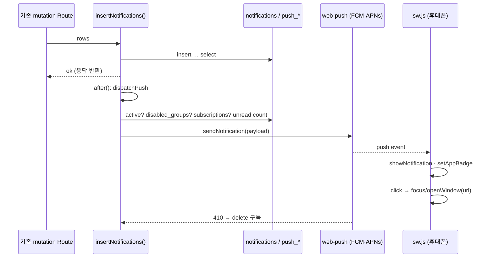

# PWA 설치 + 휴대폰 웹 푸시 알림 기획서

> Date: 2026-10-22
> Status: Completed
> Author: planner
> **SQL 예정:** `90` · `supabase/sql/90_push_subscriptions.sql` (현재 실제 최대 `89`. backend-dev가 `ls supabase/sql`·`list_migrations`로 적용 직전 재확인). **Dev DB만** 적용한다.
> **선행:** [07](./07_auth-route-guard-plan.md), [08](./08_activity-audit-log-plan.md), [14](./14_delete-confirm-dialog-plan.md), [26](./26_loading-spinner-unification-plan.md), [27](./27_in-app-notifications-user-update-plan.md), [37](./37_notifications-read-optimistic-update-plan.md), [43](./43_cs-support-comments-notifications-plan.md), [45](./45_auth-session-audit-log-plan.md), [49](./49_live-users-presence-plan.md), [57](./57_google-auth-approval-migration-plan.md), [78](./78_benefit-notifications-plan.md), [81](./81_kanban-google-tasks-plan.md), [88](./88_workflow-expense-plan.md), [89](./89_quick-workflow-dongbang-openchat-plan.md)
> **후속 영향:** [92](./92_quick-web-only-notifications-plan.md)(퀵 알림 수신자·문구 변경, `notifyQuickRequestEvent` 단일 insert 지점 · type 변화 없음) · [93](./93_quick-request-chat-plan.md)(type `quick_request.chat_message` 추가 → 30 → **31종**) — 구현 순서 92 → 93 → 91
> **Supersedes:** [27](./27_in-app-notifications-user-update-plan.md) Out 목록의 「푸시」 1항목 (이메일·SMS Out은 유지)

## 선행 plan 참조 (Phase 0)

| Plan | Status | 관계 |
|------|--------|------|
| **07** | Completed | 신규 `/api/notifications/push/**` Route는 `requireSession` 인증 필수. 페이지 추가 없음 |
| **08 · 45** | Approved | 구독 등록·해제·설정 변경·테스트 발송 Route의 **전 응답 분기**에 `recordActivityLog`(`jsonWithActivityLog`/`finishWithActivityLog`). 푸시 **발송 자체**는 알림 INSERT의 파생 작업이므로 로그 Out(알림 INSERT 로그 Out 원칙과 동일) |
| **14** | Completed | 이번 plan에 DELETE UI는 「이 기기에서 알림 끄기」(Switch off)뿐이며 되돌릴 수 있으므로 `AlertModal` 대상이 아니다. `window.confirm` 사용 금지는 유지 |
| **26** | Approved | Dialog·섹션 Read 로딩은 `PageLoadingSpinner variant="compact"` |
| **27** | Approved | `notifications` 테이블·30종 type·Realtime·읽음 PATCH·`NOTIFICATION_ACTION_ROUTES` 클릭 이동을 **그대로 재사용**. 27의 Out 「이메일·푸시·SMS」 중 **푸시를 이번 plan이 번복**한다. 인앱 알림 수신자 규칙(`recipient_user_id`)은 변경하지 않는다 |
| **37 · 43 · 78 · 88 · 89** | Approved/In Progress | 알림 type을 추가해 온 plan들. 이들이 만든 INSERT 지점 21곳을 공용 `insertNotifications()`로 모은다(동작 동일). 89가 만든 동방특송 allowlist(`isDongbangAllowedApi`)는 `/api/notifications/**`를 이미 허용하므로 신규 Route는 **추가 수정 없이** 동방특송도 쓸 수 있다 |
| **49** | Approved | 신규 dashboard 페이지 없음. 기존 `dashboard/layout` 상속으로 Presence 추가 작업 없음 |
| **57** | Approved | 계정 비활성화(`DELETE /api/users/[id]`)·pending·rejected 상태는 푸시 수신 대상이 아니다. 비활성화 시 해당 사용자의 구독 전부 삭제 |
| **81** | Approved | `E2E_GOOGLE_TASKS_MOCK` 환경변수 mock 패턴을 `E2E_WEB_PUSH_MOCK`에 재사용 |

**관계:** 기존 알림 도메인의 **전달 채널 확장**(인앱 Realtime → + OS 푸시)이다. 알림 생성·수신자·본문·읽음 처리 의미는 바뀌지 않는다.

---

## 한 줄 요약

WakeOne을 홈 화면에 설치할 수 있는 PWA(manifest + 아이콘 + 서비스 워커)로 만들고, 로그인한 기기가 Web Push(VAPID) 구독을 등록해 두면 `notifications`에 INSERT되는 **30종 알림 전부**가 안드로이드·아이폰 OS 알림으로 도착한다. 사용자는 프로필 페이지와 알림 페이지에서 이 기기의 푸시를 켜고 끄며, 알림 페이지 「휴대폰 알림 설정」에서 **9개 그룹** 단위로 받을 종류를 고른다. 로그아웃하면 그 기기 구독만 삭제되고, 계정이 비활성화되면 모든 기기 구독이 삭제된다.

---

## deep-interview 확정 (2026-10-22)

| # | 항목 | 확정 |
|---|------|------|
| D-1 | 발송 범위 | **30종 전부** 기본 ON. 사용자가 알림 페이지 「휴대폰 알림 설정」 버튼 → Dialog에서 **그룹별** ON/OFF. 저장 단위는 **그룹**(타입 단위 저장 Out) |
| D-2 | 켜기/끄기 위치 | **둘 다** — 프로필 페이지 「휴대폰 알림」 섹션(주 진입점) + 알림 페이지 상단 상태 배너·설정 버튼 |
| D-3 | 아이폰 안내 | iOS Safari(미설치) 접속 시 자동 배너(닫으면 7일 숨김) + 「켜기」·「방법 보기」 클릭 시 3단계 가이드 Dialog |
| D-4 | 안드로이드 설치 | `beforeinstallprompt`가 잡히면 「홈 화면에 추가」 버튼 제공 |
| D-5 | 앱 아이콘 배지 | 예. 페이지가 열려 있을 때는 읽지 않은 개수로 `setAppBadge`, 푸시 수신 시 SW가 payload의 `unreadCount`로 갱신. iOS 16.4+ 설치 시만 동작(제약 고지) |
| D-6 | 기기·해제 | 다기기 허용. 로그아웃 → 그 기기 구독만 삭제. 계정 비활성화 → 전 기기 삭제. 발송 404/410 → 구독 자동 삭제 |
| D-7 | 클릭 이동 | 기존 알림센터 클릭 규칙(`NOTIFICATION_ACTION_ROUTES` + metadata 분기)을 **공용 함수로 추출**해 FE·발송 양쪽이 같은 URL을 쓴다. 규칙 없는 타입은 `/dashboard/notifications` |
| D-8 | 관리자 알림 | 수신자는 `notifications.recipient_user_id` 그대로. 관리자에게 가는 운영 알림도 그 관리자의 기기에 푸시된다. 수신자 규칙 변경 없음 |

### 알림 그룹 (9개 · 30종 매핑)

| group_key | 표시명 | 포함 type | 노출 |
|-----------|--------|-----------|------|
| `profile` | 프로필 변경 | `user.update` | 전원 |
| `users` | 사용자 승인 요청 | `user.approval_request_admin` | **admin만** |
| `contract` | 계약서 | `contract.reminder_admin` `contract.reminder_recipient` `contract.import_admin` `contract.import_author` | 전원 |
| `wallet` | 식대 카드 | `wallet.sync_admin` `wallet.sync_recipient` `wallet.balance_email` `wallet.balance_email_admin` | 전원 |
| `announcement` | 공지사항 | `announcement.published` | 전원 |
| `support` | CS 문의 | `support.created` `support.updated` `support.status_changed` `support.comment_created` `support.reply_created` | 전원 |
| `benefit` | 복지비 | `benefit.import_operations` `benefit.import_applicant` `benefit.document_cancel_operations` `benefit.document_cancel_applicant` `benefit.document_restore_operations` `benefit.document_restore_applicant` | 전원 |
| `workflow` | 전자결재 | `workflow.approval_requested` `workflow.referrer_requested` `workflow.completed` `workflow.declined` `workflow.canceled` `workflow.comment_created` | 전원 |
| `quick_request` | 퀵 요청 | `quick_request.vendor_event` `quick_request.requester_event` | 전원 |

매핑은 `src/features/notifications/lib/push-groups.ts`의 상수 `PUSH_NOTIFICATION_GROUPS`에 둔다. **30종 모두 정확히 한 그룹**에 속해야 하며(타입 유니온 exhaustive check), 앞으로 type을 추가하는 plan은 이 상수에도 그룹을 지정해야 한다(누락 시 tsc 실패).

---

## 목표

- 사이트를 열어 두지 않아도 휴대폰 상단에 WakeOne 알림이 온다(안드로이드 Chrome, 아이폰 홈 화면 설치 Safari).
- 사용자는 어느 기기에서 알림을 받을지, 어떤 그룹을 받을지 스스로 정한다.
- 알림 생성 코드는 1곳(`insertNotifications`)만 거치므로, 앞으로 추가되는 알림도 자동으로 푸시된다.
- 로그아웃·비활성화·만료된 기기에는 알림이 가지 않는다.
- 서버 키가 없거나 브라우저가 지원하지 않을 때 사용자는 이유를 한국어로 안내받는다.

---

## 완료 기준 (AC)

실제 OS 알림 수신은 헤드리스 Playwright로 검증할 수 없다. 아래 AC는 **구독·설정 API, 발송 파이프라인(mock 전송기), manifest·SW·배너·Dialog·배지 호출**로 판정하고, 실제 기기 수신은 「수동 QA」 표로 분리한다. 모든 UI 문구는 한국어다.

E2E 실행 전제: `.env`에 `NEXT_PUBLIC_VAPID_PUBLIC_KEY`·`VAPID_PRIVATE_KEY`·`VAPID_SUBJECT`가 있고 `E2E_WEB_PUSH_MOCK=1`이다. mock 전송기는 endpoint가 `https://e2e.invalid/push/ok/…`면 성공, `https://e2e.invalid/push/410/…`면 410(만료)으로 처리한다.

| # | 검증 | Given | When | Then |
|---|------|-------|------|------|
| AC-01 | API | 비로그인 | `GET /manifest.webmanifest` | **200** · `name` 「WakeOne」· `short_name` 「WakeOne」· `display` `standalone` · `start_url` `/dashboard` · `icons`에 192·512(`purpose` any)와 512 maskable이 있고 각 `src`를 GET하면 **200** `image/png` |
| AC-02 | API | 비로그인 | `GET /sw.js` | **200** · `content-type`에 `javascript` · 본문에 `addEventListener('push'`·`addEventListener('notificationclick'` 포함 · `Service-Worker-Allowed` 불필요(루트 경로) |
| AC-03 | Playwright | `user.json` | `/dashboard/overview` HTML | `<link rel="manifest">`·`<meta name="apple-mobile-web-app-capable" content="yes">`·`<link rel="apple-touch-icon">`가 있다. `navigator.serviceWorker.getRegistration('/')`가 resolve되고 `scope`가 origin + `/` |
| AC-04 | Playwright | `user.json` | `/dashboard/profile` | 섹션 제목 **「휴대폰 알림」** · Switch(`data-testid="push-toggle"`) · 버튼 **「알림 종류 설정」** · 「등록된 기기 0대」. 헤드리스에서는 상태 문구가 「이 브라우저에서는 알림을 켤 수 없어요」 또는 「알림이 꺼져 있어요」 중 하나(둘 다 통과). `admin.json`으로도 같은 섹션이 보인다 |
| AC-05 | API · 로그 | `user.json` | `POST /api/notifications/push/subscriptions` `{endpoint:"https://e2e.invalid/push/ok/{uuid}", keys:{p256dh, auth}, userAgent}` | **201** `{success:true, data:{id, device_count:1}}` · 같은 endpoint 재전송 → **200** `device_count` 불변(멱등) · `keys` 누락 → **400** 「구독 정보가 올바르지 않습니다.」 · 비로그인 → **401** · 모든 응답에 `x-request-id` · `activity_logs`에 `push_subscription.create` 행(201·200·400 각각) |
| AC-06 | API · 로그 | AC-05 구독 존재 | `DELETE /api/notifications/push/subscriptions` `{endpoint}` | **200** `device_count:0` · 같은 요청 재전송 → **404** 「등록된 기기를 찾을 수 없습니다.」 · 타인(`admin.json`)이 user의 endpoint로 DELETE → **404**(소유자 범위 조회) · `push_subscription.delete` 로그 |
| AC-07 | API · 로그 | `user.json` | `GET /api/notifications/push/preferences` → `PUT` `{disabled_groups:["announcement"]}` → `GET` → `PUT {disabled_groups:["nope"]}` | GET **200** `{disabled_groups:[], device_count, devices:[], configured:true, groups:[…8개(user)]}` · PUT **200** · 다음 GET에 `["announcement"]` · 잘못된 그룹 **400** 「알림 종류가 올바르지 않습니다.」 · `push_preference.update` 로그 metadata `{disabled_groups:[…]}` · `admin.json` GET의 `groups`는 **9개**(`users` 포함) |
| AC-08 | Playwright | `user.json` · `/dashboard/notifications` | 툴바 버튼 **「휴대폰 알림 설정」** 클릭 | Dialog 제목 「휴대폰 알림 설정」 · 그룹 Switch **8개**(「사용자 승인 요청」 없음) · 「공지사항」 OFF → toast **「알림 설정을 저장했습니다.」** · 새로고침 후 다시 열면 OFF 유지 · `admin.json`은 Switch **9개** · admin이 `?notif_user={B}`로 타인 알림을 볼 때는 버튼이 **보이지 않는다** |
| AC-09 | Playwright | `user.json` · 이 브라우저에 구독 없음 | `/dashboard/notifications` 상단 | 배너(`data-testid="push-status-banner"`) 문구 **「휴대폰 알림을 켜면 사이트를 열지 않아도 알림을 받을 수 있어요」** + 링크 **「켜기」** → `/dashboard/profile#push`로 이동하고 「휴대폰 알림」 섹션이 보인다 |
| AC-10 | Playwright | `user.json` · iPhone UA(`devices['iPhone 14']`의 userAgent·viewport, chromium) · 미설치 | `/dashboard/overview` | 배너(`data-testid="ios-install-banner"`) **「홈 화면에 추가하면 알림을 받을 수 있어요」** · 「방법 보기」 → Dialog 「아이폰에서 알림 받기」에 3단계(공유 버튼 → 「홈 화면에 추가」 → 홈 화면 아이콘으로 열고 알림 켜기) · 「닫기」 → 배너 사라짐 · 새로고침 후에도 없음(localStorage 7일) · Desktop Chrome UA에서는 배너 **없음** |
| AC-11 | API | `user.json` · 구독 없음 | `POST /api/notifications/push/test` | **409** 「등록된 기기가 없습니다. 먼저 알림을 켜 주세요.」 · `push.test_send` 로그 409 |
| AC-12 | API | `user.json` · `ok` endpoint 1개 + `410` endpoint 1개 등록 | `POST /api/notifications/push/test` | **200** `{attempted:2, sent:1, removed:1}` · 이어서 GET preferences `device_count:1` · 남은 기기의 `last_used_at`이 null이 아님 · `push.test_send` 로그 200 metadata `{attempted, sent, removed}` |
| AC-13 | API | user B(`user.json`)에 `ok` 구독 1개 · B의 `disabled_groups:[]` | admin이 `PUT /api/users/{B}`로 B의 이름 변경(plan 27 AC-1 경로) 후 1초 내 B `GET preferences` | B 구독의 `last_used_at`이 갱신됨(발송 1회) · 인앱 알림 「프로필 정보가 변경되었습니다」도 생성(27 회귀) |
| AC-14 | API | AC-13 상태 · B `PUT preferences {disabled_groups:["profile"]}` | admin이 B 이름 재변경 | B 구독 `last_used_at` **불변**(그룹 OFF → 발송 스킵) · 인앱 알림은 **생성됨**(설정은 푸시만 막는다) |
| AC-15 | API · DB | user B에 구독 2개 | admin `DELETE /api/users/{B}`(비활성화) → dev DB(MCP) `select count(*) from push_subscriptions where user_id={B}` | **0** · `user.deactivate` 로그는 기존과 동일(action 변경 없음) · 재활성화 후 구독은 복구되지 않는다(사용자가 다시 켠다) |
| AC-16 | Playwright | `user.json` · `addInitScript`로 `navigator.setAppBadge`·`clearAppBadge`를 stub | 읽지 않은 알림 n≥1 상태로 `/dashboard/overview` 진입 → 「모두 읽음」 | `setAppBadge(n)`이 1회 이상 호출 · 모두 읽음 후 `clearAppBadge()` 호출 |
| AC-17 | grep | 구현 완료 | `grep -rn "from('notifications').insert" src` | **`src/features/notifications/api/insert.server.ts` 1파일만** 매치 · `src/features/notifications/**`·`src/app/api/notifications/push/**`·`public/sw.js`에 `window.confirm`·`confirm(`·`window.alert` **0건** · `features/auth/api/service.ts`의 `signOut()`이 `unsubscribePushOnThisDevice`를 **먼저** 호출 |
| AC-18 | Playwright · 로그 | `user.json` | AC-05 실행 후 `/dashboard/logs` | 최신 행에 액션 **「휴대폰 알림 기기 등록」** · Status 2xx · 행 확장 시 `request_id` |
| AC-19 | API | `dongbang.json` | `GET /api/notifications/push/preferences` | **200**(proxy 403 아님) — 89 allowlist 확인 |
| AC-20 | API | VAPID env 3개를 비운 상태(별도 spec, `E2E_WEB_PUSH_UNCONFIGURED=1`로 서버가 미설정으로 판단) | `GET preferences` · `POST subscriptions` | GET `configured:false` · POST **503** 「휴대폰 알림 서버 설정이 아직 준비되지 않았습니다.」 · 프로필 섹션 문구 「휴대폰 알림 서버 설정이 아직 준비되지 않았습니다. 관리자에게 문의해 주세요.」 **[INFERRED: env 토글 spec은 verifier가 별도 project로 분리 가능. 어려우면 수동 QA로 이관]** |
| AC-21 | CLI | — | `npx playwright test e2e/push-notifications/` · `npx tsc --noEmit` · `npm run lint:strict` · `npm run build` | 모두 통과 |

**회귀:** plan 27 AC-1·4·5(인앱 알림 생성·클릭·읽음) · plan 88 AC-19·20(워크플로우 알림) · plan 89 AC-16·20·23(퀵 알림) · plan 78 복지비 알림 — `insertNotifications` 리팩터 후 기존 `e2e/notifications/`·`e2e/workflow/`·`e2e/quick-workflow/`·`e2e/benefits/` 알림 spec이 green.

### 수동 QA (실기기 · verifier 자동 판정 대상 아님)

| # | 기기 | 절차 | 기대 |
|---|------|------|------|
| M-1 | 안드로이드 Chrome | 로그인 → 프로필 「휴대폰 알림」 Switch ON → 권한 허용 → 「테스트 알림 보내기」 | 상단 알림 「WakeOne 테스트 알림」 · 탭하면 `/dashboard/notifications` 열림 |
| M-2 | 안드로이드 | 「홈 화면에 추가」 → 아이콘으로 실행 | standalone 실행 · 아이콘·이름 「WakeOne」 |
| M-3 | 아이폰 Safari | 로그인 → 배너 「방법 보기」 → 공유 → 홈 화면에 추가 → 아이콘으로 열기 → Switch ON → 권한 허용 → 테스트 | 알림 도착 · iOS 16.4+ 아이콘 배지 숫자 |
| M-4 | 둘 다 | 다른 사람(admin)이 내 프로필 변경 / 공지 발행 | 사이트를 닫은 상태에서 알림 도착 · 탭하면 해당 화면(프로필·공지) |
| M-5 | 둘 다 | 「휴대폰 알림 설정」에서 「공지사항」 OFF → 공지 발행 | 푸시 없음 · 인앱 알림은 있음 |
| M-6 | 둘 다 | 로그아웃 → 다른 사람이 공지 발행 | 그 기기에 알림 없음 · 다른 기기(로그인 유지)에는 도착 |
| M-7 | 둘 다 | 브라우저에서 알림 권한 「차단」 후 프로필 | 문구 「알림이 차단되어 있어요. 브라우저 설정에서 WakeOne 알림을 허용해 주세요.」 · Switch 비활성 |
| M-8 | 안드로이드 | 앱이 열려 있을 때 알림 수신 | 인앱 Realtime 갱신 + OS 알림 둘 다(중복 억제 Out — 열린 탭에서도 OS 알림 허용) |

---

## 범위 (In / Out)

### In

1. **PWA 셸**: `src/app/manifest.ts`(Next `MetadataRoute.Manifest`), `public/icons/` 아이콘 5종(192·512·512 maskable·apple-touch 180·badge 72 단색), `siteMetadata.appleWebApp`·`icons` 확장, `public/sw.js`(push·notificationclick·배지), SW 등록 클라이언트 컴포넌트(루트 layout)
2. **DB SQL 90**: `push_subscriptions`, `push_notification_preferences`, RLS(SELECT 본인), 쓰기는 service_role만
3. **API 4 Route**(`/api/notifications/push/**`): 구독 등록(POST)·해제(DELETE)·설정 조회/변경(GET/PUT)·테스트 발송(POST). 전 분기 activity log
4. **발송 파이프라인**: `insertNotifications()` 공용 함수로 INSERT 21곳 리팩터 → `after()`에서 `dispatchPush()`(active 수신자 · 그룹 설정 · 구독 · web-push 전송 · 404/410 삭제 · `last_used_at`) · `E2E_WEB_PUSH_MOCK` 전송기 · 미설정(`configured:false`) 스킵
5. **클릭 URL 공용화**: `src/features/notifications/lib/notification-route.ts` `resolveNotificationRoute(notification)` — `notification-infinite-list.tsx`와 `dispatchPush` 둘이 사용
6. **FE 프로필**: `PushNotificationSettingsSection`(user·admin 공용) — 상태 문구·Switch·「홈 화면에 추가」·「테스트 알림 보내기」·「알림 종류 설정」·등록 기기 목록(N대, 기기명·마지막 발송 절대 시각)
7. **FE 알림 페이지**: `PushStatusBanner` + 툴바 「휴대폰 알림 설정」 → `PushPreferencesDialog`(그룹 Switch · 즉시 mutate)
8. **FE iOS**: `IosInstallBanner`(dashboard layout · 7일 dismiss) + `IosInstallGuideDialog`
9. **FE 배지**: `AppBadgeSync`(dashboard layout · unread count → `setAppBadge`/`clearAppBadge`)
10. **로그아웃·비활성화 연동**: `signOut()`에 `unsubscribePushOnThisDevice()` 선행 · `DELETE /api/users/[id]`에 구독 purge
11. **env**: `NEXT_PUBLIC_VAPID_PUBLIC_KEY` · `VAPID_PRIVATE_KEY` · `VAPID_SUBJECT` · `E2E_WEB_PUSH_MOCK` — `env.example.txt` 갱신, 키 생성 명령 주석
12. **활동 로그** 4 action + 라벨
13. **E2E** `e2e/push-notifications/**` + `playwright.config.ts` project 추가 + mock helper

### Out

| 항목 | 비고 |
|------|------|
| SMS · 이메일 발송 | 사용자 확정 Out |
| 타입(30종) 단위 저장·UI | 그룹 단위로 확정. 후속 가능 |
| 푸시 클릭 시 자동 읽음 처리 | SW에서 PATCH 호출 Out. 앱에서 보면 기존 규칙대로 읽음 |
| 열린 탭이 있을 때 OS 알림 억제 | Out (M-8) |
| 오프라인 캐시·precache·업데이트 프롬프트 | SW는 push 전용. `fetch` 핸들러 없음 |
| 알림 소리·진동 커스터마이즈·액션 버튼 | OS 기본 |
| 관리자가 타인의 푸시 설정·기기 조회/삭제 | 본인만 |
| 운영(Main) DB 적용 · Vercel env 등록 | 사용자 수동. plan은 Dev만 |
| DB webhook(pg_net) 기반 발송 | D-1에서 코드 훅으로 확정. 로컬 dev URL 미노출·E2E 불가가 이유. 후속 옵션으로만 기록 |
| `notifications` 테이블 스키마·Realtime 변경 | 없음 |
| 알림 INSERT 자체의 activity log | 기존 원칙대로 Out |

---

## 영향 파일 & 패턴 (정찰 · 실제 파일)

### 신규

| 파일 | 내용 |
|------|------|
| `supabase/sql/90_push_subscriptions.sql` | 아래 §DB |
| `src/app/manifest.ts` | manifest |
| `public/icons/icon-192.png` · `icon-512.png` · `icon-512-maskable.png` · `apple-touch-icon-180.png` · `badge-72.png` | designer 산출(원본: `public/assets/favicon.ico`·브랜드 로고 **[TBD: 벡터 원본 위치 — 없으면 designer가 WakeOne 워드마크로 제작]**) |
| `public/sw.js` | push → `showNotification` · notificationclick → 열린 탭 focus+navigate 또는 `openWindow` · `setAppBadge(unreadCount)` |
| `src/components/pwa/service-worker-registrar.tsx` | `'use client'` · `navigator.serviceWorker.register('/sw.js', {scope:'/'})` · 루트 layout |
| `src/features/notifications/api/insert.server.ts` | `insertNotifications(rows)`: service_role insert `.select(...)` → `after(() => dispatchPush(inserted))` |
| `src/features/notifications/api/push-dispatch.server.ts` | `dispatchPush(inserted)`: 수신자별 active 확인 → `disabled_groups` → 구독 → payload → 전송 → 410 삭제 → `last_used_at` |
| `src/features/notifications/api/push-sender.server.ts` | `web-push` 래퍼 + `E2E_WEB_PUSH_MOCK` mock 전송기 + `isPushConfigured()` |
| `src/features/notifications/api/push-subscriptions.server.ts` | upsert/delete/list/purgeByUser · preferences get/upsert |
| `src/features/notifications/api/push-types.ts` · `push-service.ts` · `push-queries.ts` · `push-mutations.ts` | FE 계약·fetch·React Query(`pushKeys`)·mutationOptions(`onSettled` invalidate) |
| `src/features/notifications/lib/push-groups.ts` | `PUSH_NOTIFICATION_GROUPS` · `groupOfType(type)` exhaustive |
| `src/features/notifications/lib/notification-route.ts` | `resolveNotificationRoute(n)` (D-7) |
| `src/features/notifications/lib/push-client.ts` | `'use client'` 유틸: 지원 여부·권한 상태·iOS/standalone 감지·`subscribeThisDevice()`·`unsubscribePushOnThisDevice()`·`urlBase64ToUint8Array` |
| `src/features/notifications/components/push-notification-settings-section.tsx` | 프로필 섹션 |
| `src/features/notifications/components/push-preferences-dialog.tsx` | 그룹 Switch Dialog |
| `src/features/notifications/components/push-status-banner.tsx` | 알림 페이지 상단 배너 |
| `src/features/notifications/components/ios-install-banner.tsx` · `ios-install-guide-dialog.tsx` | iOS 안내 |
| `src/features/notifications/components/app-badge-sync.tsx` | 배지 |
| `src/app/api/notifications/push/subscriptions/route.ts` | POST · DELETE |
| `src/app/api/notifications/push/preferences/route.ts` | GET · PUT |
| `src/app/api/notifications/push/test/route.ts` | POST |
| `e2e/push-notifications/*.spec.ts` · `e2e/helpers/push-mock.ts` | AC |

### 수정

| 파일 | 변경 |
|------|------|
| `src/features/notifications/api/fan-out.server.ts` (insert 18곳) · `src/features/workflow/api/notifications.server.ts` (1) · `src/features/quick-request/api/notifications.server.ts` (2) | `supabase.from('notifications').insert(...)` → `insertNotifications(rows)`. 반환·에러 처리 의미 유지(throw하던 곳은 throw, console.error하던 곳은 그대로) |
| `src/features/notifications/components/notification-infinite-list.tsx` | 클릭 URL 계산을 `resolveNotificationRoute`로 교체(동작 동일) |
| `src/features/notifications/components/notifications-page.tsx` | 툴바 「휴대폰 알림 설정」 버튼(본인 조회 시만) + `PushStatusBanner` |
| `src/features/auth/components/profile-page-content.tsx` · `profile-admin-page-content.tsx` | `<section id="push">` 「휴대폰 알림」 추가(Separator 뒤) |
| `src/features/auth/api/service.ts` | `signOut()` 첫 줄에 `await unsubscribePushOnThisDevice()`(try/catch · 2초 timeout) |
| `src/app/api/users/[id]/route.ts` (DELETE) | 비활성화 성공 경로에서 `purgePushSubscriptionsByUser(id)` (실패해도 응답 불변) |
| `src/app/layout.tsx` | `<ServiceWorkerRegistrar />` · `metadata`에 `manifest`·`appleWebApp`·`icons` (`src/lib/site-metadata.ts` 확장) |
| `src/app/dashboard/layout.tsx` | `<IosInstallBanner />` · `<AppBadgeSync />` (`NotificationsRealtime` 옆) |
| `src/features/activity-logs/api/types.ts` · `labels.ts` | 4 action + 라벨 |
| `env.example.txt` | VAPID 3종 · `E2E_WEB_PUSH_MOCK` |
| `package.json` | `web-push` + `@types/web-push` (dev) |
| `playwright.config.ts` | `chromium-push` project(user.json) + iPhone UA spec |
| `docs/plans/README.md` · `docs/plans/27_*.md` 수정 이력 | 91 등록 · 27 Out 번복 기록 |

### 따라야 할 패턴

- Route: `createRequestId` → `requireSession` → 실패 `finishWithActivityLog` / 성공·에러 `jsonWithActivityLog` (`src/app/api/notifications/read-all/route.ts` 그대로)
- FE CUD: `push-mutations.ts` `mutationOptions` + `onSettled` invalidate(`pushKeys.all`) → 컴포넌트는 `useMutation` + 토스트만
- Read: `useSuspenseQuery(pushPreferencesQueryOptions())` · Dialog 로딩 `PageLoadingSpinner variant="compact"`
- 날짜: 기기 목록 「마지막 발송」은 `formatAbsoluteDateTimeKo`
- 아이콘: `Icons.*`만 (`Icons.notification`·`Icons.download` 존재. 필요 시 `icons.tsx`에 `smartphone`·`share` 추가)
- 동방특송: 신규 Route 경로가 `/api/notifications/` 하위 → `isDongbangAllowedApi` 수정 불필요(AC-19)

---

## DB (`supabase/sql/90_push_subscriptions.sql`)

```sql
-- Plan: 91_pwa-web-push-notifications-plan.md
-- Date: 2026-10-22
-- Status: Approved
-- Summary: push_subscriptions(기기별 Web Push 구독) · push_notification_preferences(사용자별 끈 그룹)
--          쓰기는 service_role(Route Handler)만 · Realtime publication 추가 없음

create table public.push_subscriptions (
  id bigint generated always as identity primary key,
  user_id uuid not null references auth.users(id) on delete cascade,
  endpoint text not null unique,
  p256dh text not null,
  auth text not null,
  user_agent text,
  created_at timestamptz not null default now(),
  last_used_at timestamptz
);
comment on table public.push_subscriptions is 'Web Push 구독 (기기 1대 = 1행). endpoint는 비밀값에 준함 — 로그·metadata에 전체 저장 금지';
create index idx_push_subscriptions_user on public.push_subscriptions (user_id);

create table public.push_notification_preferences (
  user_id uuid primary key references auth.users(id) on delete cascade,
  disabled_groups text[] not null default '{}',
  updated_at timestamptz not null default now(),
  constraint push_notification_preferences_groups_check check (
    disabled_groups <@ array[
      'profile','users','contract','wallet','announcement',
      'support','benefit','workflow','quick_request'
    ]::text[]
  )
);
comment on table public.push_notification_preferences is '푸시 그룹 설정. 행 없음 = 전부 ON';

alter table public.push_subscriptions enable row level security;
alter table public.push_notification_preferences enable row level security;

create policy push_subscriptions_select_own on public.push_subscriptions
  for select to authenticated using (user_id = auth.uid());
create policy push_notification_preferences_select_own on public.push_notification_preferences
  for select to authenticated using (user_id = auth.uid());

revoke insert, update, delete on public.push_subscriptions from authenticated, anon;
revoke insert, update, delete on public.push_notification_preferences from authenticated, anon;
```

- `endpoint unique`: 같은 기기가 다시 등록하면 **upsert**(user_id 갱신 — 같은 기기에서 다른 계정으로 로그인한 경우 이전 계정 구독이 자연히 넘어감).
- 그룹 CHECK는 `push-groups.ts`와 **동일 목록**. 그룹 추가 plan은 SQL과 상수를 함께 바꾼다.
- 비활성화 purge는 Route 코드에서 service_role delete(trigger 없음 — 로그·순서 제어를 코드에 둠).

---

## API

공통: `requireSession`(active만) · 응답 `{success, data|message}` · 전 분기 `recordActivityLog` · `x-request-id`.

| Route | 입력 | 동작 | 응답 |
|-------|------|------|------|
| `POST /api/notifications/push/subscriptions` | `{endpoint, keys:{p256dh, auth}, userAgent?}` (Zod: endpoint `https:` URL, 키 base64url) | `configured` 아니면 503. endpoint 기준 upsert(user_id=세션). 신규면 201, 기존이면 200 | `{id, device_count}` · 400 · 401 · 503 · 500 |
| `DELETE /api/notifications/push/subscriptions` | `{endpoint}` | `user_id=세션 AND endpoint` 삭제. 0행이면 404 | `{device_count}` · 400 · 401 · 404 · 500 |
| `GET /api/notifications/push/preferences` | — | 설정 + 기기 목록 + 그룹 카탈로그(역할 필터) + `configured` | `{configured, disabled_groups, device_count, devices:[{id, user_agent, created_at, last_used_at}], groups:[{key, label, description, admin_only}]}` · 401 · 500 |
| `PUT /api/notifications/push/preferences` | `{disabled_groups: string[]}` (Zod enum 9종, 중복 제거) | upsert | `{disabled_groups}` · 400 · 401 · 500 |
| `POST /api/notifications/push/test` | — | 본인 구독 전부에 테스트 payload(제목 「WakeOne 테스트 알림」, 본문 「휴대폰 알림이 정상적으로 연결되었어요.」, url `/dashboard/notifications`) 발송. 구독 0 → 409. 미설정 → 503 | `{attempted, sent, removed}` · 401 · 409 · 503 · 500 |

### 발송 파이프라인 (`insert.server.ts` → `push-dispatch.server.ts`)

```
insertNotifications(rows)
  ├ service_role .from('notifications').insert(rows).select('id, recipient_user_id, type, title, body, metadata')
  ├ error → 호출부 의미 유지(throw 또는 반환)
  └ after(() => dispatchPush(inserted))        // next/server after — 응답 뒤 실행, 실패해도 응답 불변

dispatchPush(inserted)
  1. isPushConfigured() false → return
  2. recipientIds = unique(inserted.recipient_user_id)
  3. profiles: status='active'인 수신자만 (비활성·pending·rejected 제외)
  4. preferences: disabled_groups 조회 → groupOfType(type) ∈ disabled → 해당 알림 스킵
  5. subscriptions: 수신자별 push_subscriptions
  6. unreadCount: 수신자별 notifications status='unread' count (1 query / 수신자)
  7. payload = { notificationId, title, body, url: resolveNotificationRoute(n), tag: `wakeone-${id}`, unreadCount }
  8. sendPush(sub, payload, { TTL: 86400 })  — 병렬(Promise.allSettled)
  9. 404/410 → delete 구독 · 성공 → last_used_at=now()
 10. 그 밖의 오류 → console.error (재시도 Out)
```

- `web-push` `setVapidDetails(VAPID_SUBJECT, NEXT_PUBLIC_VAPID_PUBLIC_KEY, VAPID_PRIVATE_KEY)`.
- `E2E_WEB_PUSH_MOCK=1`: 전송기가 네트워크 없이 endpoint 패턴으로 결과를 정한다(`/push/ok/` 성공 · `/push/410/` 410).
- `after()`가 실행되지 않는 런타임 fallback **[INFERRED]**: `after` import 실패 시 `void dispatchPush()`로 fire-and-forget. backend-dev가 로컬 `npm run dev`와 `npm run build && npm start` 양쪽에서 AC-13을 확인한다.

### env

```
# 휴대폰 웹 푸시 (plan 91) — 세 값이 모두 있어야 「연결됨」, 없으면 configured:false (토글 비활성·발송 스킵)
# 키 생성: npx web-push generate-vapid-keys
NEXT_PUBLIC_VAPID_PUBLIC_KEY=
VAPID_PRIVATE_KEY=
VAPID_SUBJECT=mailto:admin@wakecorp.com
# 1 = E2E mock 전송기 (실제 발송 없음)
# E2E_WEB_PUSH_MOCK=1
```

`VAPID_PRIVATE_KEY`는 서버 전용. `NEXT_PUBLIC_` 접두사 금지. 운영 Vercel 등록은 사용자 수동(Out).

---

## 활동 감사 로그 (CUD In · 필수)

> `core-conventions.mdc` §활동 감사 로그 · [plan 08](./08_activity-audit-log-plan.md)

### 기록 연동

| Route | action | 라벨 | target | return 분기 | metadata allowlist |
|-------|--------|------|--------|-------------|--------------------|
| `POST /api/notifications/push/subscriptions` | `push_subscription.create` | 휴대폰 알림 기기 등록 | `user` · 본인 | 401 · 400 · 503 · 201 · 200 · 500 | `{created: boolean, device_count, endpoint_host}` (endpoint 전체·키 **금지**) |
| `DELETE /api/notifications/push/subscriptions` | `push_subscription.delete` | 휴대폰 알림 기기 해제 | `user` · 본인 | 401 · 400 · 404 · 200 · 500 | `{device_count, endpoint_host}` |
| `PUT /api/notifications/push/preferences` | `push_preference.update` | 휴대폰 알림 설정 변경 | `user` · 본인 | 401 · 400 · 200 · 500 | `{disabled_groups}` |
| `POST /api/notifications/push/test` | `push.test_send` | 휴대폰 알림 테스트 발송 | `user` · 본인 | 401 · 409 · 503 · 200 · 500 | `{attempted, sent, removed}` |

- `GET /api/notifications/push/preferences` · `/manifest.webmanifest` · `/sw.js`: READ → Out.
- `DELETE /api/users/[id]` 비활성화의 구독 purge: 기존 `user.deactivate` 로그 **변경 없음**(파생 작업).
- 알림 INSERT·푸시 발송: Out(기존 원칙).
- 로그아웃 시 구독 삭제는 `DELETE …/subscriptions` Route를 거치므로 `push_subscription.delete`로 **기록된다**(로그아웃 자체는 Out).
- `ActivityAction` 4개 추가 · `ACTION_LABELS` 위 라벨.
- 삭제 확인 Dialog: 되돌릴 수 있는 토글이므로 `AlertModal` 없음. `window.confirm` 0건(AC-17).

---

## UI 요구사항 (designer · frontend-dev)

### 상태 모델 (`push-client.ts` · 클라이언트 전용)

| 상태 | 판정 | 프로필 섹션 문구 | Switch |
|------|------|------------------|--------|
| `unsupported` | `!('serviceWorker' in navigator) \|\| !('PushManager' in window)` | 「이 브라우저에서는 알림을 켤 수 없어요」 (+ iOS면 「홈 화면에 추가한 뒤 그 아이콘으로 열어 주세요」 + 「방법 보기」) | 비활성 |
| `not_configured` | GET `configured:false` | 「휴대폰 알림 서버 설정이 아직 준비되지 않았습니다. 관리자에게 문의해 주세요.」 | 비활성 |
| `denied` | `Notification.permission === 'denied'` | 「알림이 차단되어 있어요. 브라우저 설정에서 WakeOne 알림을 허용해 주세요.」 | 비활성 |
| `off` | 구독 없음(`pushManager.getSubscription()` null) | 「알림이 꺼져 있어요」 | OFF |
| `on` | 구독 있음 + 서버 기기 목록에 endpoint 존재 | 「이 기기에서 알림이 켜져 있어요」 | ON |

Switch ON: `Notification.requestPermission()` → `subscribe({userVisibleOnly:true, applicationServerKey})` → `POST subscriptions` → toast 「휴대폰 알림을 켰어요.」. OFF: `DELETE subscriptions` → `subscription.unsubscribe()` → toast 「이 기기의 휴대폰 알림을 꺼요.」. 실패 시 `notifyError` + 상태 되돌림.

### 프로필 「휴대폰 알림」 섹션 (`<section id="push">`)

- 제목 「휴대폰 알림」 · 설명 「사이트를 열지 않아도 휴대폰 상단에 알림을 받습니다.」
- 상태 문구 1줄 + Switch(`data-testid="push-toggle"`) 라벨 「이 기기에서 휴대폰 알림 받기」
- 버튼 행: 「홈 화면에 추가」(Android `beforeinstallprompt` 잡힌 경우만 / iOS 미설치는 가이드 Dialog · standalone이면 숨김) · 「테스트 알림 보내기」(`on`일 때만) · 「알림 종류 설정」(→ `PushPreferencesDialog`)
- 「등록된 기기 N대」 목록: 기기명(UA 요약: 「Android · Chrome」「iPhone · Safari」) · 마지막 발송 `formatAbsoluteDateTimeKo` 또는 「—」 · 이 기기 표시
- 로딩: `PageLoadingSpinner variant="compact"` · user·admin 컴포넌트 둘 다 동일 섹션

### 알림 페이지

- 상단 `PushStatusBanner`(툴바 위, 본인 조회 시만): `on` → 「휴대폰 알림이 켜져 있어요 · 프로필에서 관리」(링크) · `off`/`unsupported`(iOS 미설치 포함) → 「휴대폰 알림을 켜면 사이트를 열지 않아도 알림을 받을 수 있어요」 + 「켜기」(→ `/dashboard/profile#push`) · `denied`·`not_configured` → 해당 문구. 닫기 없음(상태 표시)
- 툴바 「모두 읽음」 옆 **「휴대폰 알림 설정」** 버튼(본인 조회 시만) → `PushPreferencesDialog`
- `PushPreferencesDialog`: 제목 「휴대폰 알림 설정」 · 설명 「끈 종류는 휴대폰 알림만 오지 않고, 앱 안 알림은 그대로 보여요.」 · 그룹별 행(라벨·한 줄 설명·Switch) · admin-only 그룹은 admin에게만 · 토글 즉시 `PUT`(mutate) · 성공 toast 「알림 설정을 저장했습니다.」 · 실패 시 롤백 + `notifyError`

### iOS

- `IosInstallBanner`(dashboard layout): 조건 iOS(iPhone/iPad UA) AND `!navigator.standalone` AND dismiss 기록 7일 경과. 문구 「홈 화면에 추가하면 알림을 받을 수 있어요」 · 「방법 보기」 · 「닫기」(localStorage `wakeone.push.ios-banner-dismissed-at`, try/catch)
- `IosInstallGuideDialog`: 제목 「아이폰에서 알림 받기」 · 3단계(① Safari 하단 공유 버튼 ② 「홈 화면에 추가」 ③ 홈 화면의 WakeOne 아이콘으로 열고 프로필 → 휴대폰 알림 켜기) · 참고 「iOS 16.4 이상에서 지원됩니다.」

### SW 알림 표시

- `showNotification(title, { body, icon:'/icons/icon-192.png', badge:'/icons/badge-72.png', tag, data:{url, notificationId}, renotify:false })`
- click: `clients.matchAll({type:'window', includeUncontrolled:true})` → 같은 origin 창이 있으면 `focus()` + `navigate(url)`, 없으면 `openWindow(url)`
- `unreadCount`가 있으면 `registration.setAppBadge(n)` (지원 시)

### 아이콘 (designer)

- `icon-192.png` · `icon-512.png`(any) · `icon-512-maskable.png`(safe zone 80%) · `apple-touch-icon-180.png`(불투명 배경) · `badge-72.png`(단색 흰 실루엣, 투명 배경)
- 테마 색: `META_THEME_COLORS.light`를 `theme_color`·`background_color`로

---

## 리스크 & 완화 (pre-mortem)

| 등급 | 리스크 | 완화 |
|------|--------|------|
| HIGH | INSERT 지점 누락으로 일부 알림만 푸시 | 공용 `insertNotifications` + AC-17 grep. 신규 plan은 이 함수만 사용 |
| HIGH | iOS는 설치 전엔 `PushManager`가 없어 사용자가 「안 됨」으로 오해 | 자동 배너·가이드·상태 문구(unsupported+iOS 분기) · M-3 |
| HIGH | VAPID 미설정 배포 → 토글이 조용히 실패 | `configured:false` 노출 · 503 · 발송 스킵 · AC-20 |
| MED | 만료 구독 누적·발송 지연 | 404/410 즉시 삭제 · `Promise.allSettled` 병렬 · TTL 1일 |
| MED | `after()`가 런타임에 따라 실행 안 됨 | dev·build 양쪽 AC-13 확인 · fallback fire-and-forget · 응답 불변 |
| MED | 로그아웃 순서(세션 먼저 끊기면 DELETE 401) | `signOut()` 내부에서 DELETE → `unsubscribe()` → `auth.signOut()` 순서 고정 · 2초 timeout · 실패해도 로그아웃 진행 |
| MED | plan 88·89와 같은 파일(`fan-out.server.ts`·`labels.ts`·`types.ts`) 병행 수정 충돌 | append만 · 리팩터는 호출부 1:1 치환 · 기존 알림 spec 회귀 실행 |
| LOW | 헤드리스 Chromium에서 실제 `subscribe` 불가 | 구독 상태 UI는 수동 QA(M-1·3) · API·mock으로 파이프라인 판정 |
| LOW | endpoint가 로그에 남아 유출 | metadata는 `endpoint_host`만 · SQL comment에 금지 명시 |

---

## 추정

| 항목 | 값 |
|------|-----|
| 복잡도 | **Complex** |
| 파일 | 신규 ~24 · 수정 ~14 |
| 예상 | **~6–9시간** |
| Checkpoint | SQL 90 + `insertNotifications` 리팩터(기존 알림 spec green) + `POST subscriptions` + mock `test` 200 — 이 지점에서 verifier가 AC-05·11·12·13을 먼저 돌린다 |

---

## Battle Plan (Phase 2 · 요약)

```
SCOPE
  Goal: 설치형 WakeOne에서 30종 알림을 OS 푸시로 받고, 그룹별·기기별로 켜고 끈다.
  Done when: AC-01~21 green + 수동 QA 표 전달.
  Not doing: SMS·이메일·타입 단위 설정·클릭 자동 읽음·오프라인 캐시·운영 DB.

STEPS
  0. [ ] Step 0 백업(root)                                                 Confidence: HIGH
  1. [ ] designer: 아이콘 5종 · 섹션/Dialog/배너 레이아웃 요약               Confidence: MED (원본 로고 TBD)
  2. [ ] backend-dev: SQL 90 적용(dev) · web-push 설치 · env                 Confidence: HIGH
  3. [ ] backend-dev: insert.server.ts + 21곳 치환 → 기존 알림 spec 회귀      Confidence: HIGH
       Depends on: 2
  4. [ ] backend-dev: push-sender(mock) · push-dispatch · notification-route  Confidence: MED (after 런타임)
  5. [ ] backend-dev: Route 4종 + activity log 4 action · users DELETE purge  Confidence: HIGH
       Depends on: 2
  6. [ ] frontend-dev: manifest.ts · sw.js · registrar · site-metadata       Confidence: MED (iOS 메타)
  7. [ ] frontend-dev: push-client · 프로필 섹션 · 알림 페이지 배너/Dialog     Confidence: HIGH
       Depends on: 5
  8. [ ] frontend-dev: iOS 배너/가이드 · AppBadgeSync · signOut 연동          Confidence: HIGH
  9. [ ] verifier: e2e/push-notifications + config project · tsc/lint/build  Confidence: MED (AC-20 env 분리)

ROLLBACK
  Dev DB: drop table push_notification_preferences, push_subscriptions. 코드: Step 0 스냅샷.
  insert 리팩터는 호출 의미 동일 → 알림 회귀 위험 낮음.

ESTIMATE ~6–9h · Checkpoint: Step 5 완료 시점
```

---

## requirements-pipeline Express (Phase 3)

### 가정

| ID | 가정 | 출처 |
|----|------|------|
| A1 | 운영 도메인 `https://wakeone.site`는 HTTPS(Web Push·SW 필수). 로컬 `localhost`는 secure context로 취급됨 | Implicit |
| A2 | 수신자 규칙은 기존 fan-out 그대로 — 푸시는 이미 생성된 `notifications` 행을 따라간다 | D-8 |
| A3 | 그룹 설정은 푸시만 막는다. 인앱 알림·Realtime·읽음은 영향 없음 | D-1 |
| A4 | Next 16 `after()`는 Vercel Node 런타임에서 응답 후 실행된다. 아니면 fire-and-forget fallback | [INFERRED] |
| A5 | iOS 16.4+ 홈 화면 앱만 푸시·배지 지원. 그 이하 iOS는 unsupported 문구 | 플랫폼 제약 |
| A6 | 한 endpoint는 한 사용자에게만 속한다(기기에서 계정을 바꾸면 upsert로 이전) | DB unique |

### 핵심 흐름



### 검증 시나리오 (Express)

| 시나리오 | 기대 |
|----------|------|
| Happy path (mock) | 구독 등록 → admin이 내 이름 변경 → `last_used_at` 갱신 (AC-13) |
| 그룹 OFF | `profile` OFF → 발송 스킵, 인앱 알림은 생성 (AC-14) |
| 만료 기기 | 410 endpoint → 삭제·device_count 감소 (AC-12) |
| 로그아웃 | DELETE → unsubscribe → signOut 순서 (AC-17 grep · M-6) |
| 비활성화 | 전 기기 삭제 (AC-15) |
| 미설정 | 503·문구 (AC-20) |
| iOS 미설치 | 배너·가이드 (AC-10 · M-3) |

---

## 구현 팀 전달 메모

### designer
- 아이콘 5종(§UI 아이콘) · 프로필 「휴대폰 알림」 섹션(상태 문구 5종) · `PushPreferencesDialog` 그룹 행 · `PushStatusBanner`(알림 페이지 툴바 위, 닫기 없음) · `IosInstallBanner`(dashboard 상단, 닫기 있음) · `IosInstallGuideDialog` 3단계 그림/번호
- 기존 톤 유지: shadcn Switch·Dialog·Alert · `Icons.*`만 · 모바일(phone width) 우선

### backend-dev
- SQL 90(dev만) · `web-push` 설치 · env 3종 + mock 플래그 · `insert.server.ts` + 21곳 치환(AC-17) · `push-sender`(mock 분기) · `push-dispatch`(active·그룹·구독·410·last_used_at·unreadCount) · `notification-route.ts` · Route 4종 전 분기 로그 · `ActivityAction`/라벨 4개 · `DELETE /api/users/[id]` purge · dev·build 양쪽 AC-13

### frontend-dev
- `manifest.ts` · `public/sw.js` · `ServiceWorkerRegistrar`(루트 layout) · `site-metadata` appleWebApp/icons · `push-client.ts`(상태 5종·subscribe/unsubscribe) · 프로필 섹션(user·admin 공용) · 알림 페이지 배너+버튼+Dialog(본인 조회 시만) · iOS 배너/가이드(7일 dismiss) · `AppBadgeSync` · `signOut()` 선행 해제 · `push-queries/mutations`(`onSettled` invalidate) · `notification-infinite-list.tsx`를 `resolveNotificationRoute`로

### verifier
- `e2e/push-notifications/`: manifest·sw(AC-01~03) · profile-section(AC-04) · api(AC-05~07·11~15·19) · preferences-dialog(AC-08) · banner(AC-09) · ios(AC-10, iPhone UA chromium) · badge(AC-16 stub) · grep(AC-17) · logs(AC-18) · unconfigured(AC-20, 어려우면 수동 QA 이관 후 plan 수정 요청)
- `playwright.config.ts`에 `chromium-push`(user.json) project · `E2E_WEB_PUSH_MOCK=1` webServer env
- 기존 알림 spec 회귀(`e2e/notifications/`·`workflow/`·`quick-workflow/`·`benefits/`)
- 완료 보고에 수동 QA 표(M-1~M-8)를 사용자 작업으로 명시

---

## 열린 질문

| # | 항목 | 처리 |
|---|------|------|
| Q1 | 브랜드 로고 벡터 원본 위치 | designer가 확인. 없으면 WakeOne 워드마크로 제작 **[TBD]** |
| Q2 | AC-20(env 미설정) 자동화 가능 여부 | verifier 판단. 불가 시 수동 QA로 이관하고 plan 수정 이력에 기록 |
| Q3 | 운영 Vercel env·운영 DB SQL 90 적용 시점 | 사용자 수동(Out). 최종 보고에 체크리스트로 안내 |

---

## 수정 이력

| 날짜 | 변경 내용 | 작성자 |
|------|----------|--------|
| 2026-10-22 | 최초 작성 · Approved(/root 단일 게이트, deep-interview 8문항 답변 반영) · PWA manifest/SW/아이콘 · Web Push VAPID · `push_subscriptions`·`push_notification_preferences`(SQL 90) · 공용 `insertNotifications` + `after()` 발송 훅 · 9그룹 설정 · Route 4종 + activity log 4 action · 프로필 섹션+알림 페이지 배너/Dialog · iOS 배너/가이드 · 배지 · 로그아웃/비활성화 해제 · E2E mock 전송기 · AC 21 + 수동 QA 8 · plan 27 푸시 Out 번복 | planner |
| 2026-10-22 | **구현 전 메모(plan 92·93):** 구현 순서가 92 → 93 → 91로 정해짐. ① 92가 `quick-request/api/notifications.server.ts`를 단일 함수 `notifyQuickRequestEvent`(insert 1회)로 바꾸므로 「INSERT 21곳」 중 퀵 2곳은 1곳으로 줄어든다. ② 93이 `quick_request.chat_message`를 추가 → `PUSH_NOTIFICATION_GROUPS.quick_request`에 3종(`vendor_event`·`requester_event`·`chat_message`), 「30종」 표기는 31종으로 읽는다(SQL 그룹 CHECK는 그룹 키 기준이라 변경 없음). ③ `resolveNotificationRoute`에 `quick_request.chat_message` → `/dashboard/quick/chat?request={no}` 규칙 추가(93 r1 기준). ④ 91 회귀 목록의 「plan 89 AC-16·20·23」은 92 AC-10~18·93 AC-14~21로 대체. ⑤ SQL 번호 `90 예정`은 92·93이 먼저 쓰면 밀리므로 적용 직전 최대+1로 재확인 | planner |
| 2026-10-22 | plan 93 r2: 91 구현이 이미 진행 중임을 확인(SQL 90 dev 적용). 93이 `push-groups.ts`(`quick_request.chat_message` → `quick_request`)와 `notification-route.ts`(`view-quick-request-chat` → `/dashboard/quick/chat?request={no}`)를 **append로 직접 수정**한다. 91 구현자는 두 파일을 덮어쓰지 말고 병합한다 | planner |
| 2026-10-26 | 커밋 전 최종 확인(89·90·91 묶음) → Status **Completed**(자동 검증 완료 · 실기기 QA·운영 env/SQL 90 반영은 사용자 몫). `npm run build` exit 0 · `tsc --noEmit` 0건 · `lint:strict` 0건 · `e2e/push-notifications` 25 passed / 1 skipped(AC-20은 `E2E_PUSH_UNCONFIGURED=1` 별도 서버 필요 → 수동 QA 이관) · **AC-13 `after()` 발송을 `next start`(production 런타임)에서도 확인**(AC-12·13·14 pass, fallback 경고 없음). 회귀: workflow 45 pass · benefits 65 pass · quick-workflow/quick-info/quick-request 130 pass(실패 2건은 `next dev`에서 proxy/middleware 가드가 실행되지 않는 환경 문제 — `next start`에서는 동방특송 403·`/dashboard/quick` 리다이렉트 정상) · notifications 기존 실패 2건(user.update AC-03 admin 이름 400은 da42f40 이후 기존 문제 · infinite scroll AC-07 fixture 10건) | verifier |
| 2026-10-26 | plan 93 r3: 채팅 알림 수신자가 「보낸 사람을 뺀 참여자 전원(요청자 + active 동방 전원 + 참여한 admin)」으로 넓어져 `quick_request.chat_message` 푸시 양이 동방 1인당 약 100건/일로 늘어난다(사용자 수용). 93의 유일한 완화는 **이 plan의 푸시 그룹 「퀵 요청」 OFF**이므로 그룹 설정 UI에서 `quick_request` 그룹이 채팅 알림도 포함함을 설명 문구에 반영한다(「퀵 요청 접수·배차·대화 메시지」). type 수·라우트 규칙은 r2와 같음 | planner |
| 2026-10-27 | **퀵 2차 기획(94~101) 등록** — [94](./94_quick-realtime-and-small-fixes-plan.md): `public/sw.js` `notificationclick`의 `client.navigate()` 전체 재로드를 `postMessage` + 앱 `router.push`(ack 1.5초 fallback)로 교체 · 채팅 푸시 제목 `{이름} · {번호}`(OS 「WakeOne」 줄은 제거 불가 명시) · [95](./95_dongbang-visibility-audit-plan.md): 그룹 카탈로그에 `dongbang_visible`(동방은 `quick_request`·`profile`만) · `insertNotifications()` 동방 수신 가드. 발송 파이프라인·type 수 변경 없음 | planner |
